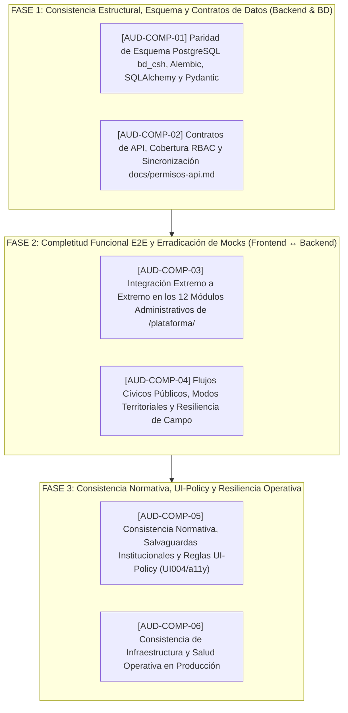

# PLAN MAESTRO DE AUDITORÍA TÉCNICA DE COMPLETITUD Y CONSISTENCIA
## PLATAFORMA POLIS CARTAGENA DE INDIAS 2026–2036
### EVALUACIÓN FORENSE INTEGRAL: PARIDAD DE ESQUEMA, CONTRATOS API, FLUJOS E2E, ERRADICACIÓN DE MOCKS, SALVAGUARDAS NORMATIVAS Y RESILIENCIA OPERATIVA

**Fecha de Formalización:** Domingo, 11 de Octubre de 2026  
**Dirección y Coordinación EAF:** `agy` (`tmux a -t agy`)  
**Ejecutor de Auditoría y Remediación EDD:** `agy2` (`tmux a -t agy2`)  
**Marco Institucional:** Alcaldía Mayor de Cartagena de Indias — Plan de Desarrollo "Cartagena Ciudad de Derechos" (2024–2027) y Política Pública de Seguridad Humana Integral (2026–2036)  
**Objetivo Estratégico:** Certificar con rigor pericial que la plataforma POLIS carece de vacíos funcionales (*gaps*), inconsistencias de esquema, botones inertes, datos simulados o desviaciones normativas, garantizando una herramienta 100% viva, veraz y blindada.

---

## 🎯 1. Justificación y Alcance de la Auditoría

Tras completar las 3 fases del *Plan Maestro de Excelencia y Adopción Territorial* (concluyendo con Modo Barrio, PWA Offline e infraestructura de Observabilidad proactiva), la plataforma cuenta con una arquitectura de alta sofisticación técnica.

Sin embargo, para garantizar fe pública indiscutible y adopción distrital plena, se requiere una **Auditoría Técnica de Completitud y Consistencia** exhaustiva bajo dos ejes vectoriales:

1. **COMPLETITUD FUNCIONAL ("Cero Cabos Sueltos"):**
   - Verificar que **cada módulo, panel, pestaña y vista** en `/plataforma/` y en el portal público esté **100% conectado de punta a punta** (Frontend React $\leftrightarrow$ FastAPI $\leftrightarrow$ PostgreSQL `bd_csh`).
   - Detectar y erradicar cualquier **botón inerte**, enlace sin destino, handler `onClick` vacío o acciones que se limiten a mostrar un `toast` sin ejecutar persistencia real.
   - Constatar la eliminación absoluta de **datos mock, listas estáticas en memoria o valores simulados**.
   - Asegurar que **cada formulario** valide, procese, transmita y persista sus datos con su respectivo radicado de seguimiento.

2. **CONSISTENCIA MULTIDIMENSIONAL ("Cero Drift y Cero Ambigüedad"):**
   - **Consistencia de Datos y Esquema:** Paridad absoluta entre PostgreSQL (`bd_csh`), migraciones Alembic, modelos SQLAlchemy y DTOs Pydantic. Cero drift en `alembic check`.
   - **Consistencia de Contratos de API:** Sincronización al 100% entre las rutas de FastAPI, la Matriz Canónica de Control de Acceso (`docs/permisos-api.md`) y los servicios HTTP de TypeScript.
   - **Consistencia Normativa e Institucional:** Estricto cumplimiento de la Ley 1757 de 2015, Ley 1581 de 2012, no regresividad de derechos, erradicación total del inexistente "Decreto 037 de 2026", preservación sagrada de códigos distritales BPIN y cero acrónimos ajenos no permitidos (DNP, MGA, SINERGIA).
   - **Consistencia Visual y de Accesibilidad:** Cero infracciones en la regla de capas UI004 (`node scripts/ui-policy.mjs`), componentes canónicos `@/shared/ui/` y cumplimiento de accesibilidad WCAG 2.1 AA.
   - **Consistencia de Infraestructura:** Operatividad continua de los servicios systemd, reverse proxy Nginx SSL, scripts de respaldo GFS y watchdog de autosanación.

---

## 🗺️ 2. Matriz de Fases y Backlog de Tareas

---

## 📋 3. Desglose Detallado por Tarea de Auditoría

### FASE 1: Consistencia Estructural, Esquema y Contratos de Datos

#### 1. `[AUD-COMP-01]` Paridad de Esquema PostgreSQL (`bd_csh`), Migraciones Alembic, Modelos SQLAlchemy y DTOs Pydantic
- **Objetivo:** Garantizar que la base de datos de producción `bd_csh` esté matemáticamente alineada con el código fuente del backend, sin tablas o columnas huérfanas, sin tipos discordantes y sin drift de migraciones.
- **Puntos de Inspección Forense:**
  1. Ejecución de `alembic check` en caliente contra `bd_csh` para verificar 0 operaciones pendientes de migración.
  2. Comparación exhaustiva entre las columnas físicas de las tablas de los 13 esquemas (`mesas_trabajo`, `indicadores`, `participacion_ciudadana`, `presupuesto`, `autenticacion`, `auditoria`, etc.) y las definiciones en `backend/app/modules/*/models.py`.
  3. Verificación de restricciones de clave foránea (`FOREIGN KEY`), índices de búsqueda (PostGIS GIST, trigramas `pg_trgm`) y restricciones de unicidad.
  4. Revisión de esquemas Pydantic (`schemas.py`) para constatar que los campos requeridos y opcionales coincidan exactamente con la nulabilidad de la base de datos.
- **Entregables:** Matriz de hallazgos de esquema, reporte de drift y pruebas unitarias de verificación.

#### 2. `[AUD-COMP-02]` Contratos de API, Cobertura RBAC y Sincronización con `docs/permisos-api.md`
- **Objetivo:** Verificar que todos los endpoints expuestos en FastAPI cuenten con autenticación, autorización RBAC estricta y estén documentados contractualmente.
- **Puntos de Inspección Forense:**
  1. Barrido de todos los routers incluidos en `backend/app/api/router.py` y `backend/app/main.py`.
  2. Comparación de cada ruta HTTP (`GET`, `POST`, `PUT`, `PATCH`, `DELETE`) contra la Matriz Canónica de Control de Acceso (`docs/permisos-api.md`).
  3. Ejecución de la suite `backend/tests/test_access_policy.py` para certificar que el 100% de las rutas tienen prueba de política de acceso.
  4. Verificación de que ningún endpoint retorne excepciones 500 no controladas ante datos inválidos, asegurando respuestas tipadas RFC 7807 o JSON estándar con códigos 400, 401, 403, 404, 409 o 422.
- **Entregables:** Reporte de cobertura de permisos, inventario de rutas activas y prueba de integridad contractual.

---

### FASE 2: Completitud Funcional E2E y Erradicación de Mocks

#### 3. `[AUD-COMP-03]` Integración Extremo a Extremo en los 12 Módulos Administrativos de `/plataforma/`
- **Objetivo:** Constatar que los 12 módulos de la suite institucional operan con datos reales de PostgreSQL y que todas las acciones interactivas son funcionales.
- **Módulos bajo Inspección:**
  1. **Mesas de Diálogo (`/plataforma/mesas`):** Apertura, registro de acuerdos, submesas, fotos y generación de actas.
  2. **Actores Estratégicos (`/plataforma/actores`):** Listado y gestión de las 17 dependencias oficiales.
  3. **Fuentes de Financiación (`/plataforma/fuentes`):** Catálogo de fuentes distritales y asignaciones.
  4. **Alternativas de Solución (`/plataforma/alternativas`):** Banco distrital, evaluación jurídica y fiscal.
  5. **Diagnóstico y Árbol MGA (`/plataforma/diagnostico`):** Fichas técnicas, causas y efectos.
  6. **Indicadores de Seguridad (`/plataforma/diagnostico` / indicadores):** 11 fichas técnicas con mediciones reales.
  7. **Seguimiento PAS (`/plataforma/seguimiento`):** Metas plurianuales y semaforización.
  8. **Noticias Distritales (`/plataforma/noticias`):** Creación, edición y publicación con persistencia en `comunicacion.noticias`.
  9. **Testimonios Comunitarios (`/plataforma/testimonios`):** Moderación y registro institucional.
  10. **Formularios de Consulta (`/plataforma/formularios`):** Creación y analítica de respuestas.
  11. **Geovisor Distrital (`/plataforma/geovisor`):** Capas de mesas, límites comunales y capas temáticas.
  12. **Configuración y Usuarios (`/plataforma/configuracion` y `/plataforma/usuarios`):** Panel de salud del sistema, parámetros y gestión de usuarios RBAC.
- **Criterio de Aceptación:** Cero botones mudos, cero mocks locales desconectados de la base de datos, 100% de operaciones CRUD persistidas.

#### 4. `[AUD-COMP-04]` Flujos Cívicos Públicos, Modos Territoriales y Resiliencia de Campo
- **Objetivo:** Verificar la integridad de los canales de participación ciudadana y la inviolabilidad de la fe pública en territorio.
- **Puntos de Inspección Forense:**
  1. **Portada Pública (`/`):** Navegación fluida, carga reactiva de datos y accesos directos.
  2. **Planilla de Asistencia Presencial (`/asistencia/[mesaId]`):** Cumplimiento de la Ley 1757 de 2015, captura en línea y fallback offline.
  3. **Modo Barrio Ultraligero (`/barrio`):** Arquitectura de 3 pasos, payload <150 KB, radicación comunitaria formal `POL-2026-XXXX`, me gusta cívicos y difusión en WhatsApp.
  4. **Formularios de Participación (`/f/[slug]`):** Carga en frío y persistencia de respuestas.
  5. **Modo PWA Offline e IndexedDB (`polis_offline_db`):** Service worker `polis-pwa-v1`, almacenamiento local y sincronización por lotes con límite de 5 reintentos.
- **Entregables:** Certificación de flujos cívicos, trazabilidad de radicados emitidos y prueba de sincronización.

---

### FASE 3: Consistencia Normativa, UI-Policy y Resiliencia Operativa

#### 5. `[AUD-COMP-05]` Consistencia Normativa, Salvaguardas Institucionales y Reglas de Diseño UI-Policy
- **Objetivo:** Blindar la plataforma frente a riesgos jurídicos, regulatorios, de accesibilidad y de arquitectura de interfaz.
- **Puntos de Inspección Forense:**
  1. **Preservación BPIN:** Verificación exhaustiva de que los códigos de proyecto BPIN distritales no han sido alterados ni eliminados.
  2. **Saneamiento Normativo y Cero Acrónimos Ajenos:** Verificación mediante barrido de código de 0 menciones al "Decreto 037 de 2026", y 0 uso indebido de acrónimos ajenos no autorizados (DNP, MGA, SINERGIA).
  3. **Habeas Data y Secreto Estadístico:** Cumplimiento de la Ley 1581 de 2012, no exposición de PII ni contraseñas en logs ni APIs públicas.
  4. **Regla de Capas UI004:** Inspección automatizada con `node scripts/ui-policy.mjs` certificando que los submódulos de `@/shared/` no importan capas superiores (`@/features/` o `@/app/`).
  5. **Accesibilidad Universal:** Cumplimiento de estándares WCAG 2.1 AA (contraste cromático, navegación por teclado, atributos ARIA).
- **Entregables:** Matriz de conformidad normativa, reporte de sanitización y resultado de UI-policy.

#### 6. `[AUD-COMP-06]` Consistencia de Infraestructura y Salud Operativa en Producción
- **Objetivo:** Comprobar la resiliencia operativa y la disponibilidad 24/7 de la infraestructura en el servidor distrital.
- **Puntos de Inspección Forense:**
  1. Servicios systemd `polis-backend.service` y `polis-frontend.service` activos y estables.
  2. Nginx reverse proxy con terminación SSL TLS 1.3 en `https://seguridadhumanaintegral.org/`.
  3. Crontab del sistema de `/root`: Automatización de respaldos GFS (`respaldo_programado_bd.sh`) y watchdog de autosanación cada 5 minutos (`monitor_sistema_polis.sh --cron`).
  4. Endpoint de salud `/api/v1/health/system`: Métricas de latencia de base de datos, memoria RSS y almacenamiento.
- **Entregables:** Certificado final de estabilidad e infraestructura de producción.

---

## 🔒 4. Salvaguardas Inviolables durante la Auditoría

1. **Inviolabilidad de Producción (`bd_csh`):** Las 33 mesas de diálogo territorial, 36 agendas comunitarias y 11 fichas técnicas de indicadores no se alteran ni eliminan bajo ninguna circunstancia.
2. **Protocolo Zero-Push:** Todo cambio, migración o ajuste queda estrictamente confinado en la rama local `main`.
3. **Calidad Absoluta (Quality Gates Verdes):** Ninguna tarea se declara aprobada sin pasar `bun run ui:check`, `bun run check`, `bun test`, `pytest` y `bun run build`.

---

## 🔄 5. Protocolo de Ejecución y Contra-Auditoría Secuencial

Para cada una de las 6 tareas del Plan Maestro:
1. `agy` (Coordinador General) redacta y formaliza la orden técnica en [`bridge/01_tarea_activa.md`](file:///root/polis/bridge/01_tarea_activa.md) y la despacha a `agy2`.
2. `agy2` (Desarrollador / EDD) ejecuta la auditoría e inspección técnica, aplica las remediaciones atómicas necesarias, valida los Quality Gates y documenta sus hallazgos en [`bridge/02_resultado_agy2.md`](file:///root/polis/bridge/02_resultado_agy2.md) con commit local.
3. `agy` ejecuta de forma independiente la **contra-auditoría forense**, corrobora los datos en caliente, emite el dictamen formal en [`bridge/03_dictamen_revision.md`](file:///root/polis/bridge/03_dictamen_revision.md), formaliza el commit de auditoría y despacha la siguiente tarea del plan.
