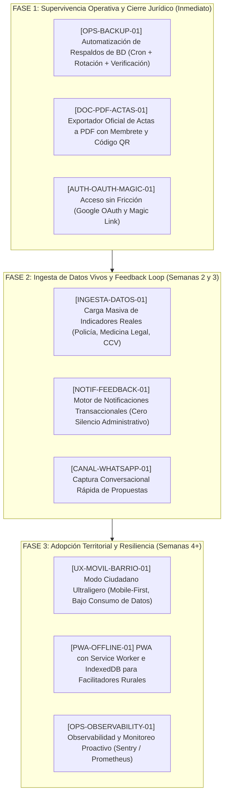

# PLAN MAESTRO DE EXCELENCIA, ADOPCIÓN TERRITORIAL Y CIERRE OPERATIVO POLIS 2026
## DE LA "CATEDRAL ARQUITECTÓNICA" A LA HERRAMIENTA VIVA DE GOBERNANZA DISTRITAL

**Fecha:** 10 de Octubre de 2026  
**Área:** Dirección Técnica, Arquitectura de Software y Supervisión Forense EAF  
**Plataforma:** POLIS (Cartagena de Indias — Plan de Desarrollo "Cartagena Ciudad de Derechos")  
**Propósito:** Cerrar la brecha entre la solidez estructural del código y la realidad operativa, institucional y territorial del Distrito.

---

## 🎯 1. Diagnóstico Estratégico y Justificación

La plataforma POLIS cuenta con una infraestructura técnica de vanguardia (22 módulos de FastAPI, 174 endpoints sincronizados, PostGIS, Next.js 16 App Router con Turbopack, LangGraph, salvaguardas periciales de fe pública y 100% de Quality Gates aprobados). 

Sin embargo, una autocrítica rigurosa revela el **síndrome de la catedral vacía**:
- **0 actas comunitarias cerradas** y **0 participantes registrados** en bases de datos.
- **0 propuestas ciudadanas radicadas** y **0 respuestas a formularios**.
- **0 mediciones oficiales** en las 11 fichas de indicadores (todas en *"Sin medición"*).
- **0 respaldos automáticos programados** en el cron del sistema operativo.
- **Ausencia de exportación documental oficial** (PDF foliado con membrete y QR para radicación pública).
- **Fricción de acceso para la ciudadanía común** (sin Google OAuth ni Magic Links activos; sin canal móvil ligero o WhatsApp).

Este Plan Maestro establece la hoja de ruta en 3 fases para transformar a POLIS en una herramienta viva, adoptada por las comunidades y respaldada jurídicamente por el Distrito.

---

## 🗺️ 2. Matriz de Fases y Backlog de Tareas

---

## 📋 3. Desglose Pericial por Tarea

### FASE 1: Supervivencia Operativa y Cierre Jurídico (Semana 1)

#### 1. `[OPS-BACKUP-01]` Automatización de Respaldos de Base de Datos y Recuperación Forense
- **Objetivo:** Garantizar que la base de datos `bd_csh` (mesas, capas geográficas, usuarios, agendas) tenga respaldo automático diario sin intervención humana.
- **Alcance Técnico:**
  - Script robusto `/root/polis/scripts/respaldo_programado_bd.sh` con retención GFS (7 copias diarias, 4 semanales, 3 mensuales).
  - Compresión zstandard/gzip y cálculo automático de hash SHA-256 de integridad para cada dump.
  - Registro en crontab de Linux (`0 2 * * *`).
  - Script de validación de restauración (`scripts/verificar_restauracion_dump.sh`) que restaura el último dump en una base efímera de verificación para comprobar que el archivo no está corrupto.
- **Entregables:** Script probado, crontab activo, log de ejecución y prueba de restauración exitosa.

#### 2. `[DOC-PDF-ACTAS-01]` Generador Oficial de Actas Comunitarias en PDF Foliado con QR y Sello Criptográfico
- **Objetivo:** Proveer a facilitadores, coordinadores, veedores y secretarías el documento PDF oficial imprimible y radicable en ventanilla distrital.
- **Alcance Técnico:**
  - Endpoint `GET /api/v1/mesas/{mesa_id}/acta/pdf` en FastAPI usando ReportLab / Jinja2-HTML con maquetación vectorial de alta fidelidad.
  - Diseño institucional con membrete de la Alcaldía Mayor de Cartagena, escudo distrital y sello del Plan "Cartagena Ciudad de Derechos".
  - Folio único formal (`ACTA-MT-2026-XXXX`).
  - Metadatos de la mesa: Nombre, Localidad, Barrio/Corregimiento, Lugar físico, Fecha, Horario, Facilitador y Aforo.
  - Tabla de Acuerdos Concertados con compromisos y entidades responsables.
  - Sello criptográfico SHA-256 estampado en el pie de página.
  - Código QR generado dinámicamente que apunta a la URL pública de validación (`https://seguridadhumanaintegral.org/asistencia/{mesa_id}` o endpoint de verificación pública).
  - Botón *"Descargar Acta Oficial (PDF)"* en `mesa-acta-panel.tsx` con descarga directa y vista previa.
- **Entregables:** Endpoint en FastAPI, botón en interfaz, tests unitarios y generación de PDF muestra validada.

#### 3. `[AUTH-OAUTH-MAGIC-01]` Erradicación de Fricción de Acceso: Google OAuth y Magic Link
- **Objetivo:** Eliminar la barrera de memorizar y digitar contraseñas para ciudadanos y facilitadores.
- **Alcance Técnico:**
  - Conexión de `@react-oauth/google` y backend FastAPI (`/api/v1/identidad/oauth/google`).
  - Flujo de *Magic Link* por correo electrónico con token de un solo uso (TTL 15 min).
  - Preservación de niveles de identidad (anónima, declarada, verificada).
- **Entregables:** Login con 1 clic en frontend y verificación de sesión en backend.

---

### FASE 2: Ingesta de Datos Vivos y Feedback Loop (Semanas 2 y 3)

#### 4. `[INGESTA-DATOS-01]` Ingesta y Certificación de Indicadores de Seguridad y Convivencia
- **Objetivo:** Pasar del estado *"Sin medición"* a información real y verificable de Cartagena (homicidios, hurtos, violencia intrafamiliar, percepción de seguridad).
- **Alcance Técnico:**
  - Pipeline de carga de datos oficiales de fuentes abiertas verificables (Medicina Legal - Forensis, Policía Nacional - SIEDCO, Cartagena Cómo Vamos 2024-2025).
  - Registro de metadatos de procedencia: resolución oficial, fecha de corte, enlace al boletín o archivo fuente.
  - Cálculo automático de semáforos de cumplimiento en el módulo de seguimiento y rendición de cuentas.

#### 5. `[NOTIF-FEEDBACK-01]` Motor Transaccional de Notificaciones y Radicación Ciudadana
- **Objetivo:** Cero silencio administrativo; cada aporte ciudadano genera radicado y seguimiento.
- **Alcance Técnico:**
  - Servicio transaccional de correos (vía SMTP distrital o servicio institucional) con plantilla HTML sobria.
  - Envío automático de constancia de radicación al crear propuestas o testimonios: *"Su aporte ha sido recibido bajo el radicado POL-2026-XXXX"*.
  - Notificación de cambio de estado cuando la mesa o secretaría prioriza la alternativa.

#### 6. `[CANAL-WHATSAPP-01]` Canal Conversacional Rápido para Propuestas y Asistencia
- **Objetivo:** Captura directa desde la herramienta de comunicación masiva en los barrios.
- **Alcance Técnico:**
  - Webhook de entrada conectado al módulo de aportes ciudadanos para transcribir audios y procesar fotos de asambleas.

---

### FASE 3: Adopción Territorial y Resiliencia (Semanas 4+)

#### 7. `[UX-MOVIL-BARRIO-01]` Vista Ciudadana Ultraligera ("Modo Barrio")
- **Objetivo:** Navegación en teléfonos Android económicos con 3G/4G prepago sin sobrecarga visual.
- **Alcance Técnico:**
  - Layout simplificado de 3 pasos: ¿Qué se acordó? / ¿Qué propones? / ¿Cómo va el barrio?
  - Peso total inferior a 150 KB en primer render.

#### 8. `[PWA-OFFLINE-01]` Modo PWA Offline para Facilitadores en Zonas Insulares y Rurales
- **Objetivo:** Permitir el levantamiento de actas y listas de asistencia en zonas sin cobertura celular (Islas del Rosario, Barú, corregimientos norte).
- **Alcance Técnico:**
  - Service Worker con Workbox y almacenamiento local en IndexedDB.
  - Cola de sincronización en segundo plano (*Background Sync*) que envía las actas al reconectarse a Internet.

#### 9. `[OPS-OBSERVABILITY-01]` Observabilidad y Monitoreo Proactivo de Producción
- **Objetivo:** Detección de anomalías en tiempo real antes de que afecten a los usuarios.
- **Alcance Técnico:**
  - Integración de Sentry / GlitchTip para rastreo de errores en frontend y backend.
  - Alertas automáticas ante caídas de servicios systemd o saturación de PostgreSQL.

---

## 🔒 4. Salvaguardas Obligatorias

1. **BPIN 100% Intacto:** No alterar identificadores presupuestales.
2. **Cero Acrónimos Ajenos:** Cero reintroducción de DNP, MGA o SINERGIA.
3. **UI-Policy Estricta:** Componentes `@/shared/ui/` sin controles HTML nativos sueltos.
4. **Integridad de Datos Canónicos:** Mantener intactas las 33 mesas territoriales y 36 agendas en `bd_csh`.
5. **Protocolo Zero-Push:** Commits atómicos locales en la rama `main`.
