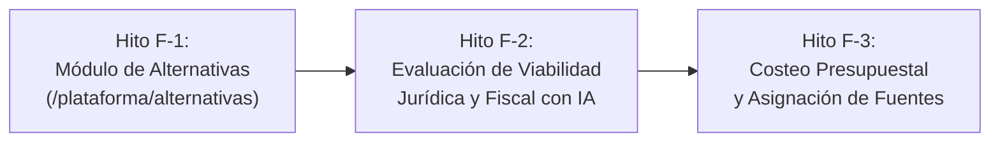

# Plan Maestro — Fase de Formulación Estratégica y Banco de Alternativas (POLIS)
**Versión**: 1.0 — Elaborado y Calibrado por EAF
**Fecha**: 2026-10-03
**Elaborado por**: Antigravity (Orquestador Central / Auditoría Forense EAF)
**Estado**: APROBADO — Listo para ejecución continua con `agy2`
**Marco Normativo**: Metodología General Ajustada (MGA/DNP), Ley Orgánica 1454 de 2011 (LOOT), Ley 715 de 2001, Ley 819 de 2003 (MFMP), Ley 1483 de 2011 (Vigencias Futuras), Ley 418 de 1997 / 2272 de 2022 (FONSET), Ley 2056 de 2020 (SGR), Convenio 169 de la OIT y Sentencia C-150 de 2015.

---

## 0. Dictamen Metodológico de la Fase de Formulación

Tras completar satisfactoriamente la Fase de Diagnóstico (Fuentes, Actores, Línea Base Cuantitativa, Árbol de Problemas MGA y Geodiagnóstico Territorial), la política pública de Cartagena entra en su etapa de **Formulación Estratégica**.

En esta fase, la administración distrital y la ciudadanía transforman los problemas identificados en **soluciones viables, estructuradas y financiables**:
1. **Banco de Alternativas MGA**: Todo objetivo central o medio directo del árbol MGA da lugar a una o más alternativas de solución (proyectos/programas).
2. **Evaluación de Viabilidad Jurídica (LOOT y OIT 169)**: El Distrito debe verificar que tiene competencia legal (Ley 1454/11) y que no invade competencias departamentales o nacionales, activando preceptivamente la salvaguarda de Consulta Previa ante afectación directa de comunidades negras e indígenas de Cartagena (Tierrabomba, La Boquilla, Barú, etc.).
3. **Evaluación de Viabilidad Fiscal y Presupuestal (MFMP y Vigencias Futuras)**: Las alternativas deben costearse y cruzarse con fuentes reales autorizadas: FONSET (para seguridad y convivencia), SGP, SGR, Presupuesto Participativo e ICLD, alertando sobre vigencias futuras excepcionales (Ley 1483/11) que requieran autorización del Concejo Distrital.
4. **Infraestructura backend ya disponible en POLIS**:
   - `backend/app/modules/presupuesto`: Ya expone `/api/v1/presupuesto/fuentes`, `/asignaciones` y `/resumen-costeo`.
   - `backend/app/modules/ia`: Ya dispone de `POST /api/v1/ia/juridico` (`AgenteJuridico`) y `POST /api/v1/ia/fiscal` (`AgenteFiscal`).

---

## 1. Estructura de Hitos de la Fase de Formulación

| Hito | Denominación Técnica | Entregables Clave | APIs Backend Involucradas |
| :--- | :--- | :--- | :--- |
| **F-1** | **Banco de Alternativas de Solución MGA** | Módulo `/plataforma/alternativas`, catálogo de iniciativas de Cartagena, filtrado multicriterio, DataGrid con estados de formulación y panel Zero-Modals `alternativa-editor`. | `/api/v1/instrumentos`, `/api/v1/politicas/lineas` |
| **F-2** | **Evaluación de Viabilidad Jurídica y Fiscal con IA** | Integración del `AgenteJuridico` y `AgenteFiscal` en panel Zero-Modals `evaluacion-viabilidad`, verificación de competencias distritales (LOOT) y consulta previa (OIT 169). | `POST /api/v1/ia/juridico`, `POST /api/v1/ia/fiscal` |
| **F-3** | **Costeo Presupuestal y Asignación de Fuentes** | Tablero de financiamiento del cuatrienio, asignación por alternativa (FONSET, SGP, SGR, ICLD), control de vigencias futuras y panel `asignacion-presupuestal`. | `GET/POST /api/v1/presupuesto/asignaciones`, `/api/v1/presupuesto/resumen-costeo` |

---

## 2. Especificación Detallada del Hito F-1: Banco de Alternativas MGA
**Objetivo**: Habilitar en la suite de plataforma la gestión y visualización de las alternativas de solución formuladas para Cartagena de Indias.

### Entregables:
1. **Control de Acceso y Navegación**:
   - `src/features/plataforma/models/acceso.ts`: Registrar módulo `alternativas` con ruta `/plataforma/alternativas`.
   - `src/features/plataforma/components/plataforma-sidebar.tsx`: Icono `Lightbulb` o `Target`.
   - `src/app/plataforma/alternativas/page.tsx`: Ruta App Router.
2. **Catálogo Canónico Oficial (`alternativas-canonicas.data.ts`)**:
   - Sembrar al menos 8 alternativas de solución formuladas para las problemáticas de Cartagena:
     1. *Ruta Distrital Segura y Protección Integral contra ESCNNA* (Sector: Protección NNA / Turismo — Centro Histórico, Playa Blanca).
     2. *Programa de Desarme Social y Empleabilidad Juvenil "Jóvenes Constructores de Paz"* (Sector: Seguridad y Convivencia — Olaya Herrera, Pozón, Mandela).
     3. *Plan de Saneamiento y Resiliencia Comunitaria Ciénaga de la Virgen* (Sector: Ambiente / Hábitat — Bajamar).
     4. *Fortalecimiento de la Red Comunitaria de Cuidados y Casas de Justicia Violeta* (Sector: Género / Inclusión).
     5. *Centro de Formación Tecnológica y Bilingüismo para Jóvenes de Zonas Insulares* (Sector: Educación / Empleo — Tierrabomba y Barú).
     6. *Sistema Integrado de Videovigilancia Comunitaria y Alarmas Comunitarias LPR* (Sector: Infraestructura de Seguridad — Localidades 1, 2 y 3).
     7. *Banco de Microcréditos y Fortalecimiento Popular contra el Gota a Gota en Bazurto* (Sector: Desarrollo Económico Popular).
     8. *Plan de Protección y Salvaguarda de la Identidad Étnica y Seguridad Alimentaria en Territorios Colectivos* (Sector: Étnico Ley 70/93 — La Boquilla, Pasacaballos).
3. **DataGrid y Vistas (`src/features/alternativas/`)**:
   - `alternativas-view.tsx`: Cabecera institucional, selector de estado (*En formulación*, *Viable*, *Requiere ajustes*, *Priorizada*), filtros por línea estratégica y dimensión ONU.
   - `alternativas-kpis.tsx`: Total de alternativas, costo total proyectado, alternativas viables, alternativas con enfoque Ley 70/93.
   - `alternativas-tabla.tsx`: DataGrid con código, título, línea estratégica vinculada, costo estimado, horizonte de ejecución (años), estado de viabilidad y botón de acciones.
4. **Panel Lateral Zero-Modals (`alternativa-editor-panel.tsx`)**:
   - ID: `"alternativa-editor"`. Montado sobre `PanelShell`, registrado en `panel-store.ts` y `panel-registry.tsx`.
   - Formulario para crear o editar alternativas: Código, título, descripción técnica, línea estratégica, objetivo central del árbol MGA vinculado, población objetivo estimada, costo aproximado, horizonte temporal y fuentes de financiación sugeridas.
   - Bloqueo en modo solo lectura para `auditor_forense`.

---

## 3. Criterios de Aceptación y Calidad Pericial EAF (Hito F-1)
1. **Zero-Modals**: Toda interacción ocurre en la vista o en paneles laterales `PanelShell`. Cero diálogos modales o popups centrados.
2. **Tokens Semánticos CSS**: 100% de estilos construidos sobre variables de diseño de POLIS. 0 colores hex hardcodeados.
3. **TypeScript Estricto**: 0 errores de tipado, 0 tipos `any`.
4. **Pruebas Automatizadas**:
   - `acceso.test.ts` actualizado cubriendo el módulo `alternativas`.
   - Suite `alternativas-store.test.ts` con cobertura de mutaciones y filtros.
5. **Quality Gates**:
   - `bun run check` (0 errores).
   - `node scripts/ui-policy.mjs` (0 infracciones).
   - `bun test` pasando al 100%.
   - `bun run build` exitoso (Turbopack).
   - HTTP 200 en `http://127.0.0.1:3000/plataforma/alternativas`.
