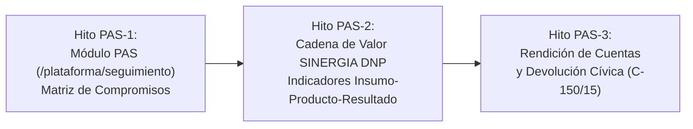

# Plan Maestro — Plan de Acción y Seguimiento (PAS / SINERGIA) (POLIS)
**Versión**: 1.0 — Elaborado y Calibrado por EAF
**Fecha**: 2026-10-03
**Elaborado por**: Antigravity (Orquestador Central / Auditoría Forense EAF)
**Estado**: EN EJECUCIÓN ININTERRUMPIDA
**Marco Normativo**: Metodología DNP / CONPES, Sistema SINERGIA, Ley Orgánica 152 de 1994, Decreto 1499 de 2017 (MIPG), Ley 1757 de 2015, Sentencia C-150 de 2015 y Decreto Distrital 037 de 2026.

---

## 0. Justificación y Fundamento Técnico del PAS

El **Plan de Acción y Seguimiento (PAS)** es el instrumento articulador y vinculante donde la política pública adquiere exigibilidad jurídica y presupuestal:
1. **Matriz de Compromisos Institucionales**: Las 8 alternativas MGA formuladas se desagregan en líneas de acción concretas asignadas a dependencias ejecutoras del Distrito de Cartagena (Secretaría del Interior, Distriseguridad, DADIS, EPA Cartagena, OAGRD, Secretaría de Participación, Educación e IDER), con metas anualizadas (2026–2029) y presupuesto comprometido.
2. **Cadena de Valor SINERGIA DNP**: Integración de la batería oficial de indicadores (`/api/v1/indicadores/cadena-valor`), relacionando insumos (FONSET/Cámaras LPR) $\rightarrow$ productos (frentes locales, luminarias LED, capacitación juvenil) $\rightarrow$ resultados (reducción de tasa de homicidios, hurtos y percepción de inseguridad CCV).
3. **Control Social y Devolución de Razones (C-150/15)**: Trazabilidad pública de cómo cada compromiso del PAS responde a los aportes y acuerdos concertados en las mesas territoriales de Cartagena.

---

## 1. Estructura de Hitos Operativos

| Hito | Alcance Técnico | Entregables Clave | APIs / Datos |
| :--- | :--- | :--- | :--- |
| **PAS-1** | **Matriz de Compromisos Institucionales del PAS** | Módulo `/plataforma/seguimiento`, catálogo de compromisos por entidad, metas anualizadas 2026-2029, panel Zero-Modals `compromiso-editor`. | `/api/v1/presupuesto/asignaciones`, `/api/v1/politicas/lineas` |
| **PAS-2** | **Tablero SINERGIA DNP y Cadena de Valor** | Visualizador jerárquico de la cadena de valor (Insumo $\rightarrow$ Producto $\rightarrow$ Resultado), avance dinámico de metas y panel de mediciones. | `/api/v1/indicadores/cadena-valor`, `/api/v1/indicadores/fichas` |
| **PAS-3** | **Rendición de Cuentas y Devolución Motivada (C-150/15)** | Matriz de correspondencia entre compromisos del PAS y propuestas ciudadanas, visor de rendición de cuentas con exportación PDF/JSON. | `/api/v1/participacion/propuestas`, `/api/v1/auditoria/registros` |

---

## 2. Hito PAS-1: Módulo de Seguimiento y Matriz de Compromisos (`/plataforma/seguimiento`)
* **Control de Acceso**:
  - `acceso.ts`: Registrar módulo `seguimiento` (`/plataforma/seguimiento`).
  - `plataforma-sidebar.tsx`: Icono `CheckSquare` o `ListTodo`.
  - Roles: `autoridad_distrital`, `auditor_forense`, `administrador_identidades`.
* **Catálogo Canónico de Compromisos (`compromisos-pas.data.ts`)**:
  - Sembrar al menos 10 compromisos institucionales estructurados para Cartagena:
    1. *Ruta de Alerta Temprana y Protección ESCNNA en Zonas Turísticas* — Responsable: Distriseguridad / Sec. Interior ($1.200M COP/año).
    2. *Capacitación e Inserción Laboral para 1.500 Jóvenes en Riesgo* — Responsable: Sec. de Participación ($1.800M COP/año).
    3. *Mantenimiento y Expansión de 250 Cámaras LPR y Centros de Monitoreo* — Responsable: Secotic / Distriseguridad ($2.000M COP/año).
    4. *Instalación de 4.800 Luminarias LED en Corredores Seguros* — Responsable: Secretaría General ($1.500M COP/año).
    5. *Plan Maestro de Limpieza y Recuperación de Canales en Ciénaga de la Virgen* — Responsable: EPA Cartagena / OAGRD ($3.000M COP/año).
    6. *Fortalecimiento de 60 Frentes Locales de Seguridad Ciudadana* — Responsable: Policía MEBAR / Sec. Interior ($400M COP/año).
    7. *Operación de 2 Manzanas del Cuidado y Centros de Vida* — Responsable: Sec. de Participación / DADIS ($950M COP/año).
    8. *Programa de Desarme Social y Mediación en 12 Barrios Priorizados* — Responsable: Sec. Interior ($1.100M COP/año).
    9. *Microcrédito Productivo para 800 Comerciantes en Mercado de Bazurto* — Responsable: Sec. de Hacienda ($850M COP/año).
    10. *Concertación y Proyectos Productivos en Consejos Comunitarios Étnicos* — Responsable: Asuntos Étnicos / Participación ($600M COP/año).
* **DataGrid y Vistas (`src/features/seguimiento/`)**:
  - `seguimiento-view.tsx`: Cabecera institucional, KPIs de avance cuatrienal, filtros por entidad responsable, vigencia y estado (`PROGRAMADO`, `EN_EJECUCION`, `CUMPLIDO`, `EN_RIESGO`, `RETRASADO`).
  - Panel Zero-Modals `compromiso-editor-panel.tsx` (ID `"compromiso-editor"`).
