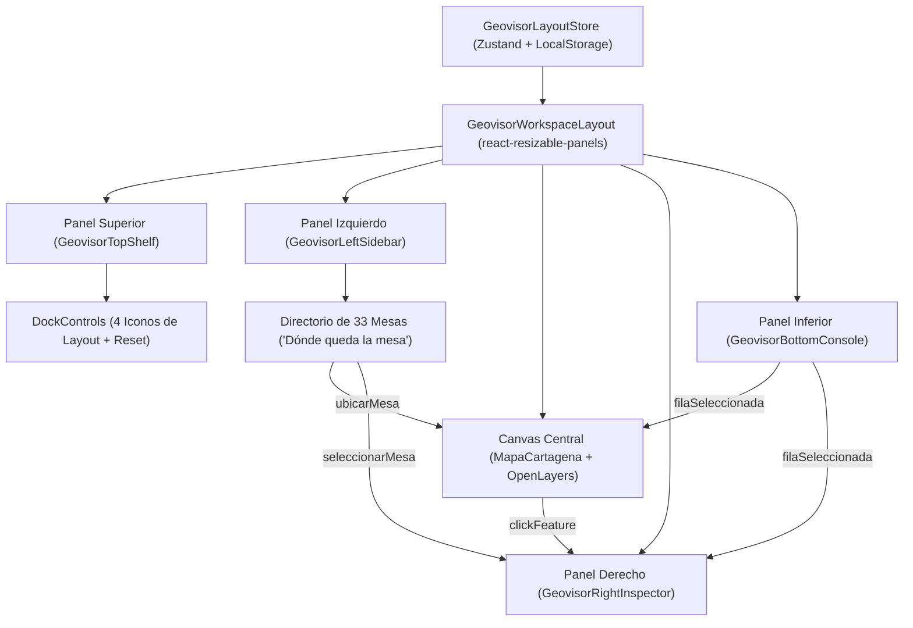

# PLAN MAESTRO DE REINGENIERÍA: GEOVISOR STUDIO DE POLIS
## Arquitectura de 4 Paneles Acoplados (Tiling Docking System Tipo VS Code) y Navegación Bidireccional de Datos

**Versión:** 1.0.0  
**Fecha:** Lunes, 12 de Octubre de 2026  
**Módulo:** Geovisor Territorial de Seguridad Humana (`/geovisor`)  
**Equipo Responsable:** Protocolo Dual `agy` (Coordinador General & Auditor EAF) y `agy2` (Desarrollador / EDD)  
**Estado:** Propuesta de Plan para Aprobación del Usuario  

---

## 1. Visión y Justificación Arquitectónica

El Geovisor Territorial de POLIS alberga una densidad creciente de datos críticos:
- **33 Mesas de Diálogo Social y Seguridad Humana** distribuidas en las 3 localidades y la zona rural-insular de Cartagena.
- **217 Barrios y Unidades Comuneras de Gobierno**.
- **9 Territorios de Análisis Cartográfico**.
- Índices de Seguridad Humana (ISH), series temporales de criminalidad y conflictividad, micro-zonificaciones y variables multidimensionales.

La disposición vertical secuencial anterior obligaba al usuario a desplazarse para cruzar datos tabulares o gráficos con el mapa. La **reingeniería hacia un espacio de trabajo tipo IDE / SIG Profesional (estilo Visual Studio Code o QGIS Web)** transforma la página en un **lienzo cartográfico central dinámico** rodeado por **4 paneles acoplados (docked panels)** que conviven en mosaico perfecto (*tiling layout*):

```
+-----------------------------------------------------------------------------------+
|  [DOCK SUPERIOR] Barra Global de Filtros, KPIs Ejecutivos & 4 Iconos de Layout   |
+-------------------+-------------------------------------------+-------------------+
|                   |                                           |                   |
|  [DOCK IZQUIERDO] |          [CANVAS CENTRAL]                 |  [DOCK DERECHO]   |
|  Capas, Leyenda,  |       Mapa OpenLayers Dinámico            |  Inspector SIG,   |
|  Directorio de    |         (ResizeObserver 60fps)            |  Ficha de Mesa    |
|  33 Mesas &       |                                           |  & Ranking BI     |
|  Dimensiones      |                                           |                   |
|                   |                                           |                   |
+-------------------+-------------------------------------------+-------------------+
|  [DOCK INFERIOR] DataGrid de Mesas, Gráficos Estadísticos & Series Temporales     |
+-----------------------------------------------------------------------------------+
```

### Reglas Cardinales de Diseño:
1. **Cero Superposición (Tiling Garantizado):** Ningún panel cubre ni flota sobre el mapa tapando información cartográfica. Los paneles dividen el espacio disponible de forma elástica y armónica.
2. **Redimensionamiento Manual Fluido:** Cada panel cuenta con un divisor (*splitter / resize handle*) arrastrable que permite al usuario ajustar manualmente ancho y alto dentro de límites seguros (`minSize`, `maxSize`).
3. **Control Rápido con 4 Iconos Dedicados:** Cuatro controles visuales permiten alternar (mostrar / ocultar / minimizar) instantáneamente cada uno de los 4 paneles.
4. **Sincronización Bidireccional de Datos (Sidebars <-> Mapa):**
   * Al hacer clic en *"¿Dónde queda la mesa?"* desde el panel izquierdo o la tabla inferior, el visor ejecuta un vuelo cinematográfico (`flyTo`) con zoom ~15.5 hacia el punto georreferenciado exacto, resalta el marcador con pulso visual y abre su ficha en el panel derecho.
   * Al cambiar filtros estadísticos o territorios, la coropleta se recolorea y los gráficos del panel inferior se recalculan en tiempo real.
5. **Persistencia de Espacio de Trabajo:** El estado de apertura/cierre y dimensiones de cada panel se conserva en el almacenamiento local del navegador (`localStorage`).

---

## 2. Especificación Técnica de los 4 Paneles Acoplados

### A. Panel Superior (Top Dock / Shelf)
* **Función:** Control rector de contexto y métricas ejecutivas.
* **Componentes Integrados:**
  * Selector global de Ámbito / Territorio (Localidades 1, 2, 3, Rural-Insular, Todas).
  * Selector de Variable ISH / Política Pública.
  * 4 Chips de KPIs en tiempo real (Población, ISH Promedio, Mesas Realizadas, Alertas Críticas).
  * **Barra de Control de Layout (Los 4 Iconos):**
    * ◰ Toggle Panel Superior
    * ◧ Toggle Panel Izquierdo
    * ◨ Toggle Panel Derecho
    * ◲ Toggle Panel Inferior
    * Botón de *Maximizar Mapa* (oculta los 4 paneles a pantalla limpia).
    * Botón de *Restablecer Vistas* (restaura anchos y altos predeterminados).
  * Botón de Exportar Cartografía en PNG de alta resolución.

### B. Panel Izquierdo (Left Sidebar: Explorador y Directorio)
* **Función:** Navegación por capas, catálogo temático y directorio de diálogo social.
* **Pestañas Internas (Tabs):**
  1. **Capas & Leyendas:** Conmutadores de capas vectoriales (Localidades, Corregimientos, Barrios, Puntos de Alerta, Etiquetas, Isócronas) con leyenda de color graduada según la variable seleccionada.
  2. **Directorio de Mesas ("¿Dónde queda la mesa?"):**
     * Buscador de texto reactivo.
     * Lista filtrada de las 33 mesas con indicativo de estado (Realizada / Programada).
     * Botón de acción directa **"Localizar en Mapa"** por cada mesa.
  3. **Líneas Temáticas:** Selector de las 5 dimensiones de la Política Distrital de Seguridad Humana.

### C. Panel Derecho (Right Sidebar: Inspector y Detalle)
* **Función:** Contextualización detallada del elemento activo y analítica territorial.
* **Pestañas Internas (Tabs):**
  1. **Ficha de Mesa Seleccionada:**
     * Nombre oficial, código, territorio y fecha/hora.
     * Aforo vs. Asistencia confirmada con barra de porcentaje.
     * Temáticas principales abordadas y acuerdos comunitarios.
     * Enlace a actas y soportes documentales.
  2. **Ficha Territorial / Barrial:**
     * Indicadores sociodemográficos del territorio o barrio cliqueado en el mapa.
     * Nivel de vulnerabilidad y semáforo de criticidad.
  3. **Ranking Comparativo BI:**
     * Comparativa del territorio frente a la media distrital de Cartagena.

### D. Panel Inferior (Bottom Panel: Analítica y Datos Tabulares)
* **Función:** Consola de datos masivos, series históricas y explotación tabular.
* **Pestañas Internas (Tabs):**
  1. **DataGrid de Mesas:**
     * Vista de tabla estructurada de las 33 mesas con paginación y ordenamiento por asistentes, territorio y fecha.
     * Selección de fila conectada al mapa (centra y resalta).
     * Exportación de datos a formato CSV.
  2. **Gráficos Estadísticos (`GeovisorCharts`):**
     * Comparativas territoriales en barras.
     * Radar de dimensiones de seguridad humana.
     * Tendencia cronológica de alertas e incidentes.
  3. **Matriz de Barrios:**
     * Tabla de indicadores calculados para los 217 barrios del Distrito.

### E. Canvas Central (Mapa OpenLayers)
* **Tecnología:** OpenLayers 10 con capas vectoriales dinámicas en Proyección Web Mercator (`EPSG:3857`).
* **Respuesta elástica:** Integración con `ResizeObserver` para invocar `map.updateSize()` de forma instantánea y a 60 fps conforme se arrastra cualquier separador.
* **Comportamiento interactivo:**
  * Soporte para `flyTo` cinematográfico con padding dinámico que evita que el objetivo quede oculto bajo los paneles desplegados.
  * Marcador de mesa con animación de pulso (ping visual) y tooltip emergente interactivo.

---

## 3. Arquitectura de Estado y Componentes



### Archivos Clave a Crear o Modificar:
1. `src/features/geovisor/state/geovisor-layout-store.ts` *(Nuevo)*:
   * Controla visibilidad (`topOpen`, `leftOpen`, `rightOpen`, `bottomOpen`).
   * Almacena tamaños porcentuales (`sizes: { top, left, right, bottom }`).
   * Acciones: `togglePanel`, `setPanelSize`, `maximizeMap`, `resetLayout`.
2. `src/features/geovisor/components/geovisor-dock-controls.tsx` *(Nuevo)*:
   * Renderiza los 4 iconos con tooltips accesibles y estado activo/inactivo.
3. `src/features/geovisor/components/geovisor-workspace-layout.tsx` *(Nuevo)*:
   * Implementa el árbol de `ResizablePanelGroup`, `ResizablePanel` y `ResizableHandle` de `src/shared/ui/resizable.tsx`.
4. `src/features/geovisor/components/geovisor-left-dock.tsx` *(Nuevo)*:
   * Agrupa Capas/Leyenda + Directorio de Mesas interactivo con buscador y botón de vuelo cartográfico.
5. `src/features/geovisor/components/geovisor-right-dock.tsx` *(Nuevo)*:
   * Ficha técnica de la mesa activa + Ficha territorial + Comparativa BI.
6. `src/features/geovisor/components/geovisor-bottom-dock.tsx` *(Nuevo)*:
   * Datagrid interactivo de mesas + Gráficos estadísticos `GeovisorCharts`.
7. `src/features/geovisor/hooks/use-mapa.ts` *(Actualización)*:
   * Refuerza la animación de vuelo centrada en coordenadas de mesa (`flyToMesa`), resaltado visual y adaptación a padding elástico.
8. `src/features/geovisor/views/geovisor-view.tsx` *(Refactor Estructural)*:
   * Orquesta el layout studio completo sin scrolls verticales redundantes.

---

## 4. Desglose de Fases de Ejecución (Protocolo Dual `agy` / `agy2`)

### FASE 1: Store de Layout, Controles de los 4 Iconos y Estructura Resizable
* **Tarea 1.1:** Implementación de `geovisor-layout-store.ts` con tipado estricto, persistencia en `localStorage` y valores por defecto balanceados.
* **Tarea 1.2:** Creación del componente de control `geovisor-dock-controls.tsx` con los 4 iconos (`PanelTop`, `PanelLeft`, `PanelRight`, `PanelBottom`) e indicadores visuales de apertura.
* **Tarea 1.3:** Ensamble del contenedor `geovisor-workspace-layout.tsx` usando `ResizablePanelGroup` anidados y splitters con cursor interactivo (`col-resize` / `row-resize`).
* **Verificación de Fase:** Pruebas unitarias de mutación de layout y verificación de no-regresión en resize.

### FASE 2: Modularización y Construcción de los 4 Paneles Acoplados
* **Tarea 2.1 (Panel Superior):** Adaptar `GeovisorKpiBar` al formato *Top Shelf* colapsable, integrando selectores, KPIs distritales y barra de control de layout.
* **Tarea 2.2 (Panel Izquierdo):** Crear `geovisor-left-dock.tsx` con pestañas para selector de capas SIG y directorio de las 33 mesas de diálogo social.
* **Tarea 2.3 (Panel Derecho):** Crear `geovisor-right-dock.tsx` con visualizador de Ficha Técnica de Mesa y panel analítico territorial.
* **Tarea 2.4 (Panel Inferior):** Crear `geovisor-bottom-dock.tsx` unificando el DataGrid de mesas y los gráficos estadísticos `GeovisorCharts` bajo navegación por pestañas de consola.
* **Verificación de Fase:** Inspección visual de jerarquía, cumplimiento de accesibilidad WCAG y consistencia tipográfica.

### FASE 3: Enlace e Interacción Bidireccional de Datos (Mesas <-> Mapa <-> Estadísticas)
* **Tarea 3.1 (Flujo "¿Dónde queda la mesa?"):**
  * Conectar el clic en cualquier mesa (desde panel izquierdo o tabla inferior) con la animación cartográfica (`flyTo` suave hacia lat/long, zoom 15.5).
  * Activar efecto visual de foco (halo/pulso) en el punto OpenLayers de la mesa.
  * Desplegar automáticamente los acuerdos, participantes y detalles de dicha mesa en el panel derecho.
* **Tarea 3.2 (Flujo Estadístico Territorial):**
  * Sincronizar el cambio de ámbito territorial (Localidad / Corregimiento) y variables temáticas con el mapa coroplético, los KPIs superiores y los gráficos inferiores.
* **Tarea 3.3 (Ajuste Cartográfico en Vivo):**
  * Asegurar que el evento `ResizeObserver` de OpenLayers responda sin desfase durante el arrastre manual de los paneles.
* **Verificación de Fase:** Validación de flujos cruzados interactivos sin errores de estado ni desbordamientos de memoria.

### FASE 4: Certificación Integral, Quality Gates y Cierre Forense
* **Tarea 4.1:** Ejecución y certificación de Quality Gates obligatorios:
  * `bun run ui:check` (0 infracciones de política UI).
  * `bun run check` (0 errores TypeScript, 0 warnings ESLint).
  * `bun test` (456+ pruebas frontend pasando sin fallos).
  * `alembic check` y verificación de integridad inmutable de `bd_csh` (33 mesas, 36 agendas, 11 fichas, 17 actores).
* **Tarea 4.2:** Documentación final y dictamen pericial en `bridge/` con commit atómico formalizado en `main`.

---

## 5. Tabla de Matriz de Tareas y Asignaciones

| ID Tarea | Descripción Detallada | Responsable | Entregable Principal |
|---|---|---|---|
| `[GEO-DOCK-01]` | Store de Layout Zustand + 4 Iconos + Resizable Shell | `agy2` (Dev) | `geovisor-layout-store.ts`, `geovisor-dock-controls.tsx`, `geovisor-workspace-layout.tsx` |
| `[GEO-DOCK-02]` | Modularización de los 4 Paneles (Top, Left, Right, Bottom) | `agy2` (Dev) | `geovisor-left-dock.tsx`, `geovisor-right-dock.tsx`, `geovisor-bottom-dock.tsx` |
| `[GEO-DOCK-03]` | Interacción Bidireccional: "¿Dónde queda la mesa?" & Estadísticas | `agy2` (Dev) | Integración OpenLayers `flyTo`, highlights y sincronización con Right/Bottom docks |
| `[GEO-DOCK-04]` | Certificación Global, Tests Frontend/Backend y Cierre Forense | `agy` (Auditor) & `agy2` | Quality Gates 100% verdes, 0 UI infractions, commit final local en `main` |

---

## 6. Criterios de Aceptación y Éxito

1. **Visibilidad Tiling No-Overlap:** Ningún panel oculta el mapa; el lienzo central ocupa el 100% del área restante de manera reactiva y exacta.
2. **Control con 4 Iconos:** Existen 4 botones de alternancia claramente identificados para esconder/mostrar individualmente cada panel.
3. **Redimensión Manual:** El usuario puede arrastrar los divisores de los 4 paneles libremente dentro de los rangos de seguridad.
4. **Localización Inmediata de Mesas:** Al pulsar sobre cualquier mesa de diálogo, el mapa vuela a sus coordenadas precisas y el panel derecho expone su ficha técnica completa.
5. **Cero Regresiones y Respaldo de Datos:** El censo de 33 mesas de `bd_csh` permanece inviolado y todos los Quality Gates se mantienen en verde.
