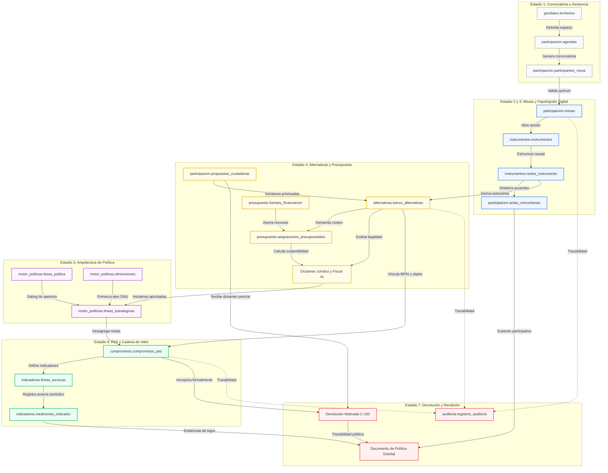

# INFORME PERICIAL DE ARQUITECTURA Y TRAZABILIDAD FUNCIONAL — TAREA [DOC-HILACION-01]
## MAPEO PERICIAL DE HILACIÓN LÓGICA, HILO CONDUCTOR Y ENCADENAMIENTO FUNCIONAL DE PUNTA A PUNTA EN POLIS

**Destinatario:** Coordinador General y Auditor Forense EAF `agy` (`tmux a -t agy`)  
**Responsable:** `agy2` (Desarrollador / EDD — `tmux a -t agy2`)  
**Fecha de Emisión:** Sábado, 10 de Octubre de 2026  
**Referencia de Trabajo:** `bridge/01_tarea_activa.md` (`[DOC-HILACION-01]`)  
**Severidad Atendida:** ALTA / ESTRATÉGICA (Arquitectura Funcional, Trazabilidad Causal y Comprensión Holística)  
**Estado de la Entrega:** 100% Completada, Estructurada y Conforme con Directrices Soberanas  

---

## 🎯 1. Fundamento y Concepto Metodológico de la "Hilación"

En el diseño de políticas públicas de base comunitaria y deliberativa, la **hilación** representa la continuidad causal, metodológica y operativa que une cada acción ciudadana e institucional. POLIS no es un conjunto de herramientas aisladas ni un mero gestor de formularios; es un **ecosistema de deliberación vinculante y trazabilidad de ciclo cerrado**.

El principio rector de POLIS establece que:
> *"Ninguna voz comunitaria se pierde en el vacío, ninguna causa detectada en territorio carece de solución técnica, ninguna alternativa carece de costeo ni viabilidad jurídica, y ninguna meta pública queda sin responsable ni medición verificable."*

La hilación lógica garantiza que el dato capturado en una cancha comunitaria o en un salón comunal de Cartagena viaje sin alteraciones a través de matrices de relatoría, análisis de viabilidad, arquitectura estratégica, presupuestación y rendición de cuentas pericial conforme a la **Ley Estatutaria 1757 de 2015** y la **Sentencia C-150 de 2015**.

---

## 🌊 2. El Gran Hilo Conductor del Ciclo de Vida (End-to-End)

El ciclo de vida en POLIS se articula en **7 estadios secuenciales e interdependientes**:

```
┌────────────────────────────────────────────────────────────────────────────────────────┐
│                      EL GRAN HILO CONDUCTOR END-TO-END EN POLIS                       │
└────────────────────────────────────────────────────────────────────────────────────────┘

  [ESTADIO 1] Convocatoria Territorial, Agendas y Quórum en Puerta
       │
       ▼
  [ESTADIO 2] Deliberación Territorial en Submesas y Papelógrafo Digital
       │
       ▼
  [ESTADIO 3] Plenaria de Acuerdos, Relatoría Técnica y Geodiagnóstico
       │
       ▼
  [ESTADIO 4] Banco de Alternativas de Solución, Viabilidad IA y Presupuesto
       │
       ▼
  [ESTADIO 5] Formulación de Política Pública Distrital y Control de Fases
       │
       ▼
  [ESTADIO 6] Plan de Acción y Seguimiento (PAS) y Cadena de Valor
       │
       ▼
  [ESTADIO 7] Devolución Motivada Ciudadana y Rendición de Cuentas Pericial
```

### Estadio 1: Convocatoria, Agendas y Quórum en Puerta
* **Propósito**: Planificar la intervención comunitaria en una localidad o corregimiento específico de Cartagena, definir la agenda temática y captar la asistencia con salvaguardas de enfoque diferencial y no duplicidad.
* **Operación**: La Autoridad Distrital o Facilitador programa la jornada en `/agendas`, generando una ficha oficial asociada a un territorio (ej. Localidad 2 de la Virgen y Turística, Olaya Herrera). El sistema crea la mesa en estado programada y habilita un código QR único y una URL pública (`/asistencia/[mesaId]`).
* **Hito de Puerta**: En el sitio físico de la jornada, los ciudadanos escanean el QR desde sus dispositivos o son registrados en la estación digital de mesa. El formulario captura pertenencia étnica (afrodescendiente, palenquero, raizal, indígena), género, rango etario y condición de discapacidad conforme a la Ley 1757 de 2015. Se valida el quórum mínimo deliberativo y se genera el libro oficial de asistentes con huella criptográfica.

### Estadio 2: Deliberación Territorial y Papelógrafo Digital
* **Propósito**: Desagregar a los asistentes en submesas temáticas especializadas para analizar problemáticas territoriales mediante la técnica del árbol causal.
* **Operación**: La plenaria se subdivide en mesas de trabajo (ej. Seguridad Económica, Convivencia y Jóvenes, Prevención de ESCNNA). Cada submesa cuenta con un facilitador y un relator comunitario que abren el `papelografo-panel`.
* **Encadenamiento Causal**:
  1. *Problema Central*: Formulado en sustantivo negativo o situación deficitaria territorial (ej. *"Alta vulnerabilidad y riesgo de explotación sexual comercial de NNA en zonas turísticas"*).
  2. *Causas Directas e Indirectas*: Exploración iterativa mediante el método de los *«¿Por qué?»* (Causas Nivel 1 y Nivel 2).
  3. *Efectos Directos e Indirectos*: Mapeo de consecuencias sobre la vida, integridad y desarrollo social.
  4. *Derivación a Soluciones*: Conversión lógica del árbol de problemas en árbol de objetivos (el problema central se transforma en Objetivo Central, las causas en Medios de intervención y los efectos en Fines esperados).

### Estadio 3: Plenaria, Relatoría Técnica y Geodiagnóstico
* **Propósito**: Consolidar los hallazgos de todas las submesas en un acta unificada y proyectar las brechas sobre el territorio.
* **Operación**: Al cerrar las submesas, los voceros exponen en plenaria. El facilitador principal compila los árboles causales en la `matriz-arbol-relatoria`. Las iniciativas coincidentes se unifican y se georreferencian con coordenadas PostGIS EPSG:4326.
* **Resultado**: Se formaliza el Acta Comunitaria y se alimenta el Geovisor Territorial (`/plataforma/geovisor`), contrastando las demandas ciudadanas con las capas de calor delictivo, necesidades básicas insatisfechas (NBI) y alertas tempranas del Distrito.

### Estadio 4: Banco de Alternativas de Solución y Presupuesto
* **Propósito**: Elevar las soluciones nacidas de las mesas y de los canales digitales a iniciativas de inversión estructuradas, con viabilidad fiscal, jurídica y asignación presupuestal.
* **Operación**: Las soluciones aprobadas en plenaria se radican en el Banco Distrital de Alternativas de Solución (`/plataforma/alternativas`).
* **Filtros de Maduración y Viabilidad**:
  1. *Evaluación Jurídica con Agente IA*: Verificación de competencias distritales (Ley 1454 de 2011 LOOT), no regresividad en derechos humanos (DESCA) y salvaguarda de Consulta Previa (Convenio 169 OIT y Ley 70 de 1993) si impacta territorios colectivos de Cartagena.
  2. *Evaluación Fiscal con Agente IA*: Sostenibilidad financiera bajo el Marco Fiscal de Mediano Plazo (MFMP) y análisis de Vigencias Futuras Excepcionales (Ley 1483 de 2011) si trasciende el cuatrienio distrital.
  3. *Costeo y Presupuesto*: Asignación plurianual de recursos con fuentes oficiales (FONSET, Sistema General de Participaciones SGP, Regalías SGR, Ingresos Corrientes de Libre Destinación ICLD) y vinculación del código **BPIN** distrital o nacional (`costeo-presupuestal-view`).

### Estadio 5: Formulación de la Política Pública Distrital
* **Propósito**: Integrar las alternativas viables dentro de la arquitectura estratégica de la política pública distrital y gestionar los interruptores de avance metodológico.
* **Operación**: La Secretaría de Planeación y la Autoridad Distrital configuran las 7 Dimensiones de Seguridad Humana de Naciones Unidas, las Líneas Estratégicas y los Programas de Inversión (`linea-editor-panel`).
* **Gobernanza de Fases**: Desde el `fases-control-panel` se conmutan los interruptores de apertura, deliberación y cierre de cada fase de política pública (Fase 1: Diagnóstico Territorial $\rightarrow$ Fase 2: Formulación y Alternativas $\rightarrow$ Fase 3: Plan de Acción y Seguimiento $\rightarrow$ Fase 4: Validación y Adopción del Documento de Política Pública Distrital).

### Estadio 6: Plan de Acción y Seguimiento (PAS) y Cadena de Valor
* **Propósito**: Traducir las líneas estratégicas y alternativas viables en compromisos institucionales ejecutables y medibles para las dependencias distritales.
* **Operación**: En `/plataforma/seguimiento`, cada alternativa priorizada se transforma en uno o más compromisos vinculantes en `compromisos_pas`. Se asigna una entidad distrital ejecutora líder (Distriseguridad, Secretaría del Interior, PES-Pedro Romero, Corvivienda, etc.), un presupuesto anualizado y una meta cuatrienal.
* **Cadena de Valor y Gestión por Resultados**:
  - *Insumos*: Recursos financieros asignados (FONSET, SGP) y capacidad operativa.
  - *Productos*: Bienes y servicios directos entregados a la comunidad (frentes de seguridad instalados, alarmas comunitarias activadas, jóvenes vinculados a formación).
  - *Resultados*: Transformación de la situación problemática (reducción de tasa de homicidios, disminución de percepción de inseguridad, erradicación de puntos de riesgo de ESCNNA).
  - *Fichas de Indicadores*: Cada eslabón cuenta con fórmula inmutable, línea base histórica auditada, meta anualizada y registro periódico de mediciones cuantitativas con semaforización oficial (verde/ámbar/rojo).

### Estadio 7: Devolución Ciudadana y Rendición de Cuentas Pericial
* **Propósito**: Cerrar el ciclo democrático devolviendo a la ciudadanía la justificación razonada de cada aporte recibido, cumpliendo con la Sentencia C-150 de 2015.
* **Operación**: En `/plataforma/seguimiento` (pestaña Rendición de Cuentas) y `/plataforma/devolucion`:
  1. *Propuestas Incorporadas*: Se vinculan directamente al código de la Alternativa de Solución y al Compromiso PAS financiado.
  2. *Propuestas No Incorporadas*: El Distrito tiene la obligación legal de emitir un dictamen motivado sustancial (prohibición taxativa del descarte silencioso). Mediante el Agente IA de Evaluación Metodológica se formula la causal fundamentada (técnica, jurídica, presupuestal, duplicidad programática o requerimiento de consulta previa) y se sugiere el canal institucional competente.
  3. *Acta Oficial Certificada*: Se expide el PDF de Acta de Mesa Comunitaria con resumen de asistencia, relatoría narrativa formal y sello digital SHA-256 para archivo del Distrito y veeduría ciudadana.

---

## 📋 3. Matriz Detallada Módulo por Módulo (Fichas de Hilación)

A continuación se detalla la hilación técnica y funcional de los 20 módulos que conforman la plataforma POLIS:

---

### Ficha 1: Agendas y Convocatoria Territorial
* **Ruta Web y Acceso**: `/agendas` (pública) y `/plataforma/mesas` $\rightarrow$ pestaña Agendas (gestión).
* **Insumo / Entrada (¿Qué lo alimenta?)**:
  - Malla territorial oficial de Cartagena (`geodatos.territorios`: 3 localidades, 11 corregimientos y zonas insulares).
  - Cronograma de formulación de la política pública (`motor_politicas.fases_politica`).
* **Proceso / Actor**:
  - *Actor*: Autoridad Distrital / Enlace Territorial.
  - *Acción*: Define lugar, fecha, hora, objetivo temático, cupo estimado y enfoque poblacional de la sesión territorial.
* **Producto / Salida**:
  - Registro en base de datos: tabla `participacion.agendas`.
  - Creación automática del cascarón de mesa en `participacion.mesas` (estado `programada`).
  - Generación de URL de asistencia pública y código QR vectorial para póster institucional.
* **Hilación / Encadenamiento Siguiente (¿A qué alimenta?)**:
  - Alimenta directamente a **Registro de Asistencia QR** (`/asistencia/[id]`) y al panel de control de **Mesas de Trabajo** (`/plataforma/mesas`).

---

### Ficha 2: Registro de Asistencia QR y Planilla Oficial
* **Ruta Web y Acceso**: `/asistencia/[mesaId]` (portal ciudadano) y `/plataforma/mesas` $\rightarrow$ panel `mesa-asistentes`.
* **Insumo / Entrada (¿Qué lo alimenta?)**:
  - `mesa_id` activo generado en la agenda.
  - Geolocalización IP / coordenadas GPS del punto de encuentro comunitario.
* **Proceso / Actor**:
  - *Actor*: Ciudadano asistente / Facilitador en puerta.
  - *Acción*: Ingreso de cédula/identificación, nombres, teléfono, correo, barrio, pertenencia étnica (Ley 70/93), condición de discapacidad y rango etario. Verificación biométrica/QR en puerta.
* **Producto / Salida**:
  - Registros en `participacion.participantes_mesa` vinculados por FK `mesa_id`.
  - Recálculo dinámico de quórum deliberativo y estadísticas demográficas por enfoque diferencial.
* **Hilación / Encadenamiento Siguiente (¿A qué alimenta?)**:
  - Habilita la constitución legal de la **Mesa de Trabajo** (quórum válido) y alimenta el consolidado demográfico del **Acta Oficial** (`participacion.actas_comunitarias`).

---

### Ficha 3: Mesas de Trabajo y Acta Viva
* **Ruta Web y Acceso**: `/plataforma/mesas` y modal de gestión `mesa-panel`.
* **Insumo / Entrada (¿Qué lo alimenta?)**:
  - Lista de asistentes confirmados en `participacion.participantes_mesa`.
  - Ejes temáticos de la dimensión de seguridad humana seleccionada.
* **Proceso / Actor**:
  - *Actor*: Facilitador líder de mesa.
  - *Acción*: Instalación formal de la jornada, asignación de moderadores de submesa, control del reloj deliberativo y redacción de la memoria técnica de apertura.
* **Producto / Salida**:
  - Transición de estado de `participacion.mesas`: `programada` $\rightarrow$ `en_curso`.
  - Estructuración inicial de `participacion.actas_comunitarias`.
* **Hilación / Encadenamiento Siguiente (¿A qué alimenta?)**:
  - Habilita la apertura simultánea de las submesas temáticas en el **Papelógrafo Digital** (`papelografo-panel`).

---

### Ficha 4: Submesas y Papelógrafo Digital
* **Ruta Web y Acceso**: `/plataforma/mesas` $\rightarrow$ botón *Papelógrafo* $\rightarrow$ `papelografo-panel`.
* **Insumo / Entrada (¿Qué lo alimenta?)**:
  - Contexto territorial de la mesa (localidad, problemáticas locales pre-identificadas).
  - Deliberación comunitaria abierta entre 10 a 20 participantes por submesa.
* **Proceso / Actor**:
  - *Actor*: Moderador de submesa y Relator comunitario.
  - *Acción*: Creación interactiva de tarjetas nodales (problema central, causas directas e indirectas, efectos directos e indirectos, objetivos, medios y fines). Validación de sintaxis causal en tiempo real.
* **Producto / Salida**:
  - Registros estructurados en `instrumentos.instrumentos` (tipo `arbol_problemas` y `arbol_objetivos`).
  - Entidades en `instrumentos.nodos_instrumento` con campos: `tipo_nodo`, `descripcion`, `orden_arbol`, `peso_relativo` y `nodo_padre_id`.
* **Hilación / Encadenamiento Siguiente (¿A qué alimenta?)**:
  - Alimenta a la **Matriz de Diagnóstico y Relatoría Técnica** para integración plenaria y al **Geodiagnóstico Territorial**.

---

### Ficha 5: Matriz de Diagnóstico y Relatoría Técnica
* **Ruta Web y Acceso**: `/plataforma/mesas` $\rightarrow$ pestaña o selector *Matriz de Diagnóstico y Relatoría* (`matriz-arbol-relatoria`).
* **Insumo / Entrada (¿Qué lo alimenta?)**:
  - Árboles causales y nodos generados en todas las submesas de la jornada (`instrumentos.nodos_instrumento`).
  - Acuerdos de plenaria y consensos comunitarios registrados al cierre de la sesión.
* **Proceso / Actor**:
  - *Actor*: Relator General y Facilitador Principal.
  - *Acción*: Síntesis y desduplicación de problemáticas territoriales, priorización por votación de manos alzadas en plenaria y consolidación de la relatoría técnica distrital. Exportación de microdatos en CSV sanitizado.
* **Producto / Salida**:
  - Estructuración de la Matriz de Marco Lógico en `instrumentos.instrumentos` vinculada a la mesa.
  - Cierre formal de la mesa en `participacion.mesas` (estado `cerrada` o `sistematizada`).
* **Hilación / Encadenamiento Siguiente (¿A qué alimenta?)**:
  - Alimenta el **Banco de Alternativas de Solución** (las soluciones acordadas pasan a ser candidatas a proyectos de inversión) y la expedición del **Acta Comunitaria Final**.

---

### Ficha 6: Geodiagnóstico y Geovisor Territorial
* **Ruta Web y Acceso**: `/geovisor` (portal público) y `/plataforma/geovisor` (análisis técnico).
* **Insumo / Entrada (¿Qué lo alimenta?)**:
  - Capas geográficas base de Cartagena (`geodatos.capas_geovisor` y `geodatos.geometrias_capas` en PostGIS EPSG:4326).
  - Coordenadas y polígonos de las mesas y aportes ciudadanos en `participacion.mesas` y `participacion.propuestas_ciudadanas`.
  - Capas estadísticas externas: DANE Censo 2018, Sisbén IV, cuadrantes de Policía MECAR y alertas tempranas SAT de la Defensoría del Pueblo.
* **Proceso / Actor**:
  - *Actor*: Analista Geoespacial / Ciudadano / Autoridad Distrital.
  - *Acción*: Cruce espacial de brechas comunitarias contra capas oficiales de conflictividad, homicidios y privación socioeconómica; filtrado multicriterio por dimensión de seguridad humana.
* **Producto / Salida**:
  - Mapas coropléticos interactivos, mapas de calor (`HeatmapLayer`) y reportes geoespaciales agregados por localidad y corregimiento.
* **Hilación / Encadenamiento Siguiente (¿A qué alimenta?)**:
  - Provee sustento territorial y de línea base cuantitativa al **Banco de Alternativas de Solución** y a la justificación del **Documento de Política Pública Distrital**.

---

### Ficha 7: Banco de Propuestas Ciudadanas y Radicación
* **Ruta Web y Acceso**: `/propuestas` (portal ciudadano) y `/plataforma/propuestas` (gestión).
* **Insumo / Entrada (¿Qué lo alimenta?)**:
  - Formulario de radicación ciudadana web o aportes transcritos de papelógrafos físicos no sistematizados en línea.
* **Proceso / Actor**:
  - *Actor*: Ciudadano autenticado o anónimo verificado por captcha/IP.
  - *Acción*: Diligenciamiento de propuesta: título, dimensión de seguridad humana, problema identificado, solución comunitaria propuesta, territorio beneficiado y adjuntos documentales/fotográficos.
* **Producto / Salida**:
  - Registro en `participacion.propuestas_ciudadanas` con código único de radicado (ej. `PROP-2026-0042`), hash criptográfico y estado inicial `recibida`.
* **Hilación / Encadenamiento Siguiente (¿A qué alimenta?)**:
  - Alimenta el módulo de **Votaciones y Priorización Participativa** y el circuito obligatorio de **Devolución Ciudadana** (Sentencia C-150/15).

---

### Ficha 8: Votaciones y Priorización Participativa
* **Ruta Web y Acceso**: `/votaciones` (pública) y `/plataforma/votaciones` (monitoreo en tiempo real).
* **Insumo / Entrada (¿Qué lo alimenta?)**:
  - Catálogo de propuestas ciudadanas admitidas en `participacion.propuestas_ciudadanas`.
  - Padrón o habilitación de participación (ciudadanos registrados con cédula o sesión comunitaria).
* **Proceso / Actor**:
  - *Actor*: Ciudadanos del Distrito de Cartagena.
  - *Acción*: Emisión de voto o apoyo único hacia iniciativas prioritarias para su barrio o corregimiento (protegido contra votos múltiples mediante hash `sha256(usuario_id + propuesta_id)` en `participacion.apoyos_propuestas`).
* **Producto / Salida**:
  - Incremento del contador `apoyos_totales` y ranking de priorización comunitaria.
* **Hilación / Encadenamiento Siguiente (¿A qué alimenta?)**:
  - Alimenta el criterio de priorización para ingreso directo al **Banco de Alternativas de Solución**.

---

### Ficha 9: Banco de Alternativas de Solución
* **Ruta Web y Acceso**: `/plataforma/alternativas` $\rightarrow$ panel `alternativa-editor-panel`.
* **Insumo / Entrada (¿Qué lo alimenta?)**:
  - Soluciones derivadas de los árboles causales de mesas (`instrumentos.nodos_instrumento` tipo medio/objetivo).
  - Propuestas ciudadanas altamente priorizadas en votación pública (`participacion.propuestas_ciudadanas`).
* **Proceso / Actor**:
  - *Actor*: Formulador de Política / Equipo Técnico de Planeación Distrital.
  - *Acción*: Estructuración técnica formal de la alternativa: código alfanumérico (ej. `ALT-ESCNNA-01`), nombre, objetivo de la intervención, sectorialización distrital, población beneficiaria estimada y horizonte de ejecución.
* **Producto / Salida**:
  - Registro en `alternativas.banco_alternativas` con estado de viabilidad inicial `en_evaluacion`.
* **Hilación / Encadenamiento Siguiente (¿A qué alimenta?)**:
  - Alimenta simultáneamente a **Costeo Presupuestal** y a **Evaluación de Viabilidad Jurídica y Fiscal con IA**.

---

### Ficha 10: Costeo Presupuestal y Asignación de Fuentes
* **Ruta Web y Acceso**: `/plataforma/alternativas` $\rightarrow$ botón *Costeo Presupuestal* (`costeo-presupuestal-view`) y panel `asignacion-presupuestal-panel`.
* **Insumo / Entrada (¿Qué lo alimenta?)**:
  - Alternativas registradas en `alternativas.banco_alternativas`.
  - Catálogo oficial de fuentes de financiación distrital en `presupuesto.fuentes_financiacion`.
* **Proceso / Actor**:
  - *Actor*: Analista Presupuestal de la Secretaría de Hacienda / Autoridad Distrital.
  - *Acción*: Estimación de costos plurianuales (2026–2029), asignación de fuentes oficiales (FONSET, SGP, Regalías SGR, ICLD), enlace del código **BPIN** distrital/nacional y cálculo de compromisos que requieran Vigencias Futuras.
* **Producto / Salida**:
  - Registros en `presupuesto.asignaciones_presupuestales` vinculados por FK `alternativa_id` y `fuente_id`.
  - Matriz de costeo plurianual y cálculo de techos presupuestales.
* **Hilación / Encadenamiento Siguiente (¿A qué alimenta?)**:
  - Alimenta la evaluación de **Sostenibilidad Fiscal** y la conformación del **Plan de Acción y Seguimiento PAS**.

---

### Ficha 11: Evaluación de Viabilidad Jurídica y Fiscal con IA
* **Ruta Web y Acceso**: `/plataforma/alternativas` $\rightarrow$ botón *Evaluar Viabilidad* $\rightarrow$ `evaluacion-viabilidad-panel`.
* **Insumo / Entrada (¿Qué lo alimenta?)**:
  - Ficha técnica de la alternativa y sus asignaciones presupuestales en `presupuesto.asignaciones_presupuestales`.
  - Marcos normativos: Ley 1454 de 2011 (LOOT), Convenio 169 OIT (Consulta Previa), Ley 1483 de 2011 (Vigencias Futuras Excepcionales), Marco Fiscal de Mediano Plazo (MFMP).
* **Proceso / Actor**:
  - *Actor*: Agente IA Jurídico y Fiscal (auditoría automatizada) + Validación por Director de Seguridad / Asesor Jurídico.
  - *Acción*: Auditoría determinista y pericial con modelo LLM/heurísticas de competencia:
    - Verificación de no transgresión de competencias distritales.
    - Activación de salvaguarda de Consulta Previa obligatoria si impacta territorios colectivos de Cartagena.
    - Chequeo de consistencia fiscal y advertencia de vigencias futuras.
* **Producto / Salida**:
  - Actualización del estado en `alternativas.banco_alternativas`: `viable`, `viable_con_condiciones` o `no_viable`.
  - Dictamen pericial motivado almacenado en JSONB estructurado.
* **Hilación / Encadenamiento Siguiente (¿A qué alimenta?)**:
  - Habilita la incorporación de la alternativa en las **Líneas Estratégicas de la Política Pública** y su transición a compromisos vinculantes en el **PAS**.

---

### Ficha 12: Centro de Control de Fases de la Política
* **Ruta Web y Acceso**: `/plataforma/contenido` $\rightarrow$ botón *Control de Fases de Política* $\rightarrow$ `fases-control-panel` y `/politicas`.
* **Insumo / Entrada (¿Qué lo alimenta?)**:
  - Estado del cronograma de política pública en `motor_politicas.fases_politica`.
  - Indicadores de avance y madurez de cada etapa.
* **Proceso / Actor**:
  - *Actor*: Autoridad Distrital / Administrador del Sistema.
  - *Acción*: Conmutación de interruptores maestros de habilitación web y cambio de ciclo operativo (Fase Preparatoria $\rightarrow$ Fase Activa $\rightarrow$ Fase Completada/Cerrada).
* **Producto / Salida**:
  - Actualización en `motor_politicas.fases_politica` de los campos `estado` y `habilitada_web`.
  - Invalidación de caché en cliente y activación de compuertas de seguridad (gating) en formularios públicos y paneles de edición.
* **Hilación / Encadenamiento Siguiente (¿A qué alimenta?)**:
  - Gobierna el permiso de escritura o solo lectura en todos los módulos de la plataforma (ej. Bloqueo de adición de compromisos en seguimiento si la Fase 3 está en preparatoria).

---

### Ficha 13: Arquitectura de Líneas Estratégicas y Programas
* **Ruta Web y Acceso**: `/plataforma/contenido` $\rightarrow$ pestaña *Dimensiones, Líneas y Sublíneas* $\rightarrow$ `linea-editor-panel`.
* **Insumo / Entrada (¿Qué lo alimenta?)**:
  - Dimensiones de Seguridad Humana de la ONU (`motor_politicas.dimensiones_seguridad_humana`).
  - Banco de Alternativas de Solución declaradas viables (`alternativas.banco_alternativas`).
* **Proceso / Actor**:
  - *Actor*: Equipo de Formulación Estratégica (Planeación Distrital).
  - *Acción*: Estructuración del árbol de política: codificación de líneas rectoras (ej. `LE-01 Blindaje Comunitario`), sublíneas de intervención, problema abordado, objetivo específico y entidades distritales líderes.
* **Producto / Salida**:
  - Registros en `motor_politicas.lineas_estrategicas` con orden jerárquico y costeo estimado agregado.
* **Hilación / Encadenamiento Siguiente (¿A qué alimenta?)**:
  - Estructura el cuerpo vertebral del **Documento de Política Pública Distrital** y define los nodos de anclaje para el **Plan de Acción y Seguimiento PAS**.

---

### Ficha 14: Plan de Acción y Seguimiento PAS
* **Ruta Web y Acceso**: `/plataforma/seguimiento` $\rightarrow$ pestaña *Matriz de Compromisos PAS* y panel `compromiso-editor-panel`.
* **Insumo / Entrada (¿Qué lo alimenta?)**:
  - Líneas estratégicas aprobadas en `motor_politicas.lineas_estrategicas`.
  - Alternativas de solución viables en `alternativas.banco_alternativas`.
* **Proceso / Actor**:
  - *Actor*: Responsable de Dependencia Distrital (ej. Distriseguridad, Corvivienda) y Supervisor PAS.
  - *Acción*: Registro de compromisos institucionales: código (ej. `PAS-SEC-01`), entidad responsable, meta cuatrienal cuantificable, unidad de medida, ponderación porcentual y presupuesto anualizado COP.
* **Producto / Salida**:
  - Registros en `compromisos.compromisos_pas`.
  - Cálculo consolidado de avance cuatrienal distrital y semáforos de cumplimiento programático.
* **Hilación / Encadenamiento Siguiente (¿A qué alimenta?)**:
  - Alimenta la **Cadena de Valor y Fichas de Indicadores** y la **Rendición de Cuentas y Devolución Ciudadana**.

---

### Ficha 15: Cadena de Valor y Fichas de Indicadores
* **Ruta Web y Acceso**: `/plataforma/seguimiento` $\rightarrow$ pestaña *Cadena de Valor y Seguimiento* (`cadena-valor-tab`) y panel `indicador-detalle-panel`.
* **Insumo / Entrada (¿Qué lo alimenta?)**:
  - Compromisos del PAS en `compromisos.compromisos_pas`.
  - Asignaciones presupuestales en `presupuesto.asignaciones_presupuestales`.
* **Proceso / Actor**:
  - *Actor*: Enlace Técnico de Seguimiento y Monitoreo / Auditor de Indicadores.
  - *Acción*: Asociación del indicador a la cadena de valor (insumo, producto, resultado o impacto). Registro periódico de mediciones cuantitativas (corte trimestral/anual), fuente de datos oficial y evidencia documental.
* **Producto / Salida**:
  - Registros en `indicadores.fichas_tecnicas_indicadores` y `indicadores.mediciones_indicador`.
  - Tablero de semáforos oficiales (verde $\ge 70\%$, ámbar $40-69\%$, rojo $<40\%$).
* **Hilación / Encadenamiento Siguiente (¿A qué alimenta?)**:
  - Provee las evidencias empíricas de impacto para las **Audiencias Públicas de Rendición de Cuentas** y el informe periódico de seguimiento al Consejo Distrital de Política Social.

---

### Ficha 16: Devolución Ciudadana y Respuestas a Propuestas
* **Ruta Web y Acceso**: `/devolucion` (pública) y `/plataforma/devolucion` (gestión).
* **Insumo / Entrada (¿Qué lo alimenta?)**:
  - Propuestas ciudadanas en `participacion.propuestas_ciudadanas`.
  - Compromisos aprobados en `compromisos.compromisos_pas` y alternativas viables.
* **Proceso / Actor**:
  - *Actor*: Equipo de Devolución Distrital asistido por el Agente IA de Devolución.
  - *Acción*: Cruce automatizado y pericial de propuestas contra alternativas adoptadas:
    - *Incorporada*: Vinculación con código de proyecto y compromiso PAS.
    - *No Incorporada*: Elaboración de motivación jurídica, presupuestal o técnica, canalización hacia programa distrital ordinario y emisión de respuesta oficial personalizada.
* **Producto / Salida**:
  - Actualización de `participacion.propuestas_ciudadanas` con campos: `estado_incorporacion` (`incorporada_total`, `incorporada_parcial`, `no_incorporada_motivada`), `justificacion_motivada` y `fecha_respuesta`.
* **Hilación / Encadenamiento Siguiente (¿A qué alimenta?)**:
  - Cumplimiento ineludible de la **Sentencia C-150 de 2015** (proscripción del descarte silencioso) y alimentación del balance para la **Rendición de Cuentas**.

---

### Ficha 17: Rendición de Cuentas y Descarga de Actas Oficiales
* **Ruta Web y Acceso**: `/rendicion-cuentas` (portal ciudadano) y `/plataforma/mesas` $\rightarrow$ panel `mesa-acta-panel`.
* **Insumo / Entrada (¿Qué lo alimenta?)**:
  - Totalidad de actas, asistencias, compromisos, indicadores y devoluciones acumuladas en la base de datos.
* **Proceso / Actor**:
  - *Actor*: Veeduría Ciudadana, Órganos de Control (Personería, Contraloría) y Comunidad General.
  - *Acción*: Consulta del balance general de participación multicanal; descarga de microdatos abiertos y actas de mesa en PDF firmadas digitalmente con sello SHA-256.
* **Producto / Salida**:
  - Generación de artefactos probatorios en PDF con metadatos de auditoría forense inmutables.
* **Hilación / Encadenamiento Siguiente (¿A qué alimenta?)**:
  - Cierre formal del ciclo de formulación y sustento legal para la expedición del **Decreto Distrital** que adopta la Política Pública de Seguridad Humana Integral de Cartagena.

---

### Ficha 18: Testimonios y Noticias Comunitarias
* **Ruta Web y Acceso**: `/testimonios`, `/noticias` (público) y `/plataforma/noticias` (gestión editorial).
* **Insumo / Entrada (¿Qué lo alimenta?)**:
  - Registros testimoniales directos de líderes comunitarios en territorio (`contenido.testimonios_comunitarios`).
  - Hitos de avance comunicados por la Secretaría de Participación y Prensa de la Alcaldía (`contenido.noticias`).
* **Proceso / Actor**:
  - *Actor*: Líderes Sociales / Equipo de Comunicaciones POLIS.
  - *Acción*: Publicación de relatos vivos de transformación territorial, alertas tempranas comunitarias y comunicados de avance por fase.
* **Producto / Salida**:
  - Artículos y testimonios verificados indexados por dimensión de seguridad humana y localidad.
* **Hilación / Encadenamiento Siguiente (¿A qué alimenta?)**:
  - Moviliza la opinión pública comunitaria, fortalece la confianza ciudadana y estimula el quórum en las convocatorias siguientes.

---

### Ficha 19: Control de Acceso RBAC, Identidades y Roles
* **Ruta Web y Acceso**: `/plataforma/usuarios` y `/plataforma/roles`.
* **Insumo / Entrada (¿Qué lo alimenta?)**:
  - Padrón de funcionarios, facilitadores, auditores y directores distritales con credenciales institucionales seguras.
* **Proceso / Actor**:
  - *Actor*: Administrador de Identidades (`administrador_identidades`).
  - *Acción*: Creación y administración de cuentas bajo el modelo PBAC/RBAC con 4 roles base:
    1. `ciudadano`: Participación, radicación, votación, consulta.
    2. `facilitador_mesa`: Convocatoria, quórum, moderación de submesas, relatoría.
    3. `autoridad_distrital`: Aprobación, priorización, costeo presupuestal, control de fases.
    4. `auditor_forense`: Acceso de solo lectura integral a trazas, metadatos y registros criptográficos.
* **Producto / Salida**:
  - Registros en `autenticacion.usuarios`, `autenticacion.roles` y `autenticacion.sesiones_usuario`.
  - Emisión de tokens de acceso JWT Bearer firmados con expiración estricta y rotación de secretos.
* **Hilación / Encadenamiento Siguiente (¿A qué alimenta?)**:
  - Otorga la capa transversal de seguridad, autorización y gobernanza sobre **todos** los endpoints de la API FastAPI y pantallas de POLIS.

---

### Ficha 20: Pista de Auditoría Forense Inmutable
* **Ruta Web y Acceso**: `/plataforma/auditoria`.
* **Insumo / Entrada (¿Qué lo alimenta?)**:
  - Cada mutación sensible ejecutada en el sistema (creación de mesa, firma de acta, cambio de estado de fase, mutación presupuestal, edición de línea estratégica, dictamen de devolución).
* **Proceso / Actor**:
  - *Actor*: Interceptor global en backend (`AuditMiddleware` y repositorios de servicio) + Auditor Forense.
  - *Acción*: Grabación síncrona en bloque de transacción de los metadatos forenses: `id_usuario`, `ip_origen`, `user_agent`, `accion`, `entidad_afectada`, `valores_anteriores`, `valores_nuevos`, `hash_sha256` y `timestamp_utc`.
* **Producto / Salida**:
  - Filas inmutables en la tabla `auditoria.registros_auditoria` con restricción de solo lectura (prohibición de `UPDATE` o `DELETE` mediante reglas a nivel de motor PostgreSQL).
* **Hilación / Encadenamiento Siguiente (¿A qué alimenta?)**:
  - Garantiza la no repudiación de actos administrativos, la trazabilidad pericial ante entes de control y la transparencia total del proceso participativo.

---

## 🗺️ 4. Diagrama Causal de Hilación de Entidades y Datos

### 4.1. Diagrama Causal ASCII (End-to-End)

```
[ CIUDADANÍA EN TERRITORIO ]
       │
       ├─────────────────────────────────────────┐
       ▼                                         ▼
[ Asistencia QR / Planilla ]          [ Propuesta Ciudadana Web ]
(participantes_mesa)                  (propuestas_ciudadanas)
       │                                         │
       ▼                                         ▼
[ Mesa de Trabajo ] (mesas)           [ Votación / Apoyo ]
       │                              (apoyos_propuestas)
       ├─────────────────────────────────────────┘
       ▼
[ Submesas / Papelógrafo Digital ]
(instrumentos.instrumentos & nodos_instrumento)
       │
       ├─────────────────────────┐
       ▼                         ▼
[ Problema Central ]    [ Derivación a Solución ]
(Árbol de Problemas)    (Árbol de Objetivos)
       │                         │
       ▼                         ▼
[ Geodiagnóstico / Mapa ]  [ Matriz de Relatoría ] ──► [ Acta Comunitaria SHA-256 ]
(geodatos.capas/territorios)                           (actas_comunitarias)
                                 │
                                 ▼
                    [ Alternativa de Solución ] ◄── [ Presupuesto & BPIN ]
                    (banco_alternativas)             (asignaciones_presupuestales)
                                 │                            │
                                 ▼                            ▼
                    [ Viabilidad Jurídica ]      [ Viabilidad Fiscal ]
                    (LOOT / Consulta Previa)     (MFMP / Vigencias Futuras)
                                 │                            │
                                 └─────────────┬──────────────┘
                                               ▼
                             [ Línea Estratégica / Política ]
                             (lineas_estrategicas & fases_politica)
                                               │
                                               ▼
                             [ Compromiso Institucional PAS ]
                             (compromisos_pas)
                                               │
                                               ▼
                             [ Cadena de Valor & Mediciones ]
                             (fichas_tecnicas & mediciones_indicador)
                                               │
                                               ▼
                             [ Devolución Motivada (C-150) ]
                             (propuestas_ciudadanas.justificacion)
                                               │
                                               ▼
                             [ Rendición de Cuentas / Decreto ]
                             (Adopción Política Pública Distrital)
```

---

### 4.2. Diagrama de Flujo y Entidades Relacionales (Mermaid)



---

## 🛡️ 5. Glosario Metodológico y Salvaguardas Institucionales

Para mantener la rigurosidad conceptual y la soberanía institucional de POLIS, la plataforma opera bajo estrictas salvaguardas:

1. **Erradicación Total de Acrónimos y Marcas Ajenas**:
   - POLIS es una plataforma propia y soberana del Distrito Turístico y Cultural de Cartagena de Indias. Quedan proscritas marcas, denominaciones o nombres de software ajenos al orden distrital.
   - La formulación se rige por la **Metodología de Cadena de Valor y Gestión por Resultados**, estructurada sobre el Marco Lógico territorial.

2. **Preservación Inviolable del Código BPIN**:
   - El código **BPIN** (*Banco de Programas y Proyectos de Inversión Nacional o Distrital*) es un identificador presupuestal estándar del Estado colombiano (Ley 38 de 1989 y Ley 152 de 1994). Se preserva al 100% como atributo fiscal de las alternativas viables para viabilizar la cofinanciación distrital y nacional.

3. **Adopción por Decreto Distrital y CONPOS (Proscripción de "CONPES Distrital")**:
   - En el ordenamiento jurídico de Cartagena, las políticas públicas distritales son aprobadas mediante **Decreto Distrital** emitido por el Alcalde Mayor, previo concepto vinculante del **Consejo Distrital de Política Social (CONPOS)**.
   - Las menciones a CONPES quedan reservadas de forma exclusiva y textual para citar antecedentes normativos del orden nacional vigente (ej. `CONPES 4040` de prevención de ESCNNA, `CONPES 3990` del Canal del Dique, `CONPES 166` de discapacidad, etc.).

4. **Garantía Constitucional contra el Descarte Silencioso (Sentencia C-150 de 2015)**:
   - Todo aporte o propuesta ciudadana que ingrese al sistema debe recibir trazabilidad pública. Aquellas que no sean incorporadas en el Plan de Acción deben contar con una justificación fundamentada en causal técnica, jurídica, presupuestal o competencia territorial, acompañada del canal institucional sugerido.

5. **Salvaguarda de Enfoque Étnico y Consulta Previa (Convenio 169 OIT y Ley 70 de 1993)**:
   - Las alternativas o líneas de intervención que involucren territorios colectivos, comunidades negras, afrocolombianas, palenqueras o indígenas de Cartagena (ej. Tierrabomba, La Boquilla, Barú) activan obligatoriamente la salvaguarda de Consulta Previa y concertación con los Consejos Comunitarios.

---

## 🏁 6. Conclusión y Dictamen de Integración

La plataforma **POLIS** dispone de una **hilación lógica continua, robusta y matemáticamente trazable**. Desde el escaneo inicial del QR por un líder comunitario en su barrio, pasando por la modelación de árboles causales en el papelógrafo, la viabilización jurídica y presupuestal de alternativas, el armado del plan de acción y el reporte de mediciones periódicas, hasta la devolución motivada de cada aporte, cada componente de la plataforma cumple una función vital dentro de un sistema unificado y soberano.

El presente informe queda formalmente registrado en `bridge/02_resultado_agy2.md` y se remite a la supervisión pericial de `agy` para su contra-auditoría de completitud.
