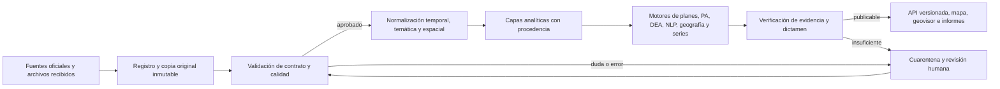

# Plan integral de orquestación de datos y análisis de seguridad humana en Cartagena

**Versión:** 1.0 · **Fecha:** 22 de octubre de 2026 · **Ámbito:** banco de fuentes, planes de desarrollo y acción, motores analíticos, mapa y geovisor.

## 1. Decisiones y resultado esperado

Construir una cadena reproducible que reciba cada fuente, preserve su versión original, compruebe su calidad, la armonice sin borrar diferencias entre instituciones, ejecute análisis verificables y publique únicamente resultados con procedencia y límites explícitos. LangGraph coordinará estados y rutas; PydanticAI interpretará documentos y emitirá salidas estructuradas cuando haga falta juicio semántico. Los cálculos, uniones y reglas de publicación serán deterministas.

La unidad mínima de resultado publicable será **indicador + territorio + periodo + fuente + definición + versión + estado de calidad**. Una cifra sin estos campos no llegará al mapa, al geovisor ni al diagnóstico.

Decisiones ya tomadas por el equipo:

1. Para corregimientos se usa la capa de **17 polígonos**. Los códigos 4 y 17, «Zona conflicto de límites», permanecen como unidades separadas; no se imputan a otros corregimientos.
2. En la presentación demográfica de **2017 y años anteriores** se usa la serie DANE publicada con base en el Censo General 2005; **desde 2018**, la serie basada en el CNPV 2018. El quiebre de base debe verse en las gráficas. Una diferencia entre 2017 y 2018 no demuestra cambio real de población.
3. Las manzanas censales 2018 sirven como referencia espacial. Sus habitantes son históricos; las proyecciones municipales posteriores no se distribuyen automáticamente entre barrios, UCG o corregimientos.
4. El análisis principal de resultados comienza en **2018**. Los años anteriores son contexto histórico y se etiquetan con su base y metodología.
5. Policía, Medicina Legal, Fiscalía y el archivo compartido representan fenómenos y unidades de registro distintos. Se muestran como series paralelas hasta que exista una conciliación documentada; no se suman como si fueran casos únicos.

## 2. Estado de partida verificado

- El consolidado actual contiene **1.860 observaciones y 40 claves de fuente**. Es una unión vertical con advertencias de calidad, no una serie ya armonizada de casos únicos.
- El sincronizador nocturno recoge fuentes de Medicina Legal, Policía, DANE, DNP, Unidad para las Víctimas, Procuraduría, IDEAM e INS. El cron activo ejecuta `fuentes`; `conciliacion` y `dea` están comentadas.
- ICBF, Fiscalía Power BI, archivos compartidos, el Excel policial de 2020–2026, la cartografía de Drive y la serie de vigencia censal tienen artefactos locales, pero no forman parte de la cadena nocturna completa.
- Hay 13 capas geográficas únicas en la última carpeta de Drive y un duplicado exacto de UCG. El Excel policial ofrece 11 grupos delictivos × 7 años para Cartagena, a escala municipal; no contiene puntos de incidentes.
- Existen un corredor de tres etapas, un supervisor LangGraph con puertas PydanticAI, un grafo de consulta PDD/PDL, un evaluador PDT con NLP/DEA/espacial/predictivo y un grafo de ciclo de política. Funcionan como circuitos separados.
- La bitácora 0070/0071 guarda corridas y pasos; el supervisor utiliza `MemorySaver` para su estado vivo. La revisión del código detectó fallas prioritarias descritas en la sección 4.

**Evidencia base:** `data/banco_fuentes_oficiales/indicadores_consolidados_cartagena_2026.manifest.json`, `data/cartografia_fuentes/drive_pshc_insumos/inventario_capas.json`, `data/cartografia_fuentes/cartografia_corregimientos_activa.json`, `data/banco_fuentes_oficiales/poblacion_cartagena_serie_vigencia_censal_2012_2026.manifest.json`, `scripts/pipeline_datos_polis.py` y `backend/app/modules/compromisos/orquestador_grafo.py`.

## 3. Arquitectura objetivo

### 3.1 Capas de datos

| Capa | Contenido | Regla |
| --- | --- | --- |
| Original | Archivo/API tal como llegó, respuesta, cabeceras permitidas, URL, fecha, SHA-256 y licencia/condición de uso | Inmutable; una nueva descarga crea versión nueva. |
| Validada | Filas y geometrías tipadas, unidades, fechas, códigos, controles y errores por registro | No sustituye silenciosamente el original. |
| Armonizada | Dimensión 7D, tipo de hecho, territorio, periodo y correspondencia con metas/PA, con versión de cada regla | Conserva ID y valor de origen y registra ambigüedad. |
| Analítica | Series, tasas, intervalos, coberturas, presupuesto, DEA, patrones espaciales y comparaciones entre planes | Cada cálculo declara numerador, denominador, universo y método. |
| Publicada | Artefactos y API con estado `publicable`, corte de datos, fuentes y advertencias | La publicación es promoción explícita y reversible. |

Las capas geográficas van en almacenamiento espacial PostGIS o artefactos GeoParquet/GeoJSON versionados; las series agregadas van en tablas relacionales. Los archivos grandes no se almacenan como estado del grafo. Un `run_id`, `source_version_id` y `artifact_id` unen todas las capas.

### 3.2 Contrato común por fuente

Cada adaptador entregará una ficha validada por Pydantic con: custodio, URL/ID, fecha de publicación y consulta, cobertura temporal y espacial, código territorial, unidad de observación (hecho, víctima, proceso, hogar, peso COP, etc.), definición del indicador, periodicidad, condición de provisionalidad, nivel de desagregación, restricciones de acceso, SHA-256, versión del adaptador y resultado de controles. `sin dato`, `cero`, `no aplica` y `dato suprimido` son estados distintos.

Una versión de fuente tendrá estado `descargada`, `validada`, `observada`, `cuarentena` o `publicable`. Ningún agente podrá cambiarlo por texto libre: la transición la autoriza una regla tipada o un dictamen humano registrado.

## 4. Fase 0: reparar la ejecución antes de ampliarla

| Corrección | Implementación | Criterio de aceptación |
| --- | --- | --- |
| Resumen entre procesos | Emitir una sola línea JSON con marcador o, preferiblemente, leer el `corrida_id` y `resumen` de PostgreSQL; eliminar el parser de líneas del stdout. | La puerta recibe el resumen real de las tres etapas, incluso con logs extensos. |
| Exclusión de corridas | Si falla `_abrir_corrida` o ya hay etapa activa, detener antes de llamar al manejador. | Dos invocaciones concurrentes ejecutan la etapa una sola vez. |
| Plan vacío | Validar `--omitir` y rechazar plan vacío; nunca convertirlo en `fuentes+conciliacion+dea`. | Omitir la única etapa no ejecuta ninguna. |
| Resultado del proceso | Incluir `exit_code`, estado de bitácora y excepción en la puerta, no solo el contenido del resumen. | Ninguna etapa fallida puede quedar `COMPLETADO_SIN_BLOQUEO`. |
| Puerta no eludible | Las reglas deterministas de severidad alta son límite inferior del dictamen; el LLM solo añade interpretación. | Un dictamen LLM no puede aprobar un fallo de contrato o trazabilidad. |
| Reanudación | Persistir checkpoint real en un backend durable compatible con LangGraph y ligar `thread_id`, `corrida_id` y revisión humana; retirar dependencia del mismo proceso. | Un worker puede detenerse y otro reanudar sin repetir etapas confirmadas. |
| Aislamiento de BD | Eliminar resolutores que convierten una URL `polis_test*` en `bd_csh`; inyectar conexión por etapa. | Ninguna prueba ni ejecución de ensayo escribe en la base productiva. |

La bitácora debe ser obligatoria para una corrida de producción: si no se puede escribir el inicio o el cierre, la etapa no se promociona. El `orden` del diario debe asignarse de modo seguro bajo concurrencia y cada paso debe referenciar su `corrida_id`, sin enlazar «la corrida más reciente» de otra ejecución.

## 5. Fase 1: inventario operativo y adaptadores de todas las fuentes

Se crea un registro de fuente y adaptador por canal de entrada, con política de actualización y prueba de disponibilidad. La primera versión incorpora lo que ya existe, sin esperar nuevas fuentes.

| Familia | Entradas actuales | Adaptador y control especial |
| --- | --- | --- |
| Demografía DANE | Censo/Manzanas 2018; series base 2005 y base CNPV 2018; GEIH, ECSC, NBI, pobreza y SAE | Selección de base por año; sexo/edad/área si la tabla lo permite; señalar cambio metodológico y no extrapolar población municipal a barrio. |
| Seguridad y justicia | Policía API y Excel 2020–2026; Medicina Legal; Fiscalía SPOA/Power BI | Unidad de registro separada; misma definición de año del hecho; provisionalidad y cortes; reconciliación de diferencias sin sumar series. |
| Víctimas y alertas | RUV, IRV, indemnizaciones, alertas SAT y archivos recibidos | Diferenciar ocurrencia, declaración, persona y evento; no convertir alertas en conteos de hechos. |
| Niñez, salud, ambiente y economía | ICBF, INS, IDEAM, TerriData, Procuraduría y otras fuentes locales | Identificar oferta frente a resultado; conservar valores contradictorios, metodología y cobertura. |
| Cartografía | 17 corregimientos, 15 UCG, 3 localidades, 217 polígonos de barrios, manzanas 2018, límite, perímetro, equipamientos y riesgo 2040 | CRS, geometría válida, solapes, cobertura y fecha; escenarios 2040 como proyección, nunca como casos observados. |
| Planeación y finanzas | 8 PDD/PDL, metas, planes de acción, BPIM, PPI, CUIPO/PIIP, SisPT | ID estable de meta y actividad, periodo, fuente de monto, pesos corrientes/constantes y tipo de vínculo con evidencia. |

Para cada fuente: frecuencia acordada (`diaria`, `mensual`, `por publicación` o `manual`), credenciales mediante secretos, descarga con reintentos acotados, control de esquema, deduplicación dentro de la misma fuente y registro de `última publicación observada`. Los archivos compartidos se tratan como insumos con procedencia pendiente hasta identificar custodio y licencia; el nombre del archivo no prueba oficialidad.

El backlog de instituciones todavía sin datos verificables o con cobertura parcial —por ejemplo, dependencias distritales de salud, ambiente y equipamientos— se conserva como **solicitud de fuente**, no como indicador vacío ni como dato estimado. La ficha indica quién debe entregar el archivo/API y qué nivel geográfico se necesita.

**Salida de fase:** catálogo legible por máquina; cada artefacto actual enlazado a su ficha; ejecución incremental e idempotente de cada adaptador. El cron no regenera ni borra versiones que estén bajo análisis.

### 5.1 Puertas de calidad por lote

| Control | Estado rojo: cuarentena | Estado ámbar: revisión | Estado verde: promoción posible |
| --- | --- | --- | --- |
| Procedencia | Falta custodio, fuente o hash; archivo corrupto | Falta ficha metodológica o licencia confirmada | Origen y versión trazables. |
| Esquema | Falta campo obligatorio o cambia el tipo sin adaptador | Campo opcional nuevo, reconocido | Contrato tipado y versión registrada. |
| Tiempo | Periodo imposible o corte desconocido para una cifra parcial | Publicación anterior al SLA acordado | Periodo, corte y provisionalidad conocidos. |
| Espacio | Código ajeno al universo declarado o geometría irreparable | Geometría reparable o borde territorial en disputa | Territorio codificado y geometría validada. |
| Valor | Unidad ambigua, conteo negativo imposible o suma interna inconsistente | Salto/anomalía que requiere explicación | Invariantes de esa fuente satisfechos. |
| Comparabilidad | Se pretende sumar hechos, víctimas y procesos, o publicar una tasa sin denominador compatible | Definición cambió entre periodos o entidades | Unidad de observación y método explícitos. |

Cada contrato fija sus umbrales y excepciones; un único porcentaje de «calidad» no sustituye estas seis comprobaciones. El lote ámbar conserva los datos para análisis exploratorio con su advertencia, pero no se presenta como conclusión cerrada.

## 6. Fase 2: normalización temática, temporal y territorial

### 6.1 Tiempo y demografía

Usar año del hecho cuando exista; registrar por separado año de denuncia, publicación y extracción. Comparar 2026 con igual periodo de años previos o marcarlo como parcial. Las tasas municipales usan el denominador de la serie de vigencia censal correspondiente al año; 2018 es el punto explícito de cambio de base. Mantener una serie analítica alternativa con retroproyecciones base 2018 para estudiar tendencias largas, sin sustituir la serie de presentación decidida por el usuario.

### 6.2 Espacio

El modelo territorial tendrá `territory_id`, versión geométrica, vigencia y jerarquía: distrito → localidad → UCG o corregimiento → barrio/manzana, según la cobertura de cada fuente. Las dos zonas en conflicto son identificables por código y quedan fuera de imputaciones automáticas. Reparar geometrías inválidas y registrar área modificada; no cambiar una capa publicada sin nueva versión. Un dato municipal sigue siendo municipal aunque se dibuje sobre el mapa: no se repetirá su valor en cada barrio como si allí se hubiera medido.

### 6.3 Taxonomía de seguridad humana

Versionar la taxonomía de siete dimensiones que compartió el usuario y sus categorías/casos. Cada correspondencia entre código fuente y caso canónico tendrá `regla`, `confianza`, `evidencia`, `revisor` y vigencia. Permitir múltiples dimensiones con pesos declarados cuando proceda; impedir doble conteo en totales. Mantener `sin clasificar` y `no medible con esta fuente` como resultados válidos. Nunca inferir la localización de un caso a partir del centroide de un agregado.

### 6.4 Planeación

Construir una tabla de vínculos tipados entre problema → dimensión → línea → programa → meta PDD/PDL → actividad PA → proyecto BPIM → presupuesto → indicador de resultado. Distinguir vínculo exacto, acreditado, inferido y ausente. Un vínculo inferido no se promociona a evidencia causal. Permitir relación 1:N con control de duplicación financiera; registrar el documento y página que sostienen cada vínculo.

**Salida de fase:** consultas reproducibles por dimensión, año y territorio; comparaciones entre fuentes con el mismo universo; controles explícitos de población y presupuesto.

## 7. Fase 3: grafo único de orquestación

El grafo supervisor debe manejar un `run_id` por corte de datos y pasar **referencias a artefactos**, no tablas completas en su estado. Rutas propuestas:

1. `registrar_corte` → congela lista de versiones de fuente y parámetros.
2. `adquirir_fuentes` → ejecuta adaptadores incrementales en paralelo por fuente, con límite de concurrencia.
3. `validar_fuentes` → contratos, licencias, cobertura y anomalías; deriva a cuarentena o revisión.
4. `normalizar` → fechas, unidades, códigos, geometrías, vigencia censal y taxonomía 7D.
5. `conciliar_planes_pa` → vínculos PDD/PDL–PA–BPIM y finanzas, sin pérdida de vínculos anteriores.
6. `calcular_indicadores` → agregados, denominadores, tasas, intervalos, auditoría de sumas y revisiones entre instituciones.
7. `analizar` → motores DEA, SisPT, espacial, predictivo y comparación de planes, cada uno con precondiciones de datos.
8. `interpretar_evidencia` → agentes PydanticAI con herramientas de lectura limitadas y salida estructurada.
9. `verificar_dictamen` → reglas de evidencia, límites de inferencia, revisión humana si hay conflicto material.
10. `promover_y_publicar` → versión API/cache/artefactos de mapa y geovisor; revocación posible por `run_id`.

Un nodo se omite **declaradamente** si no tiene insumos; la omisión no equivale a éxito. Los resultados de un nodo incluyen `estado`, conteos de entrada/salida, advertencias, artefactos, hashes, duración y motivo. Reintentos solo para fallos transitorios; cambios de esquema y calidad van a cuarentena. Las etapas con escritura externa llevan clave de idempotencia y operación de compensación.

### 7.1 Función de PydanticAI

Agentes especializados para: leer evidencia documental, clasificar semánticamente con citas, detectar inconsistencias entre fuentes, explicar diferencias territoriales y redactar dictamen con hipótesis alternativas. Cada herramienta admite solo datos autorizados y devuelve IDs/citas verificables. La salida será un modelo Pydantic con `afirmación`, `fuentes`, `periodo`, `territorio`, `método`, `incertidumbre` y `estado_de_revisión`. Si faltan datos, el agente debe declarar `insuficiente`; no inventar valores ni aprobar una regla roja.

Los agentes no ejecutan SQL libre, no deciden permisos, no cambian datos originales, no calculan las tasas oficiales ni publican por sí solos. El modelo utilizado, versión, prompt, herramientas invocadas y coste/tiempo quedan asociados al `run_id`.

## 8. Fase 4: motores de interpretación y evaluación de planes

Cada dimensión mostrará tres lecturas coordinadas: **estado de la seguridad humana**, **respuesta pública** y **relación temporal entre ambas**. La primera usa hechos y condiciones; la segunda usa metas, ejecución y presupuesto; la tercera analiza concordancias y rezagos. No atribuir una reducción de casos a un plan por simple coincidencia temporal. Para hablar de contribución se exigen comparación pertinente, control de cambios de registro, exposición poblacional, rezagos y explicación de factores externos. Si no es posible, el resultado será «asociación descriptiva» o «evidencia insuficiente».

Para determinar qué plan aportó más por dimensión y en conjunto: fijar universo comparable, metas verificadas, ejecución real, cobertura poblacional, deflactor de COP y pesos de dimensiones antes del cálculo. Publicar puntajes con componentes y sensibilidad a los pesos; separar inversión prometida de ejecutada y no agregar montos duplicados PDD–PA–BPIM. DEA y modelos predictivos son diagnósticos complementarios, no pruebas causales.

El análisis territorial usa tasas solo donde haya denominador del mismo nivel y año. Si no existe población validada por UCG/barrio, publicar conteos o proporciones con la etiqueta adecuada y evitar mapas de «riesgo» basados en tasas improvisadas. Los mapas de cámaras, estaciones y escenarios 2040 describen equipamientos o proyecciones, no demuestran impacto.

## 9. Fase 5: publicación, visualización y operación

### 9.1 Contrato de API y visualizaciones

API por corte con filtros de `dimension`, `indicador`, `territory_id`, `periodo`, `fuente` y `versión`. La respuesta incluye dato, unidad, denominador, cobertura, nivel territorial, estado de calidad, corte y enlace a procedencia. El mapa muestra únicamente la resolución real del dato. Gráficas priorizadas: serie temporal con línea del cambio censal de 2018, bandas de incertidumbre, pequeños múltiplos por fuente, comparación de metas frente a resultados, presupuesto ejecutado frente a avance, y mapas coropléticos solo con tasas válidas. La vista explica por qué una serie está parcial, suprimida o no comparable.

### 9.2 Observabilidad y gobierno

Tablero operacional: frescura por fuente, éxito de adaptadores, versiones pendientes, cuarentena, cobertura territorial/temática, tiempos por nodo, reintentos, coste de agentes, conflictos entre fuentes, precisión de vínculos y última promoción. Alertas por cambio de esquema, caída de extracción, discrepancia de totales y publicación sin procedencia. Backfill histórico y reversión de una publicación se ejecutan por corte, sin alterar originales.

Roles separados: custodio de fuente, responsable de calidad, analista sectorial, auditor de evidencia y publicador. Una decisión humana deja identidad, fecha, motivo y versión; aprobar un caso excepcional no elimina el hallazgo.

## 10. Secuencia de implementación y puertas de salida

| Paquete | Dependencia | Entrega verificable | Puerta para avanzar |
| --- | --- | --- | --- |
| P0. Seguridad del corredor | Ninguna | Fallas de sección 4 corregidas, prueba con subprocess real y aislamiento de BD | No hay ejecución sin bitácora ni aprobación falsa. |
| P1. Registro y adaptadores | P0 | Catálogo versionado de todas las fuentes actuales; sincronizador incluye ICBF/Fiscalía/Drive/Policía/censo según frecuencia | 100 % de artefactos usados tiene ficha y hash; fallos no borran versión anterior. |
| P2. Modelo canónico | P1 | Contratos de observación, territorio, indicador y vínculo; taxonomía 7D versionada | Conteos por fuente conservados y discrepancias visibles; geometrías evaluadas. |
| P3. Grafo durable | P0–P2 | Un `run_id` enruta todos los nodos; checkpoints inter-proceso; revisión humana | Reanudación tras reinicio sin duplicar efectos; `--omitir` seguro. |
| P4. Motores integrados | P2–P3 | Planes/PA, finanzas, series, DEA, espacial, PydanticAI con evidencia | Cada afirmación numérica se reconstruye desde artefacto y método. |
| P5. API y geovisor | P3–P4 | Resultados versionados y gráficas con calidad, corte y fuente | Ningún dato municipal aparece como dato de barrio; cambio censal visible. |

**Condiciones de aceptación globales:** rerun idempotente; invariantes de suma por fuente; protección contra duplicados entre fuentes; respaldo de cada afirmación; cero publicación automática de estados en cuarentena; bitácora completa de origen a vista; reversión por `run_id`; pruebas con una base `polis_test*` aislada y un corpus de referencia anotado. La exactitud de vínculos semánticos se medirá con un conjunto de casos revisado por dos personas, no con la cobertura aparente de una tabla 1:1.

## 11. Próxima acción concreta

Ejecutar P0 antes de activar más cron. En paralelo, cerrar las fichas de fuente y contratos de P1 sin modificar los datos originales. El primer corte integrado para la plataforma será **Cartagena 2018–2026**, con las siete dimensiones, la cartografía de 17 corregimientos y el cambio de base censal señalado. La publicación llegará después de superar las puertas de P2–P5.

## 12. Backlog ejecutable completo

Esta es la lista de trabajo del puente. El estado de ejecución se registra en `bridge/11_ejecucion_plan_orquestacion_2026.md`; esta tabla conserva los criterios de aceptación originales. El plan no autoriza por sí mismo desplegar, alterar datos originales ni declarar resultados publicados. Cada tarea debe cerrar con cambio revisable, evidencia de aceptación y enlace a la corrida o versión de fuente correspondiente. `P0 → P1 → P2 → P3 → P4 → P5` expresa dependencia de promoción.

### P0 · Corredor, seguridad y estado durable

| ID | Tarea concreta | Evidencia de cierre |
| --- | --- | --- |
| P0-01 | Sustituir lectura del stdout multilínea por resultado estructurado de corrida; conservar stdout como log, no como contrato. | Los resúmenes reales de `fuentes`, `conciliacion` y `dea` llegan íntegros a la puerta. |
| P0-02 | Detener ejecución si no se abre la corrida en 0070 o hay otra activa; distinguir conflicto de bloqueo de error de infraestructura. | Dos solicitudes simultáneas producen una ejecución. |
| P0-03 | Rechazar planes vacíos, etapas desconocidas y `--omitir` que deja cero etapas; no aplicar fallback a todo el plan. | Ninguna etapa omitida se ejecuta. |
| P0-04 | Llevar `exit_code`, estado y resumen a la puerta; impedir aprobación de etapa fallida. | Fallo del proceso nunca termina como `COMPLETADO_SIN_BLOQUEO`. |
| P0-05 | Hacer ineludibles los fallos deterministas de contrato, fuente, integridad y trazabilidad frente al dictamen LLM. | El agente no puede aprobar un hallazgo rojo. |
| P0-06 | Sustituir `MemorySaver` del supervisor por checkpoint durable y reanudación inter-proceso con la misma identidad de corrida. | Un segundo proceso reanuda tras `interrupt` sin repetir efectos confirmados. |
| P0-07 | Enlazar pasos a `corrida_id` real; asignar `orden` de forma segura y único por hilo; registrar resumen/hashes en el paso apropiado. | Diario completo y sin colisiones concurrentes. |
| P0-08 | Corregir resolutores de conciliación y DEA que fuerzan `bd_csh`; inyectar conexión y bloquear redirección desde `polis_test*`. | Las pruebas y ensayos permanecen en base de pruebas. |
| P0-09 | Definir timeout real, cancelación de subproceso y cierre de corrida; limpiar registros de manejadores por hilo. | No queda trabajo huérfano ni estado activo falso tras cancelación. |
| P0-10 | Añadir escenarios de aceptación para subprocess real, concurrencia, fallos de bitácora, reinicio y HITL en base aislada. | Paquete P0 aprobado con evidencia reproducible. |

### P1 · Registro, captación y actualización de fuentes

| ID | Tarea concreta | Evidencia de cierre |
| --- | --- | --- |
| P1-01 | Crear esquema de `fuente`, `versión`, `artefacto`, `lote`, `contrato`, `licencia` y `estado_calidad`; registrar SHA-256 y fecha. | Todo artefacto usado tiene ficha y versión. |
| P1-02 | Inventariar los 40 códigos del consolidado, los archivos no consolidados y las fuentes faltantes, sin contar derivados como nuevas fuentes. | Catálogo sin huérfanos ni duplicados conceptuales. |
| P1-03 | Integrar Medicina Legal y Policía de Datos Abiertos con paginación, corte, provisionalidad y esquema versionado. | Repetición incremental sin pérdida o duplicación de filas. |
| P1-04 | Integrar el Excel policial municipal 2020–2026, sus 11 delitos y el corte provisional 2026. | Series extraídas reproducibles y verificadas contra totales del libro. |
| P1-05 | Integrar Fiscalía SPOA/Power BI como procesos por año del hecho; mantener búsquedas textuales fuera del total aditivo. | Total, diferencias y criterio de búsqueda rastreables. |
| P1-06 | Integrar ICBF indicadores y oferta; preservar conflictos de valores y distinguir atenciones, cupos, personas y resultados. | Ningún agregado de oferta se presenta como reducción de casos. |
| P1-07 | Integrar DANE: censo/manzanas, serie base 2005 hasta 2017, serie base 2018 desde 2018, GEIH, ECSC, NBI, pobreza y SAE. | Base censal, fecha y nivel territorial en cada registro. |
| P1-08 | Integrar DNP TerriData, SisPT y registros pertinentes de planeación; documentar unidad y corte de cada indicador. | Catálogo temático y vinculación a versión de fuente. |
| P1-09 | Integrar RUV, IRV, indemnizaciones y SAT con unidades de observación separadas. | Ocurrencias, declaraciones, personas, eventos y alertas no se suman. |
| P1-10 | Integrar IDEAM, INS, Procuraduría y demás fuentes con datos presentes; registrar ausencia de datos locales cuando aplique. | Cobertura real por indicador y territorio visible. |
| P1-11 | Inventariar y versionar cartografía: 17 corregimientos, 15 UCG, 3 localidades, barrios, manzanas, distrito, perímetro, equipamientos y escenarios 2040. | Hash, CRS, fecha, geometrías y cobertura por capa. |
| P1-12 | Incorporar archivos compartidos de Drive con validación de permisos, duplicados, fuente institucional y condiciones de uso. | Archivo recibido no se etiqueta «oficial» sin prueba de custodio. |
| P1-13 | Catalogar los ocho PDD/PDL y sus planes de acción, metas, PPI, BPIM, CUIPO/PIIP y evidencia documental por página. | Universo y versión de cada plan explícitos. |
| P1-14 | Conectar `consolidar_datos_integral.py` y los extractores hoy manuales al flujo controlado; no sobrescribir resultados anteriores. | Un corte nocturno produce versiones nuevas o informa que no hubo cambios. |
| P1-15 | Definir frecuencia, SLA, responsable y alerta por fuente; separar actualización automática de carga manual. | Tablero de frescura y causas de atraso. |
| P1-16 | Preparar solicitudes trazables para fuentes aún ausentes: salud distrital, ambiente local, infraestructura y otras prioridades de las siete dimensiones. | Backlog con custodio, variable, nivel territorial y canal esperado. |

### P2 · Modelo canónico y calidad analítica

| ID | Tarea concreta | Evidencia de cierre |
| --- | --- | --- |
| P2-01 | Modelar observación, hecho, proceso, víctima, presupuesto, meta y actividad como unidades distintas. | Contratos impiden sumas incompatibles. |
| P2-02 | Crear pruebas de calidad por lote: procedencia, esquema, tiempo, espacio, valor y comparabilidad; registrar rojo/ámbar/verde. | Ningún lote rojo se promociona. |
| P2-03 | Versionar la taxonomía 7D, categorías y casos; mapear códigos de cada fuente con regla, confianza y evidencia. | Cada dato tiene dimensión o estado `sin clasificar`. |
| P2-04 | Construir registro territorial versionado y jerarquía distrito/localidad/UCG/corregimiento/barrio/manzana según cobertura real. | Código y versión geométrica acompañan cada unión espacial. |
| P2-05 | Reparar y auditar geometrías inválidas; comprobar solapes y cobertura; conservar las zonas 4 y 17 en disputa. | Cambio de área documentado; no hay imputación silenciosa. |
| P2-06 | Normalizar año del hecho, registro, publicación y consulta; identificar 2026 parcial y comparar periodos homólogos. | Las series muestran el tipo de fecha y corte. |
| P2-07 | Aplicar serie censal de presentación 2005/2018; mantener retroproyección alternativa para análisis, separada. | Quiebre de 2018 señalado y tasas municipales reproducibles. |
| P2-08 | Crear matriz de correspondencia PDD/PDL → programa → meta → PA → BPIM → indicador, con vínculo exacto/acreditado/inferido/ausente y relación 1:N. | No se confunde cobertura artificial con precisión. |
| P2-09 | Normalizar COP corriente/constante, deflactor, compromiso/pago/ejecución y doble imputación entre PDD–PA–BPIM. | Los totales financieros cierran por universo y año. |
| P2-10 | Conciliar fuentes sobre el mismo fenómeno sin borrar divergencias: Policía–Medicina Legal–Fiscalía–archivos recibidos. | Diferencias, definiciones y estados quedan consultables. |
| P2-11 | Crear corpus de referencia anotado por dos revisores para vínculos semánticos y clasificación 7D. | Precisión y desacuerdo medibles por categoría. |

### P3 · LangGraph, PydanticAI y gobierno de ejecución

| ID | Tarea concreta | Evidencia de cierre |
| --- | --- | --- |
| P3-01 | Definir `run_id` y estado tipado del grafo con referencias a artefactos, no cargas completas. | Estado serializable y pequeño. |
| P3-02 | Construir grafo único con fan-out por fuente y join de validaciones; limitar concurrencia y coste. | Fuentes independientes no se bloquean entre sí. |
| P3-03 | Implementar rutas condicionales para `aprobado`, `ámbar`, `cuarentena`, `sin insumo` y `fallo transitorio`. | Cada salto deja razón y estado inequívocos. |
| P3-04 | Definir reintentos, backoff, claves de idempotencia y compensación por operación externa. | Reproceso no duplica filas, pagos ni publicaciones. |
| P3-05 | Integrar los grafos PDD, PDT y ciclo de política mediante contratos de entrada/salida y `run_id`; mantener motores especializados. | Un corte completo enlaza resultados de todos los motores requeridos. |
| P3-06 | Dar a PydanticAI herramientas de lectura limitadas y salidas tipadas con citas; registrar modelo, prompt, versión y costes. | Ninguna afirmación sin fuente verificable pasa la puerta. |
| P3-07 | Incorporar revisión humana durable para conflictos de fuente, vínculo inferido material y dictamen sensible. | Decisión reanudable y auditada entre procesos. |
| P3-08 | Activar programación de etapas pesadas solo tras P0–P2 y métricas de estabilidad; diseñar backfill y reversión por corte. | Cron completo sin fallos silenciosos ni corrupción histórica. |

### P4 · Indicadores, interpretación y evaluación de políticas

| ID | Tarea concreta | Evidencia de cierre |
| --- | --- | --- |
| P4-01 | Construir indicadores 7D por fuente, año y territorio con numerador, denominador, unidad y método. | Cada cifra publicada se recalcula desde sus versiones. |
| P4-02 | Producir series temporales comparables y bandas de incertidumbre; distinguir provisionalidad y cambio censal. | Gráficas no comparan periodos incompatibles sin alerta. |
| P4-03 | Unir apuestas de ocho planes y actividades PA con resultados observados y ejecución financiera, sin afirmar causalidad automática. | Por dimensión se ven respuesta pública y resultado por separado. |
| P4-04 | Calcular aporte por plan y por conjunto 7D con pesos fijados, cobertura, ejecución y sensibilidad. | Ranking reproducible y componentes visibles. |
| P4-05 | Ejecutar DEA/SisPT/espacial/predictivo solo con precondiciones; marcar resultado no disponible cuando falten datos. | No hay DEA o mapa de tasas con denominador inventado. |
| P4-06 | Evaluar hipótesis de contribución con rezagos, exposición, cambios de registro y factores externos; declarar asociación cuando no haya diseño causal. | El dictamen distingue descripción, asociación y causalidad. |
| P4-07 | Contrastar interpretación PydanticAI con reglas, corpus anotado y revisión experta; medir error por dimensión. | Hallazgos y citas reproducibles; tasa de error reportada. |
| P4-08 | Emitir un expediente de evidencia por afirmación y por dictamen, con versión y estado. | Auditor puede reconstruir cifra y conclusión. |

### P5 · API, geovisor y operación continua

| ID | Tarea concreta | Evidencia de cierre |
| --- | --- | --- |
| P5-01 | Publicar endpoints versionados por corte, fuente, dimensión, periodo, territorio y estado de calidad. | Respuesta incluye procedencia, unidad, corte y advertencias. |
| P5-02 | Sustituir datos demográficos estáticos del geovisor por la serie autorizada y etiquetas de base censal; no repartir municipio a UCG/barrio. | Mapa y geovisor muestran mismo valor y misma fuente. |
| P5-03 | Construir visualizaciones de series, pequeños múltiplos, presupuesto/avance, metas/resultados y mapas con resolución real. | Predominan gráficas interpretables y accesibles; no hay falsa precisión. |
| P5-04 | Mostrar vacíos, provisionalidad, calidad y disputas territoriales en la interfaz; permitir abrir ficha de procedencia. | Usuario entiende qué se sabe y qué no se puede concluir. |
| P5-05 | Montar tablero de operación: frescura, cobertura, fallos, cuarentena, coste, precisión, última promoción y auditoría. | Alertas accionables por fuente y nodo. |
| P5-06 | Preparar publicación reversible por `run_id` y comparación con corte anterior; aprobar únicamente artefactos verdes o ámbar autorizados. | Rollback restaura la versión previa sin borrar evidencia. |
| P5-07 | Revisar seguridad, privacidad y agregación territorial antes de exponer casos sensibles. | Ningún dato identificable aparece en mapa o respuesta pública. |
| P5-08 | Ejecutar aceptación integral en `polis_test*` y revisión externa de un corte 2018–2026 antes de despliegue. | Acta de aprobación enlazada a manifiestos, corridas y discrepancias. |

### Orden para iniciar

**Primera entrega:** P0-01 a P0-05 y P0-08; inventario P1-01/P1-02 en paralelo. **Segunda entrega:** P0-06/P0-07/P0-09/P0-10 y adaptadores P1. **Tercera entrega:** P2 y grafo P3. **Cuarta entrega:** motores P4 y publicación P5. Ninguna entrega presupone que la anterior está aprobada solo porque el proceso terminó con código cero.
