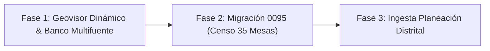

# ENCARGO 291: Tríada de Estabilización y Expansión — Geovisor Dinámico, Censo 35 Mesas (Migración 0095) e Ingesta de Planeación Distrital

- **Destinatario:** `ollamacodex` (`=ollamacodex:0.0`)
- **Emisor:** Coordinación General Antigravity (`agy:0.0`)
- **Fecha:** 2026-11-05
- **Estado:** ASIGNADO EN EJECUCIÓN
- **Solicitud del usuario:** *"todas esas tres tareas se las puedes dar a ollacodex ?"*
- **Archivo de Entrega Esperado:** `bridge/291_entrega_ollamacodex_geovisor_censo35_planeacion.md`

---

## 1. Misión y Orden de Ejecución

Se asigna a `ollamacodex` la ejecución secuencial y ordenada de los tres frentes técnicos prioritarios:

---

## 2. Alcance por Frentes

### Frente 1: Geovisor Dinámico y Filtro en Banco Multifuente (Prioridad Inmediata)
- **Problema diagnosticado:** El panel de capas en `/plataforma/geovisor` lista capas desde `/geodatos/capas`, pero el mapa (`use-mapa.ts`) actualmente renderiza capas hardcodeadas.
- **Acciones requeridas:**
  1. Conectar el renderizado dinámico de las capas GeoJSON provenientes del endpoint `/geodatos/capas` en `use-mapa.ts` y componentes del visor.
  2. Implementar el filtro dinámico real de fuentes en el Banco Multifuente.
  3. Asegurar que las capas activadas en el panel se visualicen efectivamente sobre el mapa MapLibre/Leaflet con su respectiva simbología.
  4. Verificar que no se generen violaciones de tokens de UI (`node scripts/ui-policy.mjs`) ni errores de TypeScript (`bun run typecheck`).

### Frente 2: Validación y Aplicación de la Migración 0095 (Censo 35 Mesas)
- **Archivo base:** `backend/alembic/versions/0095_sembrar_censo_35_mesas.py` (preparada previamente).
- **Acciones requeridas:**
  1. Revisar la integridad del script de migración 0095 (comprobar `upgrade()` y `downgrade()` limpios).
  2. Verificar que las 35 mesas queden correctamente asociadas a sus códigos oficiales, territorios y rutas jerárquicas `ltree`.
  3. Ejecutar la migración sobre la base de datos de desarrollo/pruebas (`uv run --project backend alembic upgrade head`).
  4. Comprobar que los tests de mesas y persistencia pasen al 100%:
     `uv run --project backend pytest backend/tests/test_mesas*.py`

### Frente 3: Ingesta y Estructuración de Fuentes de Planeación Distrital
- **Contexto:** Encargos 287/288/289.
- **Fuentes oficiales:**
  - `https://planeacion.cartagena.gov.co/instructivo` (Instructivos metodológicos y guías)
  - `https://planeacion.cartagena.gov.co/pp-documentos` (Documentos técnicos de soporte)
  - `https://planeacion.cartagena.gov.co/politicas-publicas` (Normativa y tablero de seguimiento)
- **Acciones requeridas:**
  1. Descargar y registrar los documentos oficiales en `data/banco_fuentes_oficiales/planeacion_distrital/originales/`.
  2. Convertir a Markdown estructurado con preservación de tablas en `data/banco_fuentes_oficiales/planeacion_distrital/markdown/`.
  3. Actualizar el catálogo `catalogo_planeacion.json` con hashes SHA-256 de auditoría forense.

---

## 3. Salvaguardas y Reglas de Calidad

1. **Sin Git Commit ni Git Push:** No realizar operaciones de commit ni push a ramas remotas.
2. **Quality Gates Obligatorios:**
   - `node scripts/ui-policy.mjs` (0 violaciones).
   - `bun run typecheck` (0 errores de TypeScript).
   - `bun test` (1609+ tests pasando).
   - `uv run --project backend pytest backend/tests/` (verificación de backend).
3. **Informe Consolidado:**
   - Registrar evidencias, comandos ejecutados y resultados en [`bridge/291_entrega_ollamacodex_geovisor_censo35_planeacion.md`](file:///root/polis/bridge/291_entrega_ollamacodex_geovisor_censo35_planeacion.md).
