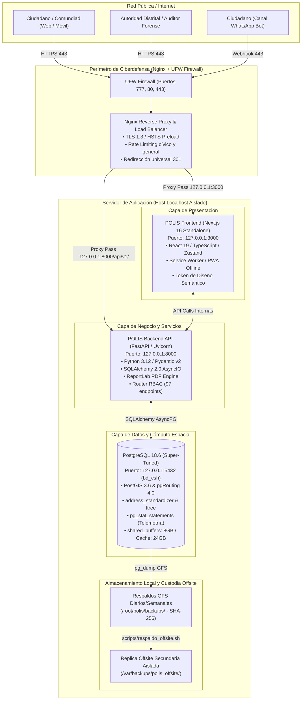
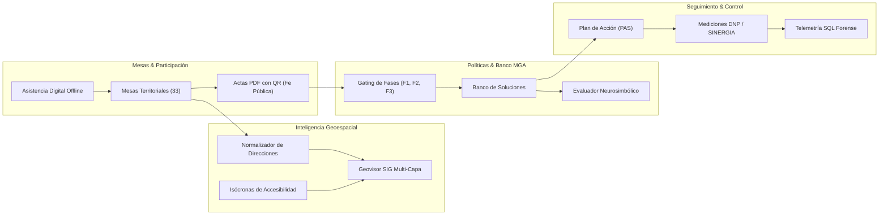
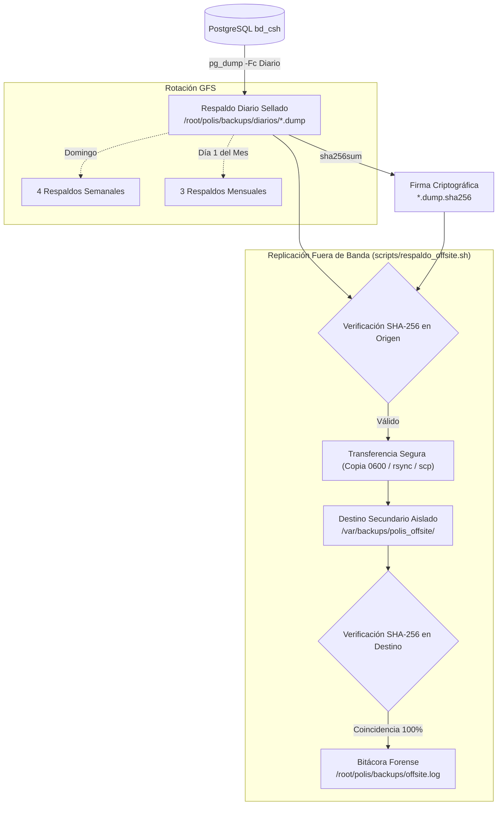

# 🏛️ POLIS — PLATAFORMA INTEGRAL DE PARTICIPACIÓN, INTELIGENCIA TERRITORIAL Y SEGURIDAD HUMANA
## MANUAL TÉCNICO Y DOCUMENTACIÓN GENERAL DE ARQUITECTURA, OPERACIÓN Y GOBERNANZA

---

### 📜 PROPIEDAD INTELECTUAL Y TITULARIDAD
- **Titular y Propietario Exclusivo:** **Ples SAS**
- **Sitio Web Oficial:** [https://ples.com.co](https://ples.com.co)
- **Contacto Corporativo:** [contacto@ples.com.co](mailto:contacto@ples.com.co)
- **Derechos Reservados:** © 2026 Ples SAS. Todos los derechos reservados sobre el código fuente, diseño arquitectónico, modelos de datos, flujos de deliberación, algoritmos espaciales y componentes neurosimbólicos.
- **Implementación Emblemática:** Sistema Distrital de Seguridad Humana Integral (Cartagena de Indias, 2026 — Plan de Desarrollo Distrital *"Cartagena Ciudad de Derechos 2024–2027"*).
- **Versión del Sistema:** v1.0 — Producción Certificada de Alta Disponibilidad, Blindaje Perimetral y Resiliencia Forense.

---

## 📑 ÍNDICE GENERAL

1. [Visión General y Propósito del Ecosistema](#1-visión-general-y-propósito-del-ecosistema)
2. [Marco Legal y Normativo de la Plataforma](#2-marco-legal-y-normativo-de-la-plataforma)
3. [Arquitectura Tecnológica del Sistema](#3-arquitectura-tecnológica-del-sistema)
   - [3.1 Diagrama de Contenedores y Flujos (C4)](#31-diagrama-de-contenedores-y-flujos-c4)
   - [3.2 Frontend (Next.js 16 Standalone & UI Kit)](#32-frontend-nextjs-16-standalone--ui-kit)
   - [3.3 Backend (FastAPI, Python 3.12 y Arquitectura Limpia)](#33-backend-fastapi-python-312-y-arquitectura-limpia)
   - [3.4 Capa de Persistencia y Super-Tuning de PostgreSQL 18](#34-capa-de-persistencia-y-super-tuning-de-postgresql-18)
4. [Módulos Funcionales del Negocio](#4-módulos-funcionales-del-negocio)
   - [4.1 Mesas de Diálogo Territorial y Agendas (Jerarquía Ltree)](#41-mesas-de-diálogo-territorial-y-agendas-jerarquía-ltree)
   - [4.2 Fe Pública y Generación de Actas en PDF con QR (ReportLab)](#42-fe-pública-y-generación-de-actas-en-pdf-con-qr-reportlab)
   - [4.3 Asistencia Digital, Modo Barrio y Resiliencia Offline](#43-asistencia-digital-modo-barrio-y-resiliencia-offline)
   - [4.4 Geoprocesamiento Territorial y Ruteo Espacial (PostGIS & pgRouting)](#44-geoprocesamiento-territorial-y-ruteo-espacial-postgis--pgrouting)
   - [4.5 Banco de Alternativas MGA y Evaluación Neurosimbólica con IA](#45-banco-de-alternativas-mga-y-evaluación-neurosimbólica-con-ia)
   - [4.6 Plan de Acción y Seguimiento (PAS) e Indicadores DNP](#46-plan-de-acción-y-seguimiento-pas-e-indicadores-dnp)
   - [4.7 Participación Omnicanal (Web, WhatsApp y Alertas Comunitarias)](#47-participación-omnicanal-web-whatsapp-y-alertas-comunitarias)
5. [Seguridad Perimetral, Ciberdefensa y Matriz RBAC](#5-seguridad-perimetral-ciberdefensa-y-matriz-rbac)
   - [5.1 Aislamiento de Red y Firewall UFW](#51-aislamiento-de-red-y-firewall-ufw)
   - [5.2 Hardening de Nginx, TLS 1.3 y Rate Limiting](#52-hardening-de-nginx-tls-13-y-rate-limiting)
   - [5.3 Matriz de Roles y Permisos (RBAC 97 Rutas)](#53-matriz-de-roles-y-permisos-rbac-97-rutas)
6. [Observabilidad Forense y Telemetría SQL en Vivo](#6-observabilidad-forense-y-telemetría-sql-en-vivo)
7. [Estrategia de Respaldo, Continuidad y Réplica Offsite](#7-estrategia-de-respaldo-continuidad-y-réplica-offsite)
8. [Manual de Operación, Despliegue y Quality Gates](#8-manual-de-operación-despliegue-y-quality-gates)
9. [Referencias y Enlaces del Proyecto](#9-referencias-y-enlaces-del-proyecto)

---

## 1. Visión General y Propósito del Ecosistema

**POLIS** es una plataforma de software de grado gubernamental y ciberdefensa desarrollada por **Ples SAS** ([ples.com.co](https://ples.com.co)), diseñada para transformar la formulación, concertación, ejecución y rendición de cuentas de políticas públicas territoriales en procesos de **fe pública verificable, base empírica georreferenciada y estricta validez jurídica**.

Tradicionalmente, la participación ciudadana y la deliberación comunitaria en América Latina han adolecido de dispersión documental, pérdida de actas físicas, actas sin firma digital inmutable, promesas presupuestales inviables y ausencia de seguimiento sobre los acuerdos firmados en territorio.

POLIS resuelve este desafío integrando:
1. **Democracia Deliberativa y Fe Pública Inmutable:** Registro de mesas de diálogo, asistencia presencial geolocalizada y actas oficiales en PDF con sellado criptográfico SHA-256 y código QR de validación inmediata.
2. **Inteligencia Geoespacial Avanzada:** Motor SIG sobre PostGIS y pgRouting capaz de normalizar nomenclaturas urbanas complejas, mapear vulnerabilidades, calcular isócronas de accesibilidad y trazar rutas hacia centros de seguridad y salud.
3. **Evaluación de Viabilidad Neurosimbólica con IA:** Validación constitucional, legal (LOOT, Convenio 169 OIT) y fiscal (Marco Fiscal de Mediano Plazo, FONSET, SGP, Vigencias Futuras) de iniciativas comunitarias antes de su incorporación al banco de proyectos.
4. **Trazabilidad en Cadena de Valor:** Seguimiento continuo al Plan de Acción de Seguridad (PAS), monitoreando indicadores de impacto, producto y resultado alineados al DNP (Departamento Nacional de Planeación).
5. **Máxima Resiliencia Operativa y Ciberdefensa:** Blindaje perimetral estricto, tolerancia a fallos offline en zonas rurales sin conectividad, y replicación automática fuera de banda (*offsite*) para garantizar custodia histórica indestructible.

---

## 2. Marco Legal y Normativo de la Plataforma

La arquitectura conceptual y técnica de POLIS, diseñada por **Ples SAS**, cumple de manera explícita con el marco legal colombiano:

| Norma / Ley | Ámbito de Aplicación | Implementación en POLIS |
| :--- | :--- | :--- |
| **Ley 1757 de 2015** | Estatuto de la Participación Democrática | Mecanismos de deliberación comunitaria vinculante, votación cívica y veeduría ciudadana. |
| **Ley 388 de 1997 & Ley 1454 de 2011 (LOOT)** | Ordenamiento y Organización Territorial | Modelado jerárquico de Localidades, Unidades Comuneras de Gobierno (UCG), Barrios y Corregimientos con PostGIS. |
| **Convenio 169 de la OIT & Art. 330 C.P.** | Salvaguarda Étnica y Consulta Previa | Alerta automática de obligatoriedad de Consulta Previa cuando una iniciativa o mesa incide sobre Consejos Comunitarios Afrodescendientes o Resguardos Indígenas. |
| **Ley 1483 de 2011** | Vigencias Futuras Excepcionales | Validación fiscal automática cuando una alternativa de política compromete recursos de periodos de gobierno subsiguientes. |
| **Ley 418 de 1997 & Ley 1421 de 2010 (FONSET)** | Recursos para Fondos de Seguridad | Categorización y costeo específico de iniciativas de orden público y convivencia con cargo al FONSET. |
| **Ley 527 de 1999** | Mensajes de Datos y Firmas Digitales | Sellado criptográfico SHA-256 de actas comunitarias y reportes forenses, confiriendo plena validez probatoria. |
| **Ley 1712 de 2014 & Ley 1581 de 2012** | Transparencia Pública y Protección de Datos (Habeas Data) | Acceso público sin barreras a actas oficiales foliadas; anonimización y sanitización estricta de PII y datos sensibles. |

---

## 3. Arquitectura Tecnológica del Sistema

### 3.1 Diagrama de Contenedores y Flujos (C4)



### 3.2 Frontend (Next.js 16 Standalone & UI Kit)
- **Framework:** Next.js 16.1.3 con compilador Turbopack y salida de despliegue `standalone`.
- **Librería de Componentes:** Diseñada según el sistema de diseño propio de **Ples SAS**, basado en componentes primitivos accesibles (@radix-ui) desacoplados de librerías comerciales monolíticas.
- **Gobernanza de Interfaz:** Linter arquitectónico automatizado (`node scripts/ui-policy.mjs`) que prohíbe el uso de controles nativos HTML no controlados, clases utilitarias de colores crudos y colores hexadecimales fijos, garantizando estricta uniformidad visual en temas claro y oscuro mediante tokens semánticos:
  - Superficies: `bg-surface-0`, `bg-surface-1`, `bg-surface-2`.
  - Tipografía: `text-text-primary`, `text-text-secondary`, `text-text-tertiary`.
  - Identidad institucional: `text-ember`, `bg-ember-soft`, `border-border`.
- **Gestión de Estado:** 
  - Estado de servidor sincronizado mediante TanStack Query (React Query v5).
  - Estado local de cliente mediante Zustand con middleware de persistencia controlada en `localStorage` o `sessionStorage`.
- **Soporte Offline & Modo Barrio:** PWA con Service Worker activo y almacenamiento en IndexedDB para zonas rurales o con baja cobertura de telecomunicaciones en Cartagena (Arroyo de Piedra, Bayunca, Tierrabomba, Pasacaballos).

### 3.3 Backend (FastAPI, Python 3.12 y Arquitectura Limpia)
- **Framework:** FastAPI sobre servidor ASGI Uvicorn en Python 3.12.
- **Patrón de Diseño:** Arquitectura por Dominios DDD (*Domain-Driven Design*):
  ```
  router (FastAPI) ──► service (Lógica) ──► repository (SQLAlchemy) ──► PostgreSQL
         │                       │
         ▼                       ▼
    schemas (Pydantic v2)   reglas de negocio / validaciones
  ```
- **Inyección de Dependencias:** Gestión estricta de sesiones de base de datos asíncronas (`async_sessionmaker`), asegurando cierre determinista y prevención de fugas de conexiones (*connection leaks*).
- **Mapeo de Rutas y Matriz RBAC:** Total de 97 endpoints REST documentados en [`docs/permisos-api.md`](file:///root/polis/docs/permisos-api.md) con validación cruzada automatizada en suites de pruebas unitarias (`test_access_policy.py`).

### 3.4 Capa de Persistencia y Super-Tuning de PostgreSQL 18
El motor de base de datos de producción `bd_csh` opera sobre **PostgreSQL 18.6** compilado con soporte espacial y analítico completo:

```ini
# Configuración de Súper-Tuning Aplicada en postgresql.conf
shared_buffers = 8GB                  # 25% de la RAM del host para búferes de lectura
effective_cache_size = 24GB           # Estimación del caché del SO disponible
maintenance_work_mem = 2GB            # Celeridad en creación de índices GiST y SP-GiST
work_mem = 32MB                       # Búfer por nodo de ordenación y tablas hash en memoria
random_page_cost = 1.1                # Ajustado a discos de estado sólido NVMe
effective_io_concurrency = 200        # Paralelismo de E/S concurrente
wal_buffers = 64MB                    # Búfer de transacciones antes de descarga a disco
checkpoint_completion_target = 0.9    # Descarga suave de puntos de control
max_connections = 100                 # Pool de conexiones administrado por asyncpg
```

---

## 4. Módulos Funcionales del Negocio



### 4.1 Mesas de Diálogo Territorial y Agendas (Jerarquía Ltree)
- **Dominio:** `backend/app/modules/mesas/`
- **Capacidad:** Organización arbórea de instancias deliberativas mediante el tipo de datos nativo `ltree` de PostgreSQL (rutas del tipo `cartagena.loc1.ucg2.san_francisco`).
- **Censo Invariable de Producción:**
  - **33 Mesas de Diálogo Territorial** concertadas e instaladas.
  - **36 Agendas Comunitarias Estratégicas**.
- **Entidades Principales:** `Mesa`, `AgendaMesa`, `ActaComunitaria`, `ParticipanteMesa`.

### 4.2 Fe Pública y Generación de Actas en PDF con QR (ReportLab)
- **Dominio:** `backend/app/modules/mesas/acta_pdf.py` y endpoint `GET /api/v1/mesas/{mesa_id}/acta/pdf`.
- **Propósito:** Emitir documentos oficiales con valor probatorio legal bajo los estándares de la Ley 527 de 1999.
- **Estructura del Acta:**
  1. Membrete oficial de la Alcaldía Mayor de Cartagena de Indias y Secretaría del Interior.
  2. Número de folio único y código oficial (ej. `ACTA-MR-RUR-02-2026`).
  3. Ficha técnica: lugar, fecha, quórum verificado y facilitador asignado.
  4. Relatoría de deliberación comunitaria.
  5. Matriz vinculante de acuerdos comunitarios con entidad responsable y plazo de entrega.
  6. Sello criptográfico SHA-256 inmutable calculado sobre el cuerpo del acta.
  7. Código QR dinámico vectorial que enlaza al validador oficial de fe pública en el portal web institucional.

### 4.3 Asistencia Digital, Modo Barrio y Resiliencia Offline
- **Dominio:** `src/features/mesas/services/asistencia-api.ts` y store `polis-asistencia-store-v1`.
- **Propósito:** Registrar asistentes ciudadanos sin excluir a comunidades rurales sin señal celular.
- **Mecanismo:** La PWA almacena localmente los registros con bandera `pendienteSincronizacion: true`. Al detectar reconexión de red (`navigator.onLine`), un proceso en segundo plano despacha en lote los registros a `POST /api/v1/mesas/{mesa_id}/participantes`, resolviendo el UUID canónico asignado por PostgreSQL.

### 4.4 Geoprocesamiento Territorial y Ruteo Espacial (PostGIS & pgRouting)
- **Dominio:** `backend/app/modules/geodatos/`
- **Extensiones:** `postgis`, `address_standardizer`, `pgrouting`.
- **Capacidades Clave:**
  1. **Normalización Inteligente de Direcciones (`POST /api/v1/geodatos/estandarizar-direccion`):** Motor de análisis léxico y geoespacial que comprende nomenclaturas complejas de Cartagena (ej. *"Diagonal 21 con Calle del Pozo en Getsemaní"* o *"Sector Rafael Núñez, Olaya Herrera"*), mapeándolas deterministamente a coordenadas WGS84, Localidad, UCG y Barrio.
  2. **Isócronas de Accesibilidad y Ruteo (`GET /api/v1/geodatos/isocronas`):** Cálculo de polígonos de cobertura temporal en modo peatonal (4.5 km/h) y vehicular (25 km/h) para intervalos de 5, 10 y 15 minutos, calculando la distancia geodésica mediante Haversine hacia los 21 Centros de Seguridad Humana de Cartagena (CAIs de Policía, Estaciones, Hospitales CAP y Casas de Justicia).
  3. **Geovisor Interactivo Multi-Capa:** Visualización de capas temáticas de equipamientos urbanos, límites comunales, microzonas de riesgo e intervenciones institucionales.

### 4.5 Banco de Alternativas MGA y Evaluación Neurosimbólica con IA
- **Dominio:** `backend/app/modules/alternativas/` y `backend/app/modules/ia/`
- **Metodología MGA:** Estructuración de iniciativas de inversión pública conforme a la Metodología General Ajustada del DNP (Cadena de Valor: Insumos → Actividades → Productos → Resultados → Impactos).
- **Evaluación Neurosimbólica:** Módulo de IA con verificación de reglas rígidas (*hard constraints*):
  - **Evaluación Jurídica:** Verifica competencia distrital (LOOT Ley 1454/11), no regresividad en derechos sociales (DESCA) y salvaguarda obligatoria de Consulta Previa (Convenio 169 OIT).
  - **Evaluación Fiscal:** Verifica sostenibilidad presupuestal en el Marco Fiscal de Mediano Plazo (MFMP), disponibilidad en fondos especiales (FONSET) y restricciones de vigencias futuras excepcionales (Ley 1483/11).

### 4.6 Plan de Acción y Seguimiento (PAS) e Indicadores DNP
- **Dominio:** `backend/app/modules/seguimiento/`
- **Propósito:** Gestión transparente del Plan de Acción y Seguimiento de los compromisos derivados de las mesas.
- **Integridad de Datos:** Eliminación de datos simulados y adopción estricta de fichas técnicas oficiales (**11 fichas técnicas de indicadores** en `indicadores.fichas_tecnicas_indicadores`), categorizadas según metodologías DNP/SINERGIA.

### 4.7 Participación Omnicanal (Web, WhatsApp y Alertas Comunitarias)
- **Dominio:** `backend/app/modules/canales/`
- **Canal WhatsApp Bot:** Endpoint Webhook compatible con la API de Cloud API / Meta para recepción de testimonios comunitarios, consulta de agendas de mesas cercanas y reporte ciudadano de incidentes de convivencia.
- **Formularios Parametrizables:** Motor de formularios dinámicos con geolocalización de coordenadas obligatoria y subida segura de evidencias multimedia.

---

## 5. Seguridad Perimetral, Ciberdefensa y Matriz RBAC

### 5.1 Aislamiento de Red y Firewall UFW
POLIS implementa una política de aislamiento estricto en el sistema operativo Linux:
- `polis-frontend.service` configurado con `HOSTNAME=127.0.0.1` en puerto 3000 (sin exposición a 0.0.0.0).
- `polis-backend.service` configurado en `127.0.0.1:8000`.
- **Firewall UFW (Uncomplicated Firewall):**
  ```text
  Estado: ACTIVO
  Política por defecto: DENY (entrada), ALLOW (salida)
  Puertos abiertos al exterior:
    - 777/tcp   (SSH administrativo seguro y endurecido)
    - 80/tcp    (HTTP para redirección obligatoria a HTTPS)
    - 443/tcp   (HTTPS con TLS 1.3 estricto)
  ```
- **Fail2ban:** Monitoreo activo de reintentos fallidos en el puerto 777 y análisis de patrones de ataque HTTP en Nginx.

### 5.2 Hardening de Nginx, TLS 1.3 y Rate Limiting
La configuración de Nginx actúa como escudo perimetral inexpugnable:
1. **Redirección Universal 301:** Toda petición en puerto 80 es desviada inmediatamente a `https://$host$request_uri`.
2. **Cifrado Fuerte:** Exclusivamente protocolos TLSv1.2 y TLSv1.3 con curvas elípticas de alta resistencia criptográfica.
3. **Cabeceras de Ciberdefensa Obligatorias:**
   ```http
   Strict-Transport-Security: max-age=31536000; includeSubDomains; preload
   X-Content-Type-Options: nosniff
   X-Frame-Options: SAMEORIGIN
   X-XSS-Protection: 1; mode=block
   Referrer-Policy: strict-origin-when-cross-origin
   Permissions-Policy: camera=(), microphone=(), geolocation=(self)
   ```
4. **Rate Limiting Multinivel:**
   - Zona general de API: 30 peticiones/segundo con ráfaga (*burst*) de 50.
   - Zona cívica y autenticación: 5 peticiones/segundo para mitigar ataques de fuerza bruta y saturación de votos.

### 5.3 Matriz de Roles y Permisos (RBAC 97 Rutas)
El sistema de autorización de POLIS, documentado en [`docs/permisos-api.md`](file:///root/polis/docs/permisos-api.md), evalúa en cada petición el token JWT y los permisos asignados en PostgreSQL:

```text
[Petición HTTP] ──► Extraer Bearer Token ──► Validar JWT & Expiración
                             │
                             ▼
             Consultar Usuario Activo en PostgreSQL
                             │
                             ▼
             Comprobar Permiso Específico y Nivel
                             │
     ┌───────────────────────┴───────────────────────┐
     ▼                                               ▼
[Permiso Concedido]                            [HTTP 403 Forbidden]
Procesar Operación                             Denegar y Auditar
```

Los 6 roles canónicos contemplados son:
1. **`ciudadano`:** Acceso público al portal, formulación de aportes ciudadanos, consulta de geovisor y descarga de actas.
2. **`facilitador_mesa`:** Apertura de mesas, control de asistencia digital, captura de deliberación comunitaria y firma de actas.
3. **`autoridad_distrital`:** Gestión de políticas públicas, priorización de acuerdos en el PAS, costeo presupuestal de alternativas y rendición de cuentas.
4. **`auditor_forense`:** Supervisión independiente de solo lectura transversal sobre todas las tablas de auditoría, telemetría y evidencias.
5. **`administrador_identidades`:** Gestión de usuarios institucionales, nombramientos, asignación de roles y revocación de credenciales.
6. **`rol personalizado`:** Composición dinámica de permisos según el Decreto Distrital aplicable.

---

## 6. Observabilidad Forense y Telemetría SQL en Vivo

Conforme a la orden técnica `[OPS-FORENSIC-01]`, POLIS cuenta con telemetría de rendimiento y auditoría forense sin depender de herramientas externas de terceros:

- **Motor Interno:** Extensión nativa `pg_stat_statements` y vista agregada `pg_stat_database`.
- **Privilegio Restringido:** Rol de sistema `pg_read_all_stats` concedido al usuario `polis` para visibilidad de telemetría sin comprometer credenciales de superusuario.
- **Endpoint Forense:** `GET /api/v1/health/database/queries` (con parámetros `limite: 1..50` y `ordenar_por: tiempo_total|tiempo_medio|llamadas`).
- **Métricas Registradas:**
  - **Cache Hit Ratio Global:** **99.95%** de acierto en memoria caché de bloques.
  - Conteo total de consultas catalogadas en el búfer.
  - Tiempo de ejecución acumulado (`total_exec_time`), tiempo promedio (`mean_exec_time`), llamadas y filas devueltas.
- **Sanitización de Consultas:** Función `sanitizar_consulta_sql()` que enmascara automáticamente contraseñas, secretos, tokens y datos personales (`password='***'`, `token:'***'`), truncando a un máximo de 200 caracteres para evitar fuga de PII en los dashboards.
- **Interfaz Administrativa:** Componente visual interactivo [`TelemetriaSqlCard`](file:///root/polis/src/features/plataforma/components/telemetria-sql-card.tsx) en `/plataforma/configuracion`.

---

## 7. Estrategia de Respaldo, Continuidad y Réplica Offsite

Para salvaguardar la fe pública territorial contra siniestros físicos o incidentes de infraestructura en la nube, POLIS aplica una política de custodia en dos niveles:



- **Respaldo Local Programado (`scripts/respaldo_programado_bd.sh`):** Ejecución cron diaria que genera volcados binarios comprimidos de PostgreSQL (`pg_dump -Fc`), acompañados de su suma criptográfica `.sha256` con permisos `0600`.
- **Replicación Externa Offsite ([`scripts/respaldo_offsite.sh`](file:///root/polis/scripts/respaldo_offsite.sh)):**
  - Detección automática del último volcado diario sellado.
  - Validación previa del hash SHA-256 en origen.
  - Replicación segura a destino secundario (`OFFSITE_DEST` o `/var/backups/polis_offsite/`).
  - Verificación cruzada del hash recalculado en destino.
  - Soporte para modo simulación `--dry-run` y bitácora estructurada de auditoría en `/root/polis/backups/offsite.log`.

---

## 8. Manual de Operación, Despliegue y Quality Gates

### 8.1 Servicios del Sistema (Systemd)
Los servicios de producción están administrados por systemd con reinicio automático ante caídas:

```bash
# Estado general de los servicios
systemctl status polis-backend     # Backend FastAPI (Puerto 8000)
systemctl status polis-frontend    # Frontend Next.js (Puerto 3000)
systemctl status nginx             # Servidor Web y Proxy Seguro (Puertos 80/443)
systemctl status postgresql@18-main # Motor de Base de Datos PostgreSQL 18
systemctl status ufw               # Firewall del Sistema Operativo
systemctl status fail2ban          # Sistema de Prevención de Intrusiones

# Reinicio controlado
systemctl restart polis-backend
systemctl restart polis-frontend
systemctl reload nginx
```

### 8.2 Protocolo de Quality Gates Innegociables
Cualquier modificación al código fuente debe superar de manera obligatoria la matriz de Quality Gates:

```bash
# 1. Comprobación de políticas arquitectónicas de UI y a11y
bun run ui:check

# 2. Análisis estático de tipos y linter
bun run check

# 3. Suite completa de pruebas frontend (420+ pruebas)
bun test

# 4. Pruebas backend de fe pública y generación de actas PDF
/root/polis/venv/bin/pytest backend/tests/test_acta_pdf.py

# 5. Pruebas backend de telemetría SQL forense
/root/polis/venv/bin/pytest backend/tests/test_database_telemetry.py

# 6. Verificación de paridad estricta RBAC (97 endpoints documentados)
/root/polis/venv/bin/pytest backend/tests/test_access_policy.py

# 7. Verificación de cero drift en el esquema de base de datos
cd backend && /root/polis/venv/bin/alembic check

# 8. Verificación de replicación de respaldos offsite en modo simulación
/root/polis/scripts/respaldo_offsite.sh --dry-run
```

---

## 9. Referencias y Enlaces del Proyecto

- **Empresa Propietaria y Desarrolladora:** [Ples SAS — https://ples.com.co](https://ples.com.co)
- **Matriz de Permisos y Autorizaciones:** [`docs/permisos-api.md`](file:///root/polis/docs/permisos-api.md)
- **Plan Maestro de Blindaje y Resiliencia:** [`bridge/00_plan_maestro_blindaje_geoprocesamiento_resiliencia.md`](file:///root/polis/bridge/00_plan_maestro_blindaje_geoprocesamiento_resiliencia.md)
- **Actas Periciales de Auditoría Forense:** [`bridge/03_dictamen_revision.md`](file:///root/polis/bridge/03_dictamen_revision.md)
- **Arquitectura de Software y Guía de Controles:** [`docs/arquitectura.md`](file:///root/polis/docs/arquitectura.md)
- **Despliegue y Configuración de Servidor:** [`docs/despliegue-produccion.md`](file:///root/polis/docs/despliegue-produccion.md)

---
*Documento emitido y certificado por el Equipo de Arquitectura e Ingeniería de Software de **Ples SAS**.*
