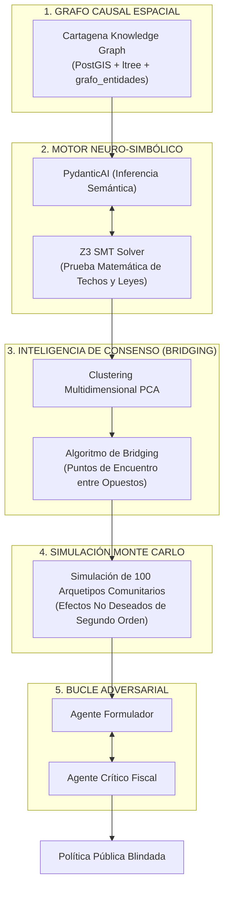

# Arquitectura de IA de Frontera: Sistema Neuro-Simbólico y Deliberativo de POLIS

*Documento Maestro de Arquitectura de Inteligencia Artificial para la Política Pública de Seguridad Humana Integral de Cartagena de Indias.*

POLIS implementa una arquitectura de inteligencia artificial de frontera que trasciende el RAG convencional y los chats probabilísticos. Combina la flexibilidad semántica de los Modelos de Lenguaje Avanzados (**PydanticAI v2.52**) con la rigurosidad matemática de los Demostradores de Teoremas (**Z3 SMT Solver de Microsoft Research**), la orquestación cíclica de estados (**LangGraph v1.2**), el razonamiento territorial causal (**Graph-RAG Espacial**) y los algoritmos de consenso cívico (**Bridging Ranking**).

---

## 🏛️ Filosofía de la IA Cívica y Constitucional

En una democracia constitucional, las decisiones públicas no pueden delegarse a una "caja negra" que alucina o improvisa cálculos presupuestales. 

Toda inferencia de la IA en POLIS cumple tres principios inquebrantables:
1. **Certeza Matemática Formal**: Ninguna propuesta con restricciones de gasto o competencias legales se da por viable sin una prueba formal ejecutada por un solver SMT.
2. **Soberanía Popular Asistida (Human-in-the-Loop Obligatorio)**: La IA nunca vota ni adopta decretos; asesora, estructura y predice impactos para empoderar a la comunidad y a los servidores públicos.
3. **Auditoría Criptográfica e Inmutabilidad**: Cada concepto, árbol MGA y respuesta motivada queda sellada con hash SHA-256 en la base de datos `bd_csh`.

---

## 🔬 Los 5 Pilares de la Arquitectura de Frontera

---

### Pilar 1: Verificación Formal Neuro-Simbólica (LLM + Z3 SMT Solver)

Los modelos de lenguaje son probabilísticos; los solvers SMT son deterministas y exactos.

1. **Flujo de Trabajo**:
   - El ciudadano o mesa introduce una propuesta de inversión (ej. *"Cámaras de vigilancia con IA y patrullaje fluvial en la Ciénaga de la Virgen por $1.200 millones de pesos"*).
   - **PydanticAI** extrae las variables del problema y las formaliza en restricciones lógicas y desigualdades:
     $$\text{Costo}_{\text{tecnología}} + \text{Costo}_{\text{operación}} \le \text{Techo}_{\text{FONSET}}$$
     $$\text{Competencia}(\text{Distrito}, \text{Ciénaga}) \land \text{Competencia}(\text{Dimar}, \text{Espejo\_Agua})$$
   - El **Z3 Solver** ejecuta la prueba de satisfactibilidad (`sat` o `unsat`):
     - Si es `sat`: Genera el modelo con los valores viables de cofinanciación (Distrito + FONSET + Dimar).
     - Si es `unsat`: Entrega la prueba formal del conflicto (ej. *"Excede el techo del FONSET para la vigencia 2026 en $400M o invade la jurisdicción exclusiva de DIMAR sobre aguas marítimas"*).
2. **Impacto**: Cero alucinaciones financieras o invasiones de competencia. La viabilidad técnica está demostrada matemáticamente.

---

### Pilar 2: Graph-RAG Espacial-Causal (Ontología Viva de Cartagena)

El RAG convencional busca fragmentos de texto en documentos planos. POLIS navega un **Grafo Causal Territorial** modelado en el esquema `grafo_entidades`:

* **Nodos**:
  * `Territorio` (Localidades, Corregimientos, Islas).
  * `Comunidad` (Consejos Comunitarios Afro, Cabildos Indígenas, Juntas de Acción Comunal).
  * `Problemática` (ESCNNA, microtráfico, sedimentación, informalidad, gentrificación).
  * `Norma` (Decreto 037/26, Ley 70/93, Ley 1448/11, Convenio 169 OIT).
  * `Fondo` (FONSET, SGP, SGR, Cooperación Internacional).
* **Aristas Semánticas**:
  * `(La Boquilla) -[TIENE_SALVAGUARDA]-> (Consulta Previa Ley 70/93)`
  * `(Centro Histórico) -[AFECTADO_POR]-> (Riesgo ESCNNA) -[PRIORIDAD_EN]-> (Decreto 037/26)`
  * `(Pasacaballos) -[LIMITA_CON]-> (Zona Industrial Mamonal) -[COMPETENCIA_AMBIENTAL]-> (EPA / Cardique)`

Cuando un agente evalúa un aporte, realiza una **travesía multi-salto** sobre el grafo. Si una propuesta toca suelo de consejo comunitario, la bandera de salvaguarda étnica se activa automáticamente antes de redactar cualquier línea.

---

### Pilar 3: Inteligencia Colectiva y Algoritmos de "Bridging" (vTaiwan Evolucionado)

Para superar la polarización y la tiranía del "like", POLIS incorpora la matemática de consenso inspirada en vTaiwan y Polis.io:

1. **Espacio Vectorial de Deliberación**:
   - Cada aporte y voto de los ciudadanos en las 33 Mesas 360° se proyecta en una matriz de opinión multidimensional.
   - Mediante **Análisis de Componentes Principales (PCA)** y algoritmos de reducción dimensional en `scikit-learn`, el sistema agrupa a la ciudadanía no por partidos políticos, sino por clústeres de afinidad de necesidades reales.
2. **Detección de Proposiciones Puente (*Bridging Statements*)**:
   - El sistema premia y visibiliza aquellas soluciones que obtienen un respaldo transversal entre clústeres con visiones divergentes (ej. pescadores artesanales y operadores turísticos).
3. **Síntesis Aumentada**:
   - PydanticAI toma las proposiciones puente y redacta **Propuestas de Consenso Sintético**, maximizando la legitimidad y la paz social territorial.

---

### Pilar 4: Simulación Monte Carlo Multi-Agente de Impacto Social

Antes de someter una línea estratégica a votación en el Concejo Distrital o a firma del Alcalde Mayor:

1. **Enjambre de 100 Arquetipos Sintéticos Basados en Evidencia**:
   - Se instancian 100 agentes concurrentes que representan perfiles reales del censo y encuestas de Cartagena:
     * *Arquetipo A*: Vendedora ambulante de playas de Bocagrande (madre soltera, estrato 1).
     * *Arquetipo B*: Pescador de Tierra Bomba afectado por erosión costera.
     * *Arquetipo C*: Joven bachiller desempleado en Nelson Mandela.
     * *Arquetipo D*: Empresario hotelero del Centro Histórico.
     * *Arquetipo E*: Líder comunal de la Veeduría de la Ciénaga de la Virgen.
2. **Simulación de Interacción Social**:
   - El enjambre debate la política propuesta en un entorno de simulación LangGraph.
   - El sistema genera un **Informe de Impacto de Segundo Orden**:
     * Detecta efectos no intencionados (ej. encarecimiento del suelo, gentrificación involuntaria o criminalización de la economía informal).
     * Recomienda salvaguardas paliativas antes de la implementación física.

---

### Pilar 5: Bucle Cerrado Adversarial Actor-Critic (*Reflexion Architecture*)

Ningún texto generado por un agente se expone directamente a los usuarios sin superar un filtro adversarial:

1. **Agente Formulador (Actor)**: Construye el borrador de política y la metodología de marco lógico (MGA).
2. **Agente Crítico Forense (Critic)**: Simula a un auditor combinado de la Contraloría, la Procuraduría y la Defensoría del Pueblo. Analiza la propuesta buscando:
   - Riesgos de sobrecostos o ambigüedades contractuales.
   - Violación de la regla de no-regresividad de derechos fundamentales.
   - Carencia de indicadores verificables en la cadena de valor DNP.
3. **Bucle de Auto-Reflexión**:
   - Si la solidez pericial es $< 95/100$, el Crítico devuelve el dictamen con retroalimentación estructurada.
   - El Formulador reescribe y afina la propuesta (hasta un máximo de 3 iteraciones).
   - Solo cuando ambos agentes firman el acuerdo, el proyecto se publica en la plataforma.

---

## 🛠️ Stack Tecnológico Activo en Servidor

El entorno de ejecución en `/root/polis/venv` cuenta con las siguientes dependencias verificadas:

| Biblioteca | Versión Instalada | Rol en la Arquitectura |
| :--- | :---: | :--- |
| **`pydantic-ai`** | `2.52` | Motor de inferencia tipada con modelos de retorno Pydantic v2 en español. |
| **`langgraph`** | `1.2` | Orquestación cíclica de grafos de estado y puntos Human-in-the-Loop. |
| **`z3-solver`** | `5.1.0` | Demostrador formal SMT para pruebas matemáticas de viabilidad legal y fiscal. |
| **`networkx`** | `3.7` | Operaciones sobre grafos de conocimiento territoriales y análisis causal. |
| **`scikit-learn`** | `1.9.1` | Algoritmos de clustering, PCA y detección de consenso (Bridging Ranking). |
| **`asyncpg` / `psycopg2`** | `0.30` / `2.9` | Conexión asíncrona de alta velocidad con PostgreSQL 18.6 y PostGIS 3.6 (`bd_csh`). |

---

## 🚦 Conclusión

Con esta arquitectura, **POLIS** no es un receptor pasivo de comentarios; es un **Laboratorio de Inteligencia Colectiva y Democracia Deliberativa de Clase Mundial**, blindado constitucionalmente, fundamentado en datos espaciales y formalmente verificado con matemáticas de precisión.
