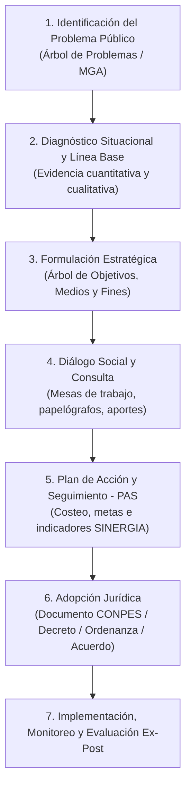

# Banco de Conocimiento: Formulación y Ciclo de Políticas Públicas en Colombia

Este documento constituye el **referente normativo, conceptual, metodológico y jurisprudencial** para el diseño, formulación, deliberación, adopción y evaluación de políticas públicas en Colombia. Sirve de base técnica e institucional para la plataforma **POLIS**.

---

## 1. Fundamentos Constitucionales (Constitución Política de 1991)

La Constitución de 1991 transformó el modelo de Estado colombiano de una democracia meramente representativa a una **democracia participativa y pluralista**.

| Artículo | Principio / Mandato Constitucional | Aplicación en Políticas Públicas |
| :--- | :--- | :--- |
| **Art. 1** | Colombia es un Estado social de derecho, democrático, **participativo y pluralista**. | La participación de la ciudadanía no es una concesión del gobernante, sino la base esencial de la soberanía popular. |
| **Art. 2** | Fin esencial del Estado: **facilitar la participación de todos en las decisiones que los afectan** y en la vida económica, política, administrativa y cultural de la Nación. | Toda política pública que regule, intervenga o transforme un sector debe prever espacios reales y efectivos de deliberación ciudadana. |
| **Art. 40** | Derecho fundamental a **participar en la conformación, ejercicio y control del poder político** (numeral 2: tomar parte en consultas populares y debates). | Respalda el derecho de la ciudadanía a emitir propuestas, observaciones y veedurías a las políticas de su territorio. |
| **Art. 103** | Mecanismos de participación ciudadana y deber del Estado de contribuir a la organización, promoción y capacitación de las asociaciones cívicas. | Las entidades públicas están obligadas a propiciar canales accesibles para que los ciudadanos deliberen colectivamente. |
| **Art. 270** | La ley organizará las formas y sistemas de participación ciudadana que permitan **vigilar la gestión pública** y sus resultados. | Fundamento del control social, la rendición de cuentas y el seguimiento a los planes de acción de las políticas. |
| **Arts. 339–342** | Régimen de Planeación: Plan Nacional de Desarrollo (PND), Planes Territoriales de Desarrollo (PDT) y **Consejo Nacional de Planeación (CNP) / Consejos Territoriales de Planeación (CTP)**. | Establece la articulación obligatoria de las políticas públicas con los instrumentos de planeación de corto, mediano y largo plazo. |

---

## 2. Marco Legal Colombiano (Leyes Orgánicas y Estatutarias)

### 2.1 Ley Estatutaria 1757 de 2015 (Estatuto de la Participación Ciudadana)
Es la norma cumbre en materia de participación ciudadana en la gestión pública.
* **Carácter vinculante de la deliberación**: Define la participación como un derecho fundamental y deber ciudadano (Art. 1).
* **Acuerdos participativos (Art. 90 a 93)**: Establece que las administraciones públicas pueden convocar ejercicios deliberativos para priorizar proyectos de inversión o definir lineamientos de política pública.
* **Control Social a la Gestión Pública (Art. 60 y ss.)**: Obliga a que los diagnósticos y las metas de las políticas sean públicos y auditables por veedurías ciudadanas y colectivos sociales.
* **Presupuestos participativos**: Promueve que un porcentaje del presupuesto de inversión sea discutido y concertado con las comunidades.

### 2.2 Ley Orgánica 152 de 1994 (Ley Orgánica del Plan de Desarrollo)
Rige el Sistema Nacional de Planeación en los niveles nacional, departamental, distrital y municipal.
* **Principio de Participación (Art. 3, literal g)**: Durante el proceso de discusión de los planes y políticas se garantizará la intervención de los sectores económicos, sociales, ecológicos, comunitarios y culturales.
* **Instancias de concertación**:
  - **Consejo Nacional de Planeación (CNP)** en el nivel central.
  - **Consejos Territoriales de Planeación (CTP)** en municipios y departamentos.
* **Ciclo de planeación**: Formulación técnica $\rightarrow$ Concepto del CTP $\rightarrow$ Aprobación por Corporación Pública (Congreso, Asamblea, Concejo) $\rightarrow$ Ejecución $\rightarrow$ Evaluación y Rendición de Cuentas.

### 2.3 Ley 489 de 1998 (Estatuto de la Administración Pública)
* **Capítulo VIII - Democratización de la Administración Pública**:
  - **Art. 32**: Las entidades públicas deben convocar obligatoriamente a la ciudadanía a discusiones sobre la formulación y ejecución de políticas públicas prioritarias.
  - **Art. 33**: Audiencias públicas y mesas de trabajo participativas para deliberar sobre las decisiones que impactan el interés general.

### 2.4 Ley 1712 de 2014 (Ley de Transparencia y Acceso a la Información Pública)
* **Principio de Máxima Publicidad**: Toda la información técnica, financiera, diagnósticos y actas de las mesas de política pública son de acceso público, salvo reserva constitucional expresa.
* Obliga a la publicación activa en formatos abiertos, reutilizables y en lenguaje claro para la ciudadanía.

### 2.5 Ley 2056 de 2020 (Régimen del Sistema General de Regalías - SGR)
* Establece las **Mesas de Participación Ciudadana** obligatorias para la priorización de proyectos financiados con regalías en el marco de las líneas estratégicas de los planes de desarrollo.

---

## 3. Marco Reglamentario y Metodológico (DNP, CONPES y MIPG)

### 3.1 El Sistema CONPES (Consejo Nacional de Política Económica y Social)
* Es la máxima autoridad nacional de planeación económica y social en Colombia, presidido por el Presidente de la República y coordinado por el **DNP (Departamento Nacional de Planeación)**.
* **Estructura canónica de un Documento CONPES**:
  1. **Introducción y Justificación**: Antecedentes y mandato legal.
  2. **Diagnóstico y Delimitación del Problema**: Análisis de causas estructurales y efectos sobre la población diana.
  3. **Marco Conceptual y Principios Orientadores**: Enfoques transversales (derechos, género, diferencial, territorial).
  4. **Plan de Acción y Seguimiento (PAS)**: Matriz de compromisos institucionales (Entidad responsable, línea de acción, meta cuantificable, vigencia presupuestal).
  5. **Financiamiento**: Fuentes presupuestales (Presupuesto General de la Nación - PGN, SGR, cooperación).

### 3.2 Metodología de Marco Lógico (MGA del DNP)
La Metodología General Ajustada (MGA) y la Guía para la Formulación de Políticas del DNP fundamentan la arquitectura lógica:

1. **Árbol de Problemas**:
   - **Problema Central**: Condición negativa que afecta a una población o sector.
   - **Causas Directas e Indirectas** (Raíces): Factores determinantes que originan el problema.
   - **Efectos Directos e Indirectos** (Ramas/Hojas): Consecuencias del problema sobre el bienestar o el desarrollo territorial.
2. **Árbol de Objetivos / Soluciones (Conversión positiva)**:
   - *Problema Central* $\longrightarrow$ **Objetivo Central** de la política.
   - *Causas* $\longrightarrow$ **Medios** (Líneas estratégicas, programas y proyectos).
   - *Efectos* $\longrightarrow$ **Fines** (Impacto esperado a mediano y largo plazo).

### 3.3 Modelo Integrado de Planeación y Gestión (MIPG) — Decreto 1499 de 2017
* Regula la gestión de las entidades públicas en Colombia.
* **Política de Participación Ciudadana en la Gestión Pública (Dimensión 5: Información y Comunicación)**:
  - Fases del ciclo: Diagnóstico participativo $\rightarrow$ Formulación participativa $\rightarrow$ Ejecución participativa $\rightarrow$ Seguimiento y evaluación participativa $\rightarrow$ Control social.

---

## 4. Jurisprudencia Fundamental de la Corte Constitucional

La Corte Constitucional colombiana ha emitido sentencias hito que delimitan la validez jurídica de cualquier política pública:

### 4.1 Sentencia C-150 de 2015 (Revisión de la Ley Estatutaria 1757 de 2015)
* **La participación como principio axial**: La Corte ratificó que la participación no es un requisito formal ni un trámite decorativo para legitimar decisiones preadoptadas por tecnócratas.
* **Requisito de Incidencia**: La ciudadanía debe contar con información comprensible antes de la deliberación y sus aportes deben ser valorados formalmente (deber de respuesta y retroalimentación de la administración pública).

### 4.2 Línea Jurisprudencial sobre Consulta Previa (Convenio 169 de la OIT)
* **Sentencias C-030 de 2008, C-175 de 2009, C-366 de 2011, SU-123 de 2018 y SU-095 de 2018**:
  - Toda política pública que afecte de manera directa a pueblos indígenas, afrocolombianos, negros, palenqueros, raizales o Rom **debe surtir el proceso de Consulta Previa libre e informada**.
  - Si una política de alcance general incluye líneas de acción con afectación directa diferencial sobre sus territorios o cultura, esas líneas deben concertarse con las autoridades tradicionales.

### 4.3 Sentencias de Estado de Cosas Inconstitucional (ECI) y Políticas Públicas Estructurales
La Corte ha intervenido directamente en el rediseño de políticas públicas cuando ha verificado vulneraciones masivas y sistemáticas de derechos:

| Sentencia | Sector / Problemática | Exigencia Jurisprudencial a la Política Pública |
| :--- | :--- | :--- |
| **Sentencia T-025 de 2004** | Desplazamiento forzado interno | Fijó estándares de **esfuerzo presupuestal suficiente**, metas temporales precisas e indicadores de goce efectivo de derechos (GED). |
| **Sentencia T-760 de 2008** | Sistema de Salud | Ordenó la unificación de los planes de beneficios y la reformulación participativa de la política farmacéutica y de salud pública. |
| **Sentencia T-302 de 2017** | Niñez Wayúu (Guajira) | Exigió la construcción de una política estructural de agua, salud y alimentación con diálogo genuino, enfoque intercultural y metas auditables. |
| **Sentencia C-038 de 2018** | Régimen sancionatorio y movilidad | Proporcionalidad y debido proceso en las medidas punitivas de políticas públicas sectoriales. |

---

## 5. Instrumentos Jurídicos de Adopción de Políticas Públicas

Según el nivel administrativo, una política pública en Colombia se adopta mediante diferentes actos administrativos:

1. **Nivel Nacional**:
   - **Documento CONPES**: Lineamiento intersectorial de política nacional.
   - **Decreto Presidencial**: Adopta planes de acción, reglamenta la política y crea comisiones intersectoriales.
   - **Resolución Ministerial**: Lineamientos operativos y manuales técnicos sectoriales.
2. **Nivel Departamental**:
   - **Ordenanza Departamental**: Aprobada por la Asamblea Departamental; da rango de norma territorial de mediano/largo plazo (ej. Política Pública de Juventud, de Equidad de Género).
   - **Decreto Departamental**: Expedido por el Gobernador para su reglamentación.
3. **Nivel Municipal / Distrital (Bogotá, Medellín, Cali, etc.)**:
   - **Acuerdo Municipal / Distrital**: Aprobado por el Concejo Municipal/Distrital. Da estabilidad jurídica plurianual a la política más allá del período de 4 años del alcalde.
   - **Decreto Alcaldicio**: Adopción y reglamentación del Plan de Acción Institucional.

---

## 6. Correspondencia con la Arquitectura de POLIS

| Concepto Normativo Colombiano | Implementación Técnica en POLIS |
| :--- | :--- |
| **Política Pública Territorial / Nacional** | Entidad raíz `PoliticaPublica` ([domain.ts](file:///root/preview_project/src/types/domain.ts)), con sector, coberturas y vigencia temporal. |
| **Fases del Ciclo de Planeación** | Entidad `Fase` (Diagnóstico, Formulación, Deliberación, Validación, Implementación, Seguimiento). |
| **Medios / Ejes Estratégicos** | Entidad `LineaEstrategica` (Código LE-01, título, descripción y vinculación con la fase). |
| **Diálogo Social y Aportes Ciudadanos** | Entidad `Aporte` (propuestas, anotaciones, preguntas; con fotos y trazabilidad de identidad o anonimato garantizado). |
| **Mesas Participativas (Ley 1757 / SGR)** | Módulo `MesaDeTrabajo` ([mesas.ts](file:///root/preview_project/src/types/mesas.ts)), con facilitador, entidad convocante, lugar y acuerdos de plenaria. |
| **Marco Lógico DNP (MGA)** | Módulo `Papelografo` con editor reactivo de **Árbol de Problemas** (causas/efectos) y derivación automática a **Árbol de Soluciones** (medios/fines). |
| **Principio de Incidencia y Zero-Modals** | Navegación deslizante apilada (`PanelHost`) que permite al ciudadano profundizar desde el contexto macro hasta la propuesta puntual sin perder la visión sistémica. |
