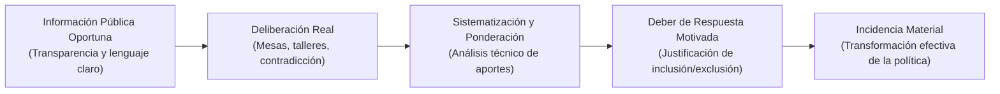

# Módulo 2: Línea Jurisprudencial de la Corte Constitucional sobre Políticas Públicas

---

## 1. Introducción y Relevancia Constitucional

La Corte Constitucional de Colombia ha sido pionera a nivel global en el **control judicial de las políticas públicas**. La Corte ha establecido que, si bien el diseño de políticas públicas corresponde prioritariamente a la rama ejecutiva en el marco de sus competencias discrecionales de gobierno, dicha discrecionalidad está estrictamente acotada por:
1. El **respeto por los derechos fundamentales** y la dignidad humana.
2. El **principio de progresividad y prohibición de no regresividad** en derechos económicos, sociales, culturales y ambientales (DESCA).
3. El **derecho fundamental a la participación ciudadana cualificada e incidente**.
4. El **principio de racionalidad mínima y consistencia presupuestal**.

---

## 2. El Principio de Democracia Participativa y el Test de Incidencia

### 2.1 Sentencia C-089 de 1994 (M.P. Eduardo Cifuentes Muñoz)
* **Tesis**: La democracia participativa tiene un **carácter expansivo y universal**.
* **Doctrina**: No se limita al acto electoral ni a los mecanismos tradicionales de votación. Debe permear todos los ámbitos de la vida comunitaria y administrativa. La Corte acuñó que la participación ciudadana es *"un principio y un fin del Estado que debe proyectarse en el diseño, ejecución y evaluación de las políticas públicas"*.

### 2.2 Sentencia C-150 de 2015 (M.P. Mauricio González Escobar)
Es la sentencia estructural más importante de la historia jurídica colombiana sobre participación ciudadana (revisión de constitucionalidad del Proyecto de Ley Estatutaria 1757 de 2015).

* **El Estándar de la "Participación Incidente"**:
  - La Corte prohíbe categóricamente los ejercicios de **"participación de fachada" o "participación cosmética"**, entendidos como aquellos talleres o encuestas donde se convoca a la gente para llenar una lista de asistencia o validar decisiones prefabricadas por la burocracia sin capacidad de alterar el contenido sustancial de la política.
  - La participación debe ser **previa, informada, libre y dotada de eficacia causal (incidencia)** en la decisión final.
* **El Deber de Respuesta Motivada (Retroalimentación Obligatoria)**:
  - Las entidades públicas tienen la obligación de sistematizar todos los aportes ciudadanos recibidos en las consultas.
  - Si una propuesta ciudadana es técnicamente viable y coherente con el marco constitucional, debe ser considerada; si es rechazada por razones presupuestales, jurídicas o técnicas, la administración tiene el deber de emitir un informe público motivado explicando por qué no fue incorporada.
* **Acceso Previo a la Información**:
  - No puede haber deliberación válida si la comunidad no cuenta con los diagnósticos, líneas base y estudios previos en un lenguaje claro, accesible y con suficiente anticipación.

---

## 3. Línea Jurisprudencial sobre Consulta Previa y Consentimiento Libre, Previo e Informado (CLPI)

La Corte Constitucional ha desarrollado una línea uniforme y vinculante respecto al **Convenio 169 de la OIT** (integrado al Bloque de Constitucionalidad por el Art. 93 CP):

### 3.1 El Criterio de "Afectación Directa" (Sentencias C-030 de 2008, C-175 de 2009 y C-366 de 2011)
* **¿Cuándo es obligatoria la Consulta Previa en una política pública?**:
  - No todas las políticas generales del Estado requieren consulta previa generalizada.
  - La consulta previa es obligatoria siempre que la política pública contenga medidas que generen una **afectación directa, diferenciada y específica** sobre los pueblos indígenas, comunidades afrodescendientes, negras, raizales, palenqueras o el pueblo Rrom.
* **Vicio de inconstitucionalidad**:
  - La omisión de la consulta previa en las líneas estratégicas que afectan a comunidades étnicas constituye un vicio insubsanable que acarrea la nulidad judicial de los decretos o resoluciones que adopten la política pública (Sentencia C-366 de 2011, declaratoria de inexequibilidad de la Ley Forestal).

### 3.2 Sentencias de Unificación SU-123 de 2018 y SU-095 de 2018
* **Reglas para la Consulta Previa**:
  1. **Buena fe**: Debe ser un proceso de diálogo intercultural genuino, sin coacciones ni imposiciones.
  2. **Momento oportuno**: La consulta debe realizarse antes de que se adopte la política o se consolide la decisión técnica.
  3. **Consentimiento Previo, Libre e Informado (CLPI)**: Es obligatorio y reforzado en casos de traslado o reubicación de comunidades, almacenamiento de residuos tóxicos o proyectos que amenacen la subsistencia física y cultural del pueblo étnico.

---

## 4. Estado de Cosas Inconstitucional (ECI) y Criterios de Validez de las Políticas Públicas

Cuando el Estado vulnera de forma masiva, sistemática y generalizada los derechos de una población, la Corte declara el **Estado de Cosas Inconstitucional (ECI)** y asume un rol de control estricto sobre las políticas públicas:

### 4.1 Sentencia T-025 de 2004 (M.P. Manuel José Cepeda Espinosa) — Desplazamiento Forzado
Es el precedente rector sobre los requisitos mínimos de racionalidad constitucional que debe cumplir toda política pública en Colombia:

| Requisito Constitucional | Definición y Criterio de Evaluación de la Corte |
| :--- | :--- |
| **Diagnóstico Riguroso y Verificable** | La política no puede sustentarse en suposiciones burocráticas; debe basarse en un censo, línea base empírica y caracterización demográfica fidedigna. |
| **Coherencia entre Medios y Fines** | Las líneas estratégicas y los programas deben ser técnicamente idóneos para resolver las causas estructurales identificadas en el diagnóstico. |
| **Esfuerzo Presupuestal Suficiente** | Prohibición de formular políticas "de papel". Toda política debe contar con fuentes financieras reales en el Marco Fiscal de Mediano Plazo. El Estado no puede alegar escasez de recursos si no demuestra haber hecho el máximo esfuerzo presupuestal disponible. |
| **Metas Cuantificables y Cronogramas** | La política debe definir metas temporales explícitas a corto, mediano y largo plazo. No se admiten enunciados puramente aspiracionales. |
| **Indicadores de Goce Efectivo de Derechos (GED)** | La evaluación no se mide por la cantidad de dinero gastado o de reuniones realizadas (indicadores de gestión/insumo), sino por el impacto real en la garantía efectiva del derecho de las personas (indicadores de resultado e impacto). |
| **Monitoreo y Rendición de Cuentas Periódica** | Obligatoriedad de mesas técnicas de seguimiento con participación de las víctimas, la academia y la Procuraduría/Defensoría del Pueblo. |

### 4.2 Sentencia T-760 de 2008 (M.P. Manuel José Cepeda Espinosa) — Sistema de Salud
* Ordenó la reestructuración integral de la política pública de salud en Colombia.
* Fijo el principio de **sostenibilidad financiera ligada a la progresividad del derecho**: la política de salud no puede recortar beneficios adquiridos por los usuarios a menos que exista una justificación imperiosa y exhaustivamente motivada.
* Exigió la formulación de una política farmacéutica nacional transparente y la unificación de los planes de salud contributivo y subsidiado con participación de los actores médicos y ciudadanos.

### 4.3 Sentencia T-302 de 2017 (M.P. Aquiles Arrieta Gómez) — Niñez Wayúu en La Guajira
* Declaratoria de ECI por la desnutrición y muerte evitable de niños y niñas Wayúu en Riohacha, Manaure, Maicao y Uribia.
* **Exigencia metodológica a la política pública**:
  - Ordenó construir un **Plan de Acción Integral** concertado con las autoridades tradicionales de los clanes Wayúu.
  - Fijó la obligación de incorporar un **enfoque diferencial e intercultural**: la provisión de agua, alimentación y salud debe respetar los usos, costumbres y la cosmovisión indígena.
  - Prohibió la imposición de soluciones tecnocráticas verticales diseñadas desde Bogotá sin validación en las rancherías.

---

## 5. Principio de Progresividad y Prohibición de Regresividad (DESCA)

La Corte ha reiterado de forma pacífica (Sentencias C-038 de 2004, C-503 de 2014, C-046 de 2018) que en materia de políticas públicas que desarrollan Derechos Económicos, Sociales, Culturales y Ambientales (educación, salud, vivienda digna, trabajo, agua potable):

1. **Obligación de Progresividad**: El Estado tiene el deber constante de ampliar la cobertura, la calidad y el acceso a los bienes sociales protegidos.
2. **Presunción de Inconstitucionalidad de Medidas Regresivas**: Si una nueva política pública disminuye el nivel de protección de derechos alcanzado por una política anterior (por ejemplo, recorta subsidios a población vulnerable o reduce metas de saneamiento básico), la medida se presume inconstitucional.
3. **Carga Estricta de la Justificación**: Para superar el juicio de constitucionalidad, el Gobierno debe demostrar:
   - Que la medida regresiva es estrictamente necesaria y obedece a razones de fuerza mayor o crisis fiscal extrema no atribuible a negligencia.
   - Que se evaluaron todas las alternativas posibles antes de optar por la medida regresiva.
   - Que no se vulnera el **núcleo esencial del derecho** de los sectores más vulnerables de la población.
