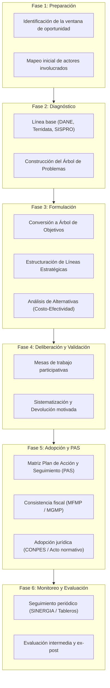
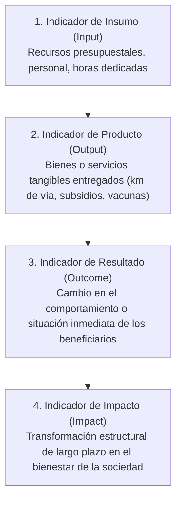

# Módulo 3: Metodología DNP, Sistema CONPES y Marco Lógico (MGA)

---

## 1. El Ciclo de Vida Metodológico de la Política Pública (DNP)

El Departamento Nacional de Planeación (DNP) define la política pública como un **conjunto de decisiones, instrumentos, acciones y recursos articulados por el Estado**, con participación de la sociedad, para prevenir, mitigar o resolver una situación socialmente diagnosticada como un **problema público**.

---

## 2. Fase 2: Diagnóstico y el Árbol de Problemas

Un problema se convierte en **problema público** cuando trasciende la esfera privada individual, adquiere relevancia colectiva y se reconoce la responsabilidad del Estado en su atención y solución.

### 2.1 Fuentes Oficiales de Información para la Línea Base
* **DANE (Departamento Administrativo Nacional de Estadística)**: Censo Nacional de Población y Vivienda, Gran Encuesta Integrada de Hogares (GEIH), Índice de Pobreza Multidimensional (IPM), Índice de Necesidades Básicas Insatisfechas (NBI).
* **Terridata (DNP)**: Sistema de estadísticas territoriales a nivel municipal y departamental (demografía, educación, salud, finanzas públicas, seguridad).
* **SISBEN (Sistema de Identificación de Potenciales Beneficiarios)**: Focalización sociodemográfica y socioeconómica por grupos (A: pobreza extrema, B: pobreza moderada, C: vulnerabilidad, D: no pobre/no vulnerable).
* **SUIFP (Sistema Unificado de Inversiones y Finanzas Públicas)**: Registro de bancos de proyectos de inversión nacional.

### 2.2 Metodología del Árbol de Problemas
El Árbol de Problemas es la herramienta analítica de la Metodología de Marco Lógico que descompone una situación negativa en sus componentes causales y sus manifestaciones lesivas:

1. **Problema Central (El Tronco)**:
   - Debe redactarse como una **situación negativa real y focalizada**, no como la ausencia de una solución predeterminada.
   - *Ejemplo incorrecto*: "Falta una app móvil de movilidad" (eso es una solución).
   - *Ejemplo correcto*: "Elevados índices de siniestralidad y demoras operativas en el corredor de transporte intermodal".
2. **Causas Directas (Primer nivel de raíces)**:
   - Fenómenos inmediatamente responsables de la existencia del problema central.
3. **Causas Indirectas (Segundo y tercer nivel de raíces)**:
   - Factores estructurales, económicos, culturales o institucionales que originan las causas directas.
4. **Efectos Directos (Primer nivel de ramas)**:
   - Consecuencias directas que el problema central produce sobre la población afectada.
5. **Efectos Indirectos (Ramas superiores y hojas)**:
   - Pérdida de productividad, deterioro de la calidad de vida, vulneración de derechos fundamentales, estancamiento del desarrollo territorial.

---

## 3. Fase 3: Formulación Estratégica y el Árbol de Soluciones

El Árbol de Objetivos o Soluciones representa la **situación futura deseada** una vez resuelto el problema central. Se construye mediante una estricta correspondencia lógica positiva con el Árbol de Problemas:

| Componente en el Árbol de Problemas | $\longrightarrow$ | Componente en el Árbol de Soluciones / Objetivos |
| :--- | :---: | :--- |
| **Problema Central** | $\longrightarrow$ | **Objetivo Central / Propósito General** de la política |
| **Causas Directas** | $\longrightarrow$ | **Medios de Primer Nivel / Ejes Estratégicos** |
| **Causas Indirectas** | $\longrightarrow$ | **Medios Fundamentales / Líneas de Acción y Proyectos** |
| **Efectos Directos** | $\longrightarrow$ | **Fines Directos / Resultados Esperados a Mediano Plazo** |
| **Efectos Indirectos** | $\longrightarrow$ | **Fines Últimos / Impacto y Goce Efectivo de Derechos** |

### 3.1 Criterios de Selección y Evaluación de Alternativas
No todos los medios son viables técnica o financieramente. El equipo formulador aplica:
* **Análisis Costo-Beneficio (ACB)**: Expresión monetaria de costos y beneficios sociales cuando los resultados son cuantificables en dinero.
* **Análisis Costo-Efectividad (ACE)**: Se utiliza cuando el resultado social no es fácilmente monetizable (ej. reducción de mortalidad infantil, incremento de años de escolaridad); compara el costo unitario por cada unidad de resultado obtenida.
* **Evaluación Multicriterio**: Pondera factibilidad legal, viabilidad política, impacto ambiental y aceptabilidad social comunitaria.

---

## 4. Fase 5: El Plan de Acción y Seguimiento (PAS) de CONPES

El **Plan de Acción y Seguimiento (PAS)** es el corazón operativo y vinculante de una política pública formal en Colombia. Es una matriz exhaustiva que compromete a las entidades del Estado con responsabilidades concretas y presupuesto:

### 4.1 Campos Estándar de la Matriz PAS (DNP)
1. **Línea Estratégica / Objetivo Específico**: Agrupación programática.
2. **Acción / Actividad Concreta**: Mandato de gestión (verbo rector medible).
3. **Entidad Líder Responsable**: Ministerio, Departamento Administrativo o Secretaría cabeza de sector.
4. **Entidades Co-responsables / Acompañantes**: Instituciones públicas vinculadas a la ejecución.
5. **Indicador de Producto**: Fórmula matemática de medición, unidad de medida (porcentaje, número absoluto, tasa) y periodicidad de reporte.
6. **Línea Base del Indicador**: Valor numérico cuantificado al momento de inicio de la política.
7. **Metas Anualizadas**: Desglose cuantitativo por año (Año 1, Año 2 ... Año N).
8. **Costeo y Fuentes de Financiación**:
   - Presupuesto General de la Nación (PGN): Funcionamiento e Inversión.
   - Sistema General de Regalías (SGR).
   - Recursos Propios Territoriales (ICLD).
   - Cooperación Internacional y Crédito Externo.

### 4.2 Consistencia Fiscal Obligatoria
De conformidad con la **Ley 819 de 2003 (Ley de Responsabilidad Fiscal)**:
* Toda política pública con impacto fiscal debe contar con el aval del **Ministerio de Hacienda y Crédito Público** (a nivel nacional) o de la **Secretaría de Hacienda** (a nivel territorial).
* El costo total anualizado debe ser consistente con las metas de déficit y endeudamiento fijadas en el **Marco Fiscal de Mediano Plazo (MFMP)** a 10 años y el **Marco de Gasto de Mediano Plazo (MGMP)** a 4 años.

---

## 5. Fase 6: Sistema de Monitoreo y Evaluación (SINERGIA del DNP)

El DNP administra **SINERGIA (Sistema de Información para el Seguimiento a las Metas del Gobierno Nacional)**, plataforma oficial de rendición de cuentas e indicadores del Estado colombiano.

### 5.1 Jerarquía Estándar de Indicadores

* **Insumo (Input)**: Recursos financieros, humanos o materiales utilizados (ej. \$12.000 millones de pesos invertidos).
* **Producto (Output)**: Bien o servicio público directamente entregado a la ciudadanía (ej. 3.500 mujeres capacitadas en habilidades digitales).
* **Resultado (Outcome)**: Efecto intermedio observable en la población objetivo a corto o mediano plazo (ej. Tasa de inserción laboral formal de las mujeres capacitadas incrementada en un 28%).
* **Impacto (Impact)**: Efecto estructural de largo plazo atribuible a la política pública (ej. Reducción de la brecha de ingresos salariales por género en el territorio).

### 5.2 Tipologías Oficiales de Evaluación (Dirección de Seguimiento y Evaluación de Políticas Públicas - DSEPP del DNP)
1. **Evaluación de Procesos / Operaciones**: Analiza si la política se está ejecutando conforme a los manuales, tiempos y costos programados, detectando cuellos de botella administrativos.
2. **Evaluación Institucional**: Valora la capacidad de coordinación interinstitucional y la gobernanza entre las entidades involucradas.
3. **Evaluación de Impacto**: Emplea metodologías estadísticas econométricas rigurosas con **grupo de tratamiento y grupo de control** para determinar si los cambios observados en la población son causalmente atribuibles a la política pública y no a variables externas:
   - *Diferencias en Diferencias (DiD)*.
   - *Regresión Discontinua (RDD)*.
   - *Propensity Score Matching (PSM)*.
   - *Variables Instrumentales (IV)*.

---

## 6. De la Política Pública al Proyecto de Inversión Pública (MGA Web del DNP)

Las líneas estratégicas y compromisos de una política pública o plan de desarrollo se operativizan en el Estado colombiano a través de **Proyectos de Inversión Pública** formulados bajo la **Metodología General Ajustada (MGA Web)** y registrados en el **Banco de Programas y Proyectos de Inversión (BPIM / BPIN)**.

Para la doctrina técnica completa, consulte el documento especializado:
👉 **[Módulo 12: Estructuración y Formulación de Proyectos de Inversión Pública en Colombia (MGA Web del DNP)](file:///root/polis/knowledge-base/12_ESTRUCTURACION_PROYECTOS_INVERSION_PUBLICA_MGA_DNP.md)**.

### 6.1 Síntesis de los Cuatro (4) Módulos MGA Web
1. **Módulo 1 - Identificación**: Articulación con PND/PDD, Árbol de Problemas, Análisis de Participantes, Población Afectada vs. Objetivo, Árbol de Objetivos y Alternativas.
2. **Módulo 2 - Preparación**: Estudio de Necesidades (Déficit de Atención), localización territorial, análisis de riesgos y estructuración de la **Cadena de Valor Pública (Insumos $\rightarrow$ Actividades $\rightarrow$ Productos del Catálogo DNP $\rightarrow$ Resultados $\rightarrow$ Impactos)**.
3. **Módulo 3 - Evaluación Ex-Ante**: Flujo de caja a precios cuenta con la **Tasa Social de Descuento (TSD = 12% anual)** del DNP, cálculo de **VPNE, TIRS, Relación Beneficio-Costo (RBC)** y **Costo Anual Equivalente / Análisis Costo-Efectividad (CAE/ACE)** para proyectos sociales y de Seguridad Humana.
4. **Módulo 4 - Programación**: Indicadores bajo filtro CREMA, asignación de fuentes presupuestales plurianuales (ICLD, SGP, SGR, Crédito) y **Matriz de Marco Lógico (MML de 4x4)**.

### 6.2 Ciclo de Viabilidad Institucional
El proyecto formulado transita desde la MGA Web hacia la Secretaría de Planeación para la emisión de la **Ficha EBI (Concepto de Viabilidad en el BPIM)**, su inclusión obligatoria en el **Plan Operativo Anual de Inversiones (POAI)** y su desagregación en las metas trimestrales de la Hoja 1 del **Plan de Acción Institucional**.
