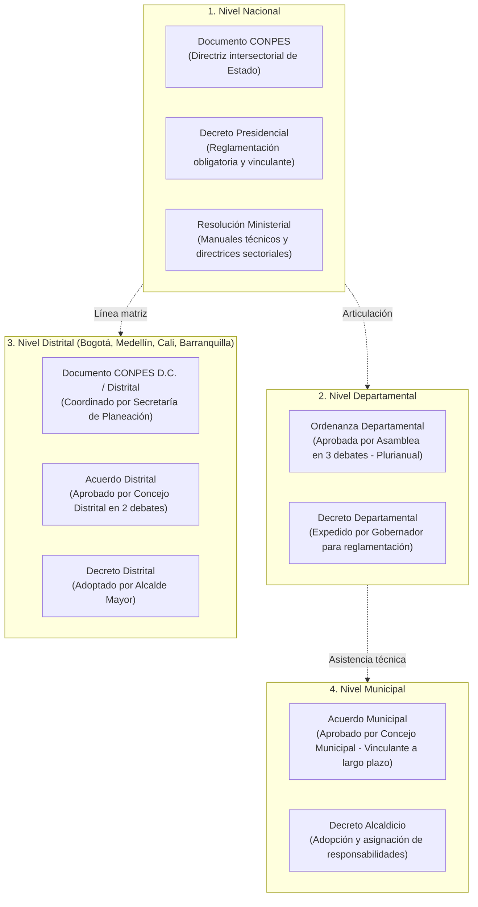

# Módulo 4: Niveles Territoriales y Actos Administrativos de Adopción

---

## 1. El Principio de Autonomía Territorial y Competencias en Colombia

El Artículo 1 de la Constitución Política consagra que Colombia es una República unitaria pero **descentralizada y con autonomía de sus entidades territoriales**. En materia de políticas públicas, rigen los principios de la **Ley Orgánica 1454 de 2011 (LOOT)** y la **Ley 489 de 1998**:
* **Coordinación**: La Nación y las entidades territoriales deben articular sus políticas sectoriales para evitar duplicidad de esfuerzos.
* **Concurrencia**: Dos o más niveles de gobierno pueden concurrir financieramente en la ejecución de una misma política pública.
* **Subsidiariedad**: El nivel superior (Nación o Departamento) apoyará al nivel municipal cuando este carezca de capacidad técnica o fiscal para resolver el problema público.
* **Complementariedad**: Colaboración mutua para la prestación eficiente de servicios.

---

## 2. Tipologías y Jerarquía de Actos Administrativos según Nivel de Gobierno

---

## 3. Nivel Nacional: El Sistema CONPES

* **Naturaleza**: El Consejo Nacional de Política Económica y Social (CONPES) es el organismo asesor del Gobierno Nacional en todos los aspectos relacionados con el desarrollo económico y social del país.
* **Composición**: Presidido por el Presidente de la República, Ministros de Despacho, Directores de Departamentos Administrativos (DNP, DANE, DAFP) y el Director del DNP, quien ejerce la Secretaría Técnica.
* **Efectos Jurídicos del Documento CONPES**:
  - Aunque un Documento CONPES es formalmente un acto administrativo complejo de planeación (declaración de política de gobierno), adquiere **fuerza vinculante interinstitucional** a través de:
    1. La inclusión de sus proyectos en el Plan Nacional de Desarrollo y en las Leyes Anuales de Presupuesto.
    2. La expedición de **Decretos Reglamentarios Presidenciales** que instrumentalizan los mandatos y cronogramas del Plan de Acción y Seguimiento (PAS).
    3. Documentos de **Declaratoria de Importancia Estratégica Nacional**: Permiten comprometer vigencias futuras ordinarias o excepcionales por más de 10 años (Art. 12 Ley 819 de 2003).

---

## 4. Nivel Distrital: El Caso Emblemático de Bogotá D.C. (CONPES D.C.)

Bogotá D.C. cuenta con el sistema distrital de políticas públicas más robusto y reglamentado de América Latina:

### 4.1 Marco Regulatorio Distrital
* **Estatuto Orgánico de Bogotá (Decreto Ley 1421 de 1993)**: Otorga atribuciones especiales al Alcalde Mayor y al Concejo Distrital en materia de planeación socioeconómica y territorial.
* **Decreto Distrital 438 de 2019 y Decreto Distrital 668 de 2022**:
  - Crean y reglamentan el **Sistema Distrital de Políticas Públicas (SDPP)**.
  - Crean el **Consejo de Política Económica y Social del Distrito Capital (CONPES D.C.)**, máxima instancia de coordinación de políticas públicas distritales.
  - La **Secretaría Distrital de Planeación (SDP)**, a través de su Dirección de Políticas Públicas, emite los conceptos de viabilidad técnica y metodológica.

### 4.2 Fases del Ciclo de Políticas Públicas en Bogotá D.C.
1. **Fase Preparatoria**: Documento de solicitud de inicio, justificación de pertinencia y conformación del equipo técnico líder interinstitucional.
2. **Fase de Diagnóstico**:
   - Identificación del problema público y factores explicativos.
   - Participación y consulta ciudadana obligatoria en las 20 localidades del Distrito.
   - Formulación del Árbol de Problemas y delimitación de la población objetivo.
3. **Fase de Formulación**:
   - Construcción del Árbol de Objetivos y alternativas.
   - Definición del Plan de Acción con entidades cabeza de sector y entidades descentralizadas.
   - Estimación de costos y concepto previo favorable de la Secretaría Distrital de Hacienda (SDH).
4. **Fase de Adopción**:
   - Aprobación formal por el Consejo de Gobierno / CONPES D.C.
   - Expedición del **Decreto Distrital** firmado por el/la Alcalde(sa) Mayor y los Secretarios de Despacho del sector.
   - Alternativamente, si se requiere crear tributos, exenciones o modificar estructuras orgánicas, se radica como Proyecto de **Acuerdo en el Concejo de Bogotá**.
5. **Fase de Implementación, Seguimiento y Evaluación**:
   - Seguimiento semestral en el Sistema de Seguimiento a Políticas Públicas de la SDP.
   - Evaluación intermedia a los 4 años y evaluación final de impacto ex-post a los 10 o 12 años.

---

## 5. Nivel Departamental y Municipal

### 5.1 La Ordenanza Departamental (Nivel Intermedio)
* Las políticas públicas departamentales (ej. Política Pública de Envejecimiento y Vejez, Política de Juventud Departamental, Política de Ciencia y Tecnología) son radicadas por el Gobernador ante la **Asamblea Departamental**.
* **El Trámite de la Ordenanza**:
  - Surte **tres debates obligatorios** en días distintos: primer debate en Comisión Permanente de Plan de Desarrollo, segundo debate y tercer debate en Sesión Plenaria.
  - Una vez sancionada por el Gobernador y publicada en la Gaceta Departamental, adquiere **rango de norma obligatoria** para todo el territorio del departamento.
  - **Ventaja de estabilidad**: Ningún gobernador entrante puede suprimir la política por simple capricho de gobierno; cualquier modificación de fondo requiere una nueva ordenanza aprobada por la Asamblea.

### 5.2 El Acuerdo Municipal / Distrital (Nivel Local)
* En los municipios de categorías 1ª, 2ª, 3ª, 4ª, 5ª, 6ª y Especiales, las políticas de largo plazo son tramitadas ante el **Concejo Municipal**.
* **El Trámite del Acuerdo**:
  - Surte **dos debates obligatorios**: primer debate en Comisión de Plan o Hacienda, y segundo debate en Plenaria del Concejo.
  - Requiere obligatoriamente concepto de impacto fiscal emitido por el Secretario de Hacienda Municipal.
  - Sancionado por el Alcalde Municipal, se convierte en Acuerdo Municipal vinculante para todas las secretarías y para las administraciones de los siguientes 3 a 4 cuatrienios.

---

## 6. Esquemas Asociativos Territoriales (EAT) y Políticas Metropolitanas

Con la expedición de la **Ley Orgánica 1454 de 2011 (LOOT)** y la **Ley 1625 de 2013 (Régimen de Áreas Metropolitanas)**:
* Los municipios conurbados (ej. Área Metropolitana del Valle de Aburrá, Área Metropolitana de Bucaramanga, Área Metropolitana de Barranquilla) pueden formular y adoptar **Políticas Públicas Metropolitanas** conjuntas en materias de:
  - Movilidad intermunicipal e infraestructura vial compartida.
  - Calidad del aire, cuencas hídricas y ordenamiento ambiental metropolitano.
  - Gestión integral de residuos sólidos y rellenos sanitarios.
* Se adoptan formalmente mediante **Acuerdos Metropolitanos** aprobados por la Junta Metropolitana (integrada por los alcaldes miembros, el gobernador y delegados del concejo).
