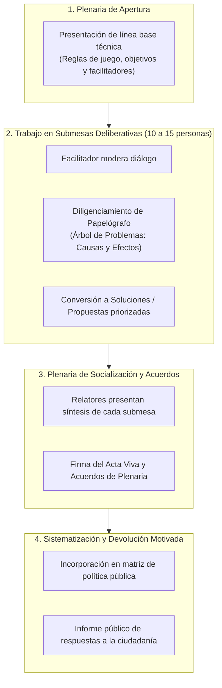
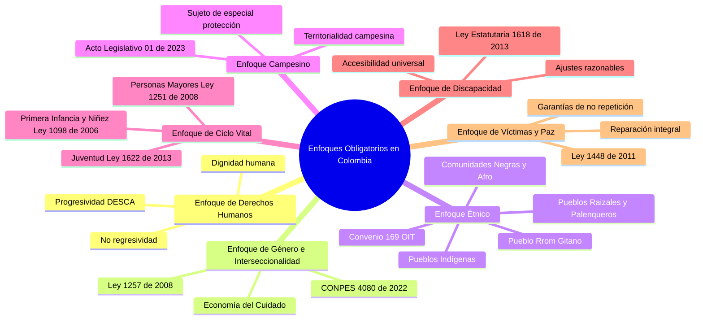

# Módulo 5: Herramientas Participativas, Técnicas de Campo y Enfoques Diferenciales

---

## 1. La Dinámica de las Mesas de Trabajo Participativas en Colombia

En la práctica institucional y comunitaria colombiana, la **Mesa de Trabajo** es el dispositivo por excelencia para la deliberación ciudadana en el marco de la **Ley Estatutaria 1757 de 2015**, la **Ley 489 de 1998** y los lineamientos del DNP.

### 1.1 Roles Clave en una Mesa de Trabajo
* **Facilitador / Moderador**: Neutral, dinamiza la palabra, garantiza que los sectores minoritarios intervengan y evita que una voz dominante monopolice la discusión.
* **Relator Técnico**: Registra con exactitud los consensos, disensos, propuestas y evidencias aportadas por los ciudadanos.
* **Delegado Institucional (Secretaría / Ministerio)**: Aclara competencias administrativas y restricciones legales sin vetar la imaginación propositiva de la comunidad.
* **Participantes Ciudadanos**: Aportan vivencias, diagnósticos barriales o gremiales, preguntas y propuestas concretas.

---

## 2. La Metodología del Papelógrafo y la Facilitación Visual

El papelógrafo (físico en talleres comunitarios o digital en la plataforma **POLIS**) es el lienzo interactivo donde se estructura colectivamente el pensamiento:

### 2.1 Fase A: Papelógrafo del Árbol de Problemas
1. **Identificación del Problema Central**: La comunidad debate tarjetas de ideas hasta consensuar una única tarjeta nuclear de color destacado que resume la situación crítica.
2. **Lluvia de Causas (Las Raíces)**:
   - Se agrupan en **Causas Directas** (ej. "Falta de iluminación en los paraderos") e **Indirectas** (ej. "Ausencia de presupuesto municipal de mantenimiento").
3. **Mapeo de Efectos (Las Ramas y Hojas)**:
   - Consecuencias visibles en la vida diaria (ej. "Inseguridad, atracos, deserción escolar nocturna de mujeres").

### 2.2 Fase B: Conversión al Árbol de Soluciones / Objetivos
En la submesa se realiza el ejercicio pedagógico de inversión semántica positiva:
* El problema central se redacta en infinitivo como **Objetivo Central**.
* Las causas se transforman en **Medios de intervención** (Proyectos, líneas de acción, inversión en infraestructura o programas sociales).
* Los efectos se convierten en **Fines o Metas de Bienestar** (Espacio público seguro, incremento de la matrícula escolar).

---

## 3. Enfoques Diferenciales y Transversales Obligatorios en Colombia

La Corte Constitucional ha señalado que formular una política pública como si toda la población fuera homogénea constituye una forma velada de discriminación. En Colombia, toda política debe incorporar transversalmente los siguientes enfoques:

### 3.1 Enfoque de Derechos Humanos
* La ciudadanía no es beneficiaria pasiva de caridad estatal, sino **titular de derechos fundamentales exigibles**.
* El Estado es el sujeto obligado a respetar, proteger y realizar dichos derechos.

### 3.2 Enfoque de Género e Interseccionalidad
* **Normativa**: Ley 1257 de 2008 (No violencia contra las mujeres), CONPES 4080 de 2022 (Política Pública de Equidad de Género).
* **Aplicación**: Análisis de cómo la política impacta de manera diferenciada a hombres, mujeres y personas con orientaciones sexuales e identidades de género diversas (LGBTIQ+).
* **Interseccionalidad**: Cruce simultáneo de factores de discriminación (ej. mujer rural, víctima del conflicto y en situación de discapacidad).
* **Sistema Nacional del Cuidado**: Reconocimiento, redistribución y reducción del trabajo doméstico y de cuidado no remunerado.

### 3.3 Enfoque Étnico
* Reconocimiento de la autonomía territorial, usos y costumbres, medicina tradicional y cosmovisión de pueblos indígenas, comunidades negras, afrocolombianas, raizales, palenqueras y Rrom.
* Metodologías de deliberación con traducción en lenguas nativas y respeto por las autoridades tradicionales legítimas (cabildos, consejos comunitarios, Kumpanyas).

### 3.4 Enfoque Campesino (Acto Legislativo 01 de 2023)
* Reconoce formalmente al **campesinado como sujeto de especial protección constitucional**.
* Obliga a que las políticas públicas garanticen el acceso a la tierra, el agua, la soberanía alimentaria, el crédito de fomento y la protección de semillas nativas.

### 3.5 Enfoque de Ciclo Vital y Poblacional
* **Niñez y Adolescencia (Ley 1098 de 2006)**: Principio del **interés superior del niño**; sus derechos prevalecen sobre los derechos de los demás.
* **Juventud (Leyes 1622 de 2013 y 1885 de 2018)**: Articulación obligatoria con los **Consejos Municipales y Locales de Juventud (CMJ/CLJ)**.
* **Personas Mayores (Ley 1251 de 2008)**: Envejecimiento activo y entornos protectores.

### 3.6 Enfoque de Discapacidad e Inclusión Social (Ley Estatutaria 1618 de 2013)
* Modelo social de la discapacidad: la limitación no reside en la persona, sino en las barreras físicas, comunicativas y actitudinales del entorno.
* Obligatoriedad de **ajustes razonables**, accesibilidad web (estándares W3C / WCAG 2.1 AA) e intérpretes de lengua de señas colombiana (LSC).

### 3.7 Enfoque de Víctimas y Construcción de Paz (Ley 1448 de 2011)
* Medidas de satisfacción, rehabilitación, restitución de tierras y garantías de no repetición en las políticas territoriales.

---

## 4. El Cierre del Ciclo: Devolución Motivada de la Información

Uno de los factores que mayor frustración y apatía genera en la ciudadanía es la sensación de que sus aportes "cayeron en un saco roto".

Para cumplir los estándares de la **Sentencia C-150 de 2015**, la administración pública debe construir la **Matriz de Devolución Ciudadana**:

| Aporte Ciudadano Recibido | Sector / Línea | Decisión de la Entidad | Justificación Motivada y Destino Técnico |
| :--- | :--- | :---: | :--- |
| "Construir ciclorrutas segregadas en la Avenida Central con iluminación LED" | Movilidad y Seguridad | **Incorporada** | Se incluyó en la Línea Estratégica LE-02 (Meta: 14 km en el cuatrienio; financiado con fondo de sobretasa a la gasolina). |
| "Prohibir el tránsito de vehículos particulares en todo el municipio" | Movilidad | **No viable** | Rechazada por desproporcionalidad y vulneración del derecho a la libre circulación (Art. 24 CP); se optó por restricción horaria en horas pico. |
| "Crear subsidio universal de desempleo municipal del 100% del SMLV" | Empleo y Desarrollo | **Competencia Nacional** | Excede la competencia y la capacidad fiscal municipal; se remite la solicitud formal al Ministerio del Trabajo y Prosperidad Social. |
