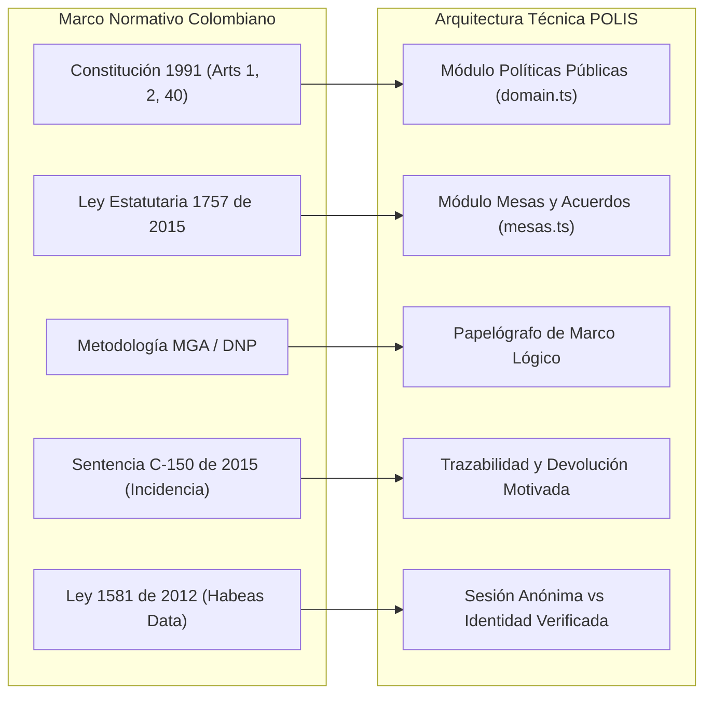

# Módulo 6: Traducción Metodológica a la Arquitectura Funcional de POLIS

---

## 1. El Puente entre la Dogmática Pública y el Software

La plataforma **POLIS** no es un gestor de contenidos genérico; es un **sistema de gobernanza deliberativa digital** diseñado con precisión matemática para operacionalizar el marco normativo, metodológico y jurisprudencial colombiano.



---

## 2. Correspondencia Canónica de Modelos de Datos

### 2.1 Modelo General de Políticas Públicas ([domain.ts](file:///root/preview_project/src/types/domain.ts))
$$\text{PoliticaPublica} \longrightarrow \text{Fase} \longrightarrow \text{LineaEstrategica} \longrightarrow \text{Aporte}$$

| Entidad | Fundamento Metodológico Colombiano | Atributos Críticos del Modelo |
| :--- | :--- | :--- |
| **`PoliticaPublica`** | Acto de Estado (CONPES, Ordenanza, Acuerdo, Decreto). | `id`, `slug`, `titulo`, `resumen`, `descripcion`, `problema`, `sector`, `estado`, `cobertura`, `fechaInicio`, `fechaCierre`, `participantes`, `fases`. |
| **`Fase`** | Ciclo formal de planeación DNP. | `id`, `politicaId`, `orden`, `nombre`, `tipo` (`diagnostico`, `formulacion`, `deliberacion`, `validacion`, `implementacion`, `seguimiento`), `estado` (`activa`, `proxima`, `completada`), `progreso`, `lineas`. |
| **`LineaEstrategica`** | Medios de intervención del Árbol de Objetivos y componentes del PAS. | `id`, `faseId`, `codigo` (ej. "LE-01"), `titulo`, `descripcion`, `aportes`. |
| **`Aporte`** | Diálogo ciudadano vinculante con derecho de contradicción. | `id`, `lineaId`, `tipo` (`propuesta`, `anotacion`, `pregunta`), `titulo`, `contenido`, `autor`, `autorId` (opcional: anonimato garantizado), `fotos` (evidencia territorial), `fecha`, `votos`, `apoyado`. |

### 2.2 Modelo de Área de Trabajo y Mesas Deliberativas ([mesas.ts](file:///root/preview_project/src/types/mesas.ts))
$$\text{MesaDeTrabajo} \longrightarrow \text{SubMesa} \longrightarrow \text{Papelografo} \ (\text{Árbol de Problemas} \longleftrightarrow \text{Árbol de Soluciones})$$

| Entidad | Fundamento Metodológico Colombiano | Atributos Críticos del Modelo |
| :--- | :--- | :--- |
| **`MesaDeTrabajo`** | Encuentro territorial de concertación (Ley 1757 / SGR / MIPG). | `id`, `nombre`, `fecha`, `lugar`, `entidad` convocante, `facilitador`, `totalAsistentes`, `acuerdosPlenaria` (Acta viva suscrita), `submesas`. |
| **`SubMesa`** | Grupo focal temático de trabajo intensivo. | `id`, `nombre`, `tema`, `participantes`, `arbolProblemas`, `arbolSoluciones`. |
| **`ArbolProblemas`** | MGA del DNP — Diagnóstico causal. | `problemaCentral`, `causas` (`NodoArbol[]`: directas e indirectas), `efectos` (`NodoArbol[]`: directos e indirectos). |
| **`ArbolSoluciones`** | MGA del DNP — Objetivos transformadores. | `objetivoCentral`, `medios` (`NodoArbol[]`: de primer nivel y fundamentales), `fines` (`NodoArbol[]`: directos y últimos). |

---

## 3. Especificación del Backend FastAPI (Python 3.12)

### 3.1 Arquitectura por Capas Estrictas
```
/root/backend
├── app
│   ├── core
│   │   ├── config.py           # Variables de entorno pydantic-settings
│   │   ├── security.py         # Criptografía bcrypt, tokens JWT (python-jose)
│   │   └── database.py         # Motor SQLAlchemy 2.0 asíncrono (asyncpg)
│   ├── models                  # Modelos declarativos SQLAlchemy 2.0
│   │   ├── base.py
│   │   ├── politicas.py        # Politica, Fase, LineaEstrategica, Aporte
│   │   ├── mesas.py            # Mesa, SubMesa, ArbolProblemas, ArbolSoluciones
│   │   └── usuarios.py         # Usuario, Rol, Permiso (PBAC/RBAC)
│   ├── schemas                 # Esquemas canónicos Pydantic v2 (espejo TypeScript)
│   │   ├── politicas.py
│   │   ├── mesas.py
│   │   └── auth.py
│   ├── api
│   │   ├── deps.py             # Dependencias inyectadas: get_db, get_current_user, require_module_access
│   │   └── v1
│   │       ├── router.py       # Enrutador maestro /api/v1
│   │       ├── politicas.py    # Endpoints CRUD y avance de fases
│   │       ├── aportes.py      # Creación de propuestas, anotaciones y votos
│   │       ├── mesas.py        # Endpoints de actas y papelógrafos
│   │       └── auth.py         # Login, registro y token anónimo
│   ├── websockets
│   │   ├── connection_mgr.py   # Gestor de conexiones concurrentes por canal
│   │   └── endpoints.py        # /ws/politicas/{id} y /ws/mesas/{id}/papelografo
│   └── services
│       ├── image_service.py    # Procesamiento con Pillow: compresión y stripping EXIF
│       └── policy_service.py   # Lógica de conversión de árboles y cálculo de progreso
├── alembic                     # Migraciones versionadas inmutables
│   ├── env.py
│   └── versions/
├── pyproject.toml
└── main.py
```

### 3.2 Seguridad y Control de Acceso (PBAC/RBAC con Guards)
* **Principio de Mínimo Privilegio**:
  - `ciudadano_anonimo`: Puede consultar todo el catálogo público, emitir preguntas o aportes anónimos y apoyar propuestas (1 voto por sesión o huella técnica).
  - `ciudadano_verificado`: Puede crear propuestas formales con su nombre e identidad verificada, subir fotografías territoriales de evidencia y postularse a mesas de trabajo.
  - `facilitador_mesa`: Puede crear y editar mesas de trabajo, gestionar submesas, moderar el papelógrafo interactivo y redactar los acuerdos de plenaria.
  - `funcionario_planeacion`: Puede crear políticas públicas, gestionar el cambio de fases, emitir la matriz de devolución motivada y exportar informes CONPES/PAS.
  - `super_admin`: Administración de roles, configuración general y auditoría de eventos.
* **Guard de Seguridad Reusable**:
  ```python
  def require_module_access(required_permission: str):
      async def dependency(current_user: User = Depends(get_current_active_user)):
          if not current_user.has_permission(required_permission):
              raise HTTPException(
                  status_code=status.HTTP_403_FORBIDDEN,
                  detail=f"Acceso denegado: se requiere el permiso {required_permission}"
              )
          return current_user
      return dependency
  ```

### 3.3 Procesamiento Ético de Imágenes con Pillow (PIL)
La evidencia fotográfica ciudadana es vital para ilustrar problemáticas (baches viales, colegios sin baterías sanitarias, vertimientos de aguas residuales), pero exige **estricta protección de datos personales (Ley 1581 de 2012)**:
* **Stripping de Metadatos EXIF**: Los teléfonos móviles graban coordenadas GPS exactas en las fotos; por seguridad de los líderes sociales y de los ciudadanos en territorios vulnerables, Pillow elimina todos los metadatos EXIF de ubicación y modelo del dispositivo antes de guardar la imagen en el servidor.
* **Optimización y Miniaturas**: Conversión a formato moderno optimizado (WebP/JPEG con calidad al 82%), limitación de resolución máxima a 1920px y generación automática de thumbnail a 320px para el feed de aportes.

### 3.4 Sincronización en Tiempo Real con WebSockets Nativos
* **Canal de Política Pública (`/ws/politicas/{politica_id}`)**: Emite eventos JSON cuando entra una nueva propuesta ciudadana o cuando sube el contador de apoyos/votos.
* **Canal de Papelógrafo Colaborativo (`/ws/mesas/{mesa_id}/submesas/{submesa_id}`)**:
  - Permite que los 10 o 15 integrantes de una submesa, armados con tablets o teléfonos, o el facilitador desde una laptop, vean proyectados en pantalla en tiempo real los nuevos nodos creados, ediciones de texto y la derivación automática del árbol de problemas al árbol de soluciones.

---

## 4. Especificación del Frontend (Zero-Modals y Tokens Semánticos)

### 4.1 Principio Zero-Modals
* **Nada de diálogos bloqueantes centrados (`<Dialog />` tradicional)** para lectura profunda o edición.
* Toda interacción (ver detalle de una política, consultar fases, inspeccionar una línea, redactar un aporte, gestionar una mesa o editar un árbol de papelógrafo) ocurre en **paneles laterales deslizantes (`Drawer` / `RightPanel`)** montados en el `PanelHost`.
* **Apilado Progresivo**: Hasta 4-5 niveles de profundidad visual con desplazamiento horizontal (`depth * 46px`), reducción de escala y botón de **Maximizar a 100vw** para trabajar con total comodidad en pantallas grandes.

### 4.2 Tokens Semánticos Exclusivos
* Nunca usar clases con colores rígidos (`bg-blue-600`, `text-slate-900`).
* Utilizar siempre las variables semánticas:
  - Superficies: `bg-[var(--surface-0)]`, `bg-[var(--surface-1)]`, `bg-[var(--surface-2)]`, `bg-[var(--surface-3)]`.
  - Textos: `text-[var(--text-primary)]`, `text-[var(--text-secondary)]`, `text-[var(--text-tertiary)]`.
  - Acentos y estados: `bg-[var(--ember)]`, `text-[var(--ember)]`, `text-[var(--success)]`, `text-[var(--warning)]`.
  - Bordes: `border-[var(--border)]`, `border-[var(--border-strong)]`.
