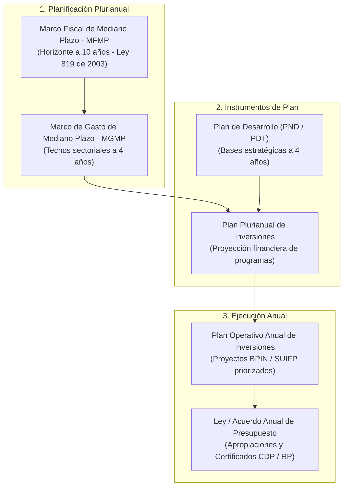
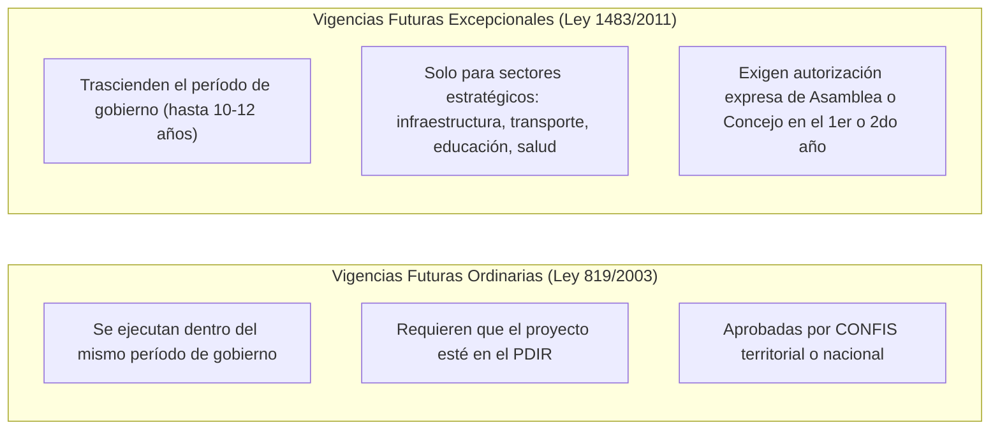

# Módulo 7: Sistema Presupuestal, Financiación y Viabilidad Fiscal de Políticas Públicas en Colombia

---

## 1. El Principio de Realidad Fiscal: Las Políticas Públicas no son "de Papel"

En Colombia, uno de los vicios históricos más recurrentes en la gestión pública ha sido la formulación de políticas públicas retóricas, con diagnósticos ambiciosos pero sin asignación presupuestal concreta.

La **Corte Constitucional** (especialmente en la Sentencia **T-025 de 2004** y en las sentencias de control presupuestal **C-1065 de 2001** y **C-038 de 2004**) y el marco orgánico de planeación han establecido una regla tajante:
> **"Una política pública que no cuente con una fuente de financiación identificada, un costeo riguroso y una articulación demostrada con el Marco Fiscal de Mediano Plazo no es una política pública jurídicamente válida, sino una mera declaración de intenciones sin fuerza vinculante"**.

---

## 2. El Ecosistema Presupuestal Colombiano

El ciclo presupuestal en Colombia está regido por normas de jerarquía orgánica que condicionan cualquier compromiso financiero de una política pública:

### 2.1 El Estatuto Orgánico del Presupuesto (Decreto 111 de 1996)
El Decreto 111 de 1996 compila las Leyes 38 de 1989, 179 de 1994 y 225 de 1995. Fija los principios presupuestales infranqueables:
1. **Planificación**: El presupuesto general debe guardar estricta correspondencia con los contenidos del Plan de Desarrollo y sus políticas asociadas.
2. **Anualidad**: El año fiscal comienza el 1 de enero y termina el 31 de diciembre. Ningún recurso puede ejecutarse por fuera de la vigencia sin la figura de vigencias futuras o reservas presupuestales debidamente constituidas.
3. **Universalidad**: El presupuesto debe contener la totalidad de los gastos que el Estado pretende realizar para ejecutar sus políticas públicas; se prohíben las "cajas negras" o presupuestos paralelos no auditables.
4. **Especialización**: Las apropiaciones deben referirse en cada organismo a su objeto y funciones, y se ejecutarán estrictamente conforme al fin para el cual fueron programadas.

### 2.2 Ley 819 de 2003 (Ley de Responsabilidad y Transparencia Fiscal)
* **Marco Fiscal de Mediano Plazo (MFMP)**:
  - Documento financiero a **10 años** que el Gobierno Nacional y los Gobiernos Territoriales deben presentar anualmente ante las respectivas corporaciones públicas (Congreso, Asambleas, Concejos).
  - Determina la trayectoria de la deuda pública, el superávit o déficit primario y el límite de gasto para garantizar la sostenibilidad macroeconómica.
* **Artículo 7 (Análisis de Impacto Fiscal de Políticas y Normas)**:
  - Todo proyecto de ley, ordenanza, acuerdo o política pública que ordene gasto o que otorgue beneficios tributarios **debe incluir expresamente sus costos fiscales y la fuente de ingreso adicional generada para su financiamiento**.
  - El Ministerio de Hacienda (en la Nación) o la Secretaría de Hacienda (en el territorio) debe emitir un **Concepto de Viabilidad Fiscal vinculante** antes de la adopción formal de la política.

---

## 3. Fuentes de Financiación de las Políticas Públicas en Colombia

Para que una política pública se traduzca en transformaciones reales, sus líneas estratégicas deben alimentarse de una canasta diversa de fuentes de financiamiento:

| Fuente de Financiación | Base Jurídica | Características y Destinación en Políticas Públicas |
| :--- | :--- | :--- |
| **Ingresos Corrientes de Libre Destinación (ICLD)** | Ley 617 de 2000 | Recursos propios de la entidad territorial (Impuesto Predial, ICA, vehículos). Permiten financiar programas prioritarios autónomos de la administración. |
| **Sistema General de Participaciones (SGP)** | Art. 356 y 357 CP, Ley 715 de 2001, Ley 1176 de 2007 | Transferencias obligatorias de la Nación a los entes territoriales con destinación específica: **Educación (58,5%)**, **Salud (24,5%)**, **Agua Potable y Saneamiento Básico (5,4%)** y **Propósito General (11,6%)**. No pueden desviarse a otros sectores. |
| **Sistema General de Regalías (SGR)** | Art. 360 y 361 CP, Ley 2056 de 2020 | Ingresos por explotación de recursos naturales no renovables. Se distribuyen en Asignaciones Directas (regiones productoras), Fondo de Compensación Regional, Fondo de Desarrollo Regional y Asignación para la Paz (OCAD Paz). Requiere **mesas participativas de priorización**. |
| **Recursos de Capital y Crédito Público** | Ley 358 de 1997 (Semáforos de endeudamiento) | Operaciones de crédito interno o externo (BID, Banco Mundial, CAF). Exclusivamente destinados a financiar proyectos de inversión pública en infraestructura física y social; prohibido para gastos de funcionamiento. |
| **Sobretasas y Rentas con Destinación Específica** | Leyes sectoriales | Sobretasa a la gasolina (movilidad y malla vial), Sobretasa bomberil (gestión del riesgo), Estampilla Pro-Cultura (políticas culturales y artísticas), Estampilla Pro-Adulto Mayor (centros vida y bienestar de personas mayores). |
| **Asociaciones Público-Privadas (APP)** | Ley 1508 de 2012 | Vinculación de capital privado para diseño, construcción, operación y mantenimiento de infraestructura pública o prestación de servicios conexos (de iniciativa pública o privada). |
| **Cooperación Internacional No Reembolsable** | APC Colombia | Recursos técnicos y financieros aportados por agencias bilaterales (USAID, GIZ, AECID) o multilaterales (ONU, PNUD, UNICEF) para políticas de paz, derechos humanos, género y ambiente. |

---

## 4. El Mecanismo de las Vigencias Futuras: Blindaje Plurianual

Dado que las políticas públicas tienen vigencias de **10 a 12 años**, mientras que los mandatos de alcaldes y gobernadores duran solo **4 años**, el ordenamiento jurídico colombiano prevé el instrumento de **Vigencias Futuras** para garantizar que los proyectos estratégicos de la política no se paralicen tras el cambio de gobierno:

### Requisitos de las Vigencias Futuras Excepcionales Territoriales (Ley 1483 de 2011)
1. Que el proyecto esté consignado en el Plan de Desarrollo Territorial.
2. Que se cuente con declaratoria previa de **importancia estratégica** aprobada por el Consejo de Gobierno.
3. Que no superen el límite de capacidad de pago de la entidad territorial (Ley 358 de 1997).
4. Que cuenten con la aprobación del Concejo Municipal o la Asamblea Departamental mediante Acuerdo u Ordenanza motivada.

---

## 5. El Sistema de Inversión Pública: BPIN y SUIFP

En Colombia, ningún recurso del Estado puede ejecutarse si el proyecto no está formalmente registrado en el banco de proyectos:
* **BPIN (Banco de Programas y Proyectos de Inversión Nacional)** / **BPIT (Bancos Territoriales)**:
  - Catálogo donde se registran los proyectos que materializan las líneas estratégicas de las políticas públicas.
  - Exige formular el proyecto bajo la **Metodología General Ajustada (MGA)** del DNP, con su respectivo Árbol de Problemas y Árbol de Objetivos.
* **SUIFP (Sistema Unificado de Inversiones y Finanzas Públicas)**:
  - Sistema de información que integra el ciclo completo de la inversión pública (formulación, viabilidad, programación, ejecución y seguimiento financiero en el SIIF Nación).

---

## 6. Implicaciones para la Arquitectura de POLIS

En la plataforma **POLIS**, la viabilidad fiscal debe ser un componente auditable en cada nivel del modelo:
1. **Atributo Presupuestal en Líneas Estratégicas (`LineaEstrategica`)**:
   - Cada línea estratégica debe poder vincularse a una o más fuentes de financiación del catálogo presupuestal colombiano (SGP, SGR, ICLD, Crédito, Cooperación).
   - Debe permitir registrar el costo estimado cuatrienal y el código BPIN asociado.
2. **Validación de Viabilidad en Aportes Ciudadanos (`Aporte`)**:
   - En la interfaz de devolución ciudadana (Sentencia C-150 de 2015), si una propuesta ciudadana no puede ejecutarse por restricciones fiscales o porque excede el techo del MFMP, el sistema debe permitir clasificar la causal técnica y generar automáticamente el informe de respuesta motivada.
3. **Módulo de Acuerdos de Plenaria en Mesas de Trabajo (`MesaDeTrabajo.acuerdosPlenaria`)**:
   - Los compromisos concertados en las mesas territoriales deben parametrizarse como "Compromisos con respaldo presupuestal asignado" o "Propuestas de priorización para el próximo POAI".
