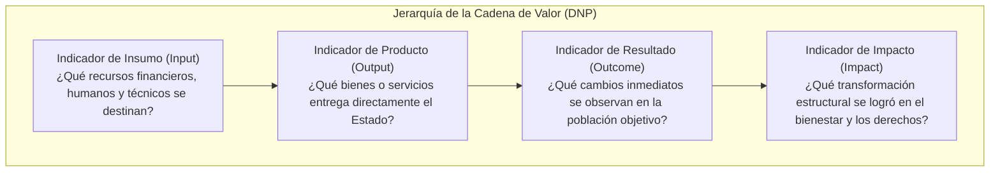
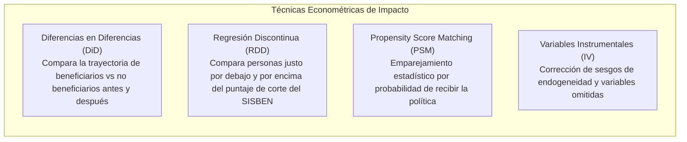

# Módulo 8: Sistema de Indicadores, Monitoreo y Evaluación de Impacto (SINERGIA / DANE)

---

## 1. Introducción al Monitoreo y Evaluación (M&E) en Colombia

En la arquitectura de Estado colombiano, la evaluación no es una auditoría contable punitiva posterior; es una **herramienta científica de aprendizaje institucional y rendición de cuentas democrática**.

El Sistema Nacional de Evaluación de Gestión y Resultados (**SINERGIA**), coordinado por la Dirección de Seguimiento y Evaluación de Políticas Públicas (DSEPP) del DNP, establece los estándares para determinar si una política pública está cumpliendo su promesa de valor ciudadano.

---

## 2. Ficha Técnica Canónica de Indicadores (Estándar DNP)

Toda línea estratégica en una política pública debe contar con una o más **Fichas Técnicas de Indicador** formalizadas. El DNP exige los siguientes campos para que un indicador sea admitido en el Banco de Indicadores:

| Campo Técnico | Definición | Ejemplo Ilustrativo |
| :--- | :--- | :--- |
| **Nombre del Indicador** | Denominación clara que expresa la magnitud o cualidad que se mide. | Tasa de deserción escolar anual en secundaria rural. |
| **Definición Conceptual** | Explicación teórica de la variable y su relevancia para la política. | Porcentaje de estudiantes matriculados en secundaria en zonas rurales que abandonan el sistema educativo durante el año lectivo. |
| **Tipo de Indicador** | Ubicación en la cadena de valor (Insumo, Producto, Resultado o Impacto). | **Resultado (Outcome)**. |
| **Algoritmo / Fórmula de Cálculo** | Expresión matemática unívoca de las variables. | $$\text{TDE} = \left( \frac{\text{Estudiantes desertores en el año } t}{\text{Total estudiantes matriculados en el año } t} \right) \times 100$$ |
| **Unidad de Medida** | Magnitud de reporte (Porcentaje, Tasa por 100k hab, Número absoluto, Días, Pesos). | Porcentaje (%). |
| **Polaridad / Sentido** | Dirección deseable del indicador. | **Decreciente** (a menor valor, mayor éxito de la política). |
| **Periodicidad de Medición** | Frecuencia de corte y reporte de datos. | Anual (al cierre del año lectivo escolar). |
| **Nivel de Desagregación** | Variables de cruce demográfico y territorial obligatorias. | Sexo (Hombre/Mujer), pertenencia étnica, edad, municipio y vereda. |
| **Fuente Oficial de Verificación** | Registro administrativo o encuesta oficial de captura. | SIMAT (Sistema Integrado de Matrícula) del Ministerio de Educación Nacional. |
| **Línea Base (Año base)** | Valor del indicador antes del inicio de la política. | 6,8% (Año 2024). |
| **Metas Anualizadas** | Trayectoria de cumplimiento programada. | Año 1: 6,2% \| Año 2: 5,5% \| Año 3: 4,8% \| Año 4: 4,0%. |
| **Entidad Responsable del Reporte** | Institución que valida y sube el dato a la plataforma. | Secretaría de Educación Departamental / Ministerio de Educación. |

---

## 3. Criterios de Calidad Metodológica (El Estándar CREMA)

El DNP aplica el filtro **CREMA** para validar si un indicador formulado por un equipo sectorial es técnicamente robusto:
1. **Claro (Clear)**: Preciso, inequívoco, comprensible tanto para el analista técnico como para el ciudadano del común.
2. **Relevante (Relevant)**: Mide de forma directa el cambio sustantivo de la política y no aspectos periféricos o accesorios.
3. **Económico (Economic)**: El costo de recolectar la información no debe superar el beneficio que aporta conocer el dato.
4. **Medible (Measurable)**: Se fundamenta en fuentes independientes verificables y comprobables empíricamente.
5. **Adecuado (Adequate)**: Proporciona una base sólida y confiable para evaluar el desempeño y tomar decisiones de ajuste.

---

## 4. Los Indicadores de Goce Efectivo de Derechos (GED) de la Corte Constitucional

A raíz de la histórica **Sentencia T-025 de 2004** y sus autos de seguimiento (Auto 109 de 2007, Auto 008 de 2009 y Auto 206 de 2017), la Corte Constitucional colombiana transformó la evaluación de políticas públicas mediante la doctrina de los **Indicadores GED**:

### 4.1 La Distinción entre Esfuerzo Institucional y Goce Efectivo
* **Indicadores de Esfuerzo Institucional (Insuficientes por sí solos)**:
  - Miden la actividad interna de la burocracia (ej. cantidad de leyes expedidas, convenios firmados, dinero desembolsado o personas registradas).
  - *Crítica de la Corte*: El Estado puede gastar billones de pesos y emitir cientos de decretos sin que la calidad de vida de un solo ciudadano mejore.
* **Indicadores de Goce Efectivo de Derechos (GED)**:
  - Miden la **garantía real, sustantiva y tangible** del derecho en la vida de los titulares:
    - ¿El niño tiene una escuela accesible a menos de 30 minutos? (Accesibilidad física).
    - ¿La comunidad cuenta con agua potable apta para consumo humano las 24 horas del día? (Disponibilidad y calidad).
    - ¿La familia desplazada recuperó su capacidad de autosostenimiento y cesó su situación de vulnerabilidad extrema? (Adaptabilidad y dignidad).

### 4.2 Los Tres Criterios Constitucionales de Evaluación
Todo indicador GED evalúa tres dimensiones del derecho:
1. **Disponibilidad**: Existencia material suficiente de bienes, servicios e infraestructura pública.
2. **Accesibilidad**: Ausencia de barreras geográficas, económicas, de discriminación o comunicativas para acceder a ellos.
3. **Calidad y Aceptabilidad**: Que los bienes y servicios cumplan estándares técnicos y sean culturalmente apropiados para las comunidades.

---

## 5. Metodologías Científicas de Evaluación de Impacto (DSEPP del DNP)

Para determinar si una política pública es la **verdadera causa** del cambio observado (y no factores macroeconómicos externos, clima o dinámicas demográficas), el DNP emplea metodologías econométricas de **inferencia causal con grupos de control**:

1. **Diferencias en Diferencias (DiD / Double Difference)**:
   - Se utiliza cuando la política pública se implementa de manera escalonada en el tiempo (por ejemplo, se inicia en 50 municipios y al año siguiente en otros 50).
   - Compara la diferencia de resultados antes y después en el grupo tratado, restándole la diferencia observada en el grupo de control.
2. **Regresión Discontinua (RDD - Regression Discontinuity Design)**:
   - Estándar de oro en políticas sociales focalizadas por el SISBEN (ej. subsidios de renta ciudadana o becas educativas).
   - Se compara a las familias ubicadas justo por debajo de la línea de corte (tratados) con las familias ubicadas justo por encima (no tratados). Al estar tan cerca de la frontera, ambos grupos son idénticos en casi todo excepto en la recepción del programa.
3. **Propensity Score Matching (PSM)**:
   - Construye un "gemelo estadístico" para cada beneficiario a partir de un modelo logit/probit basado en características observables (edad, educación, ruralidad, tamaño del hogar).

---

## 6. Integración Funcional con POLIS

1. **Modelo de Indicadores en Líneas Estratégicas (`LineaEstrategica`)**:
   - POLIS debe almacenar los atributos del indicador DNP: `tipoIndicador`, `lineaBase`, `meta`, `unidadMedida`, `polaridad` y `fuente`.
2. **Visualización Gráfica para la Ciudadanía**:
   - En el frontend de Next.js, utilizando **Recharts**, POLIS debe proyectar la **trayectoria del indicador** (Línea Base $\rightarrow$ Avance Reportado $\rightarrow$ Meta Cuatrienal).
3. **Trazabilidad de la Evaluación Participativa**:
   - Los ciudadanos en sus aportes pueden contrastar el dato oficial con su realidad territorial (ej. "El indicador dice que la cobertura de agua es del 95%, pero en nuestra vereda el agua llega solo 2 horas a la semana"), permitiendo a los formuladores recalibrar la línea base.
