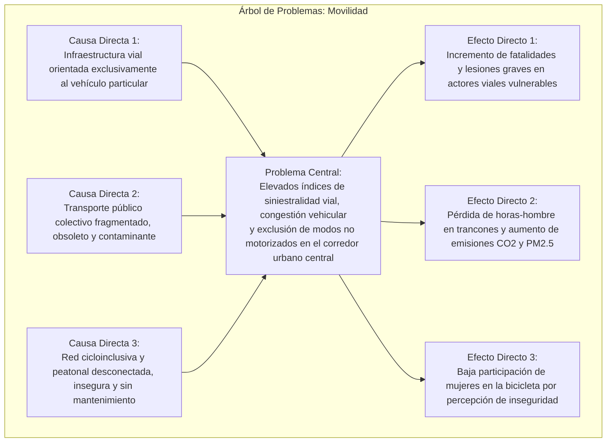
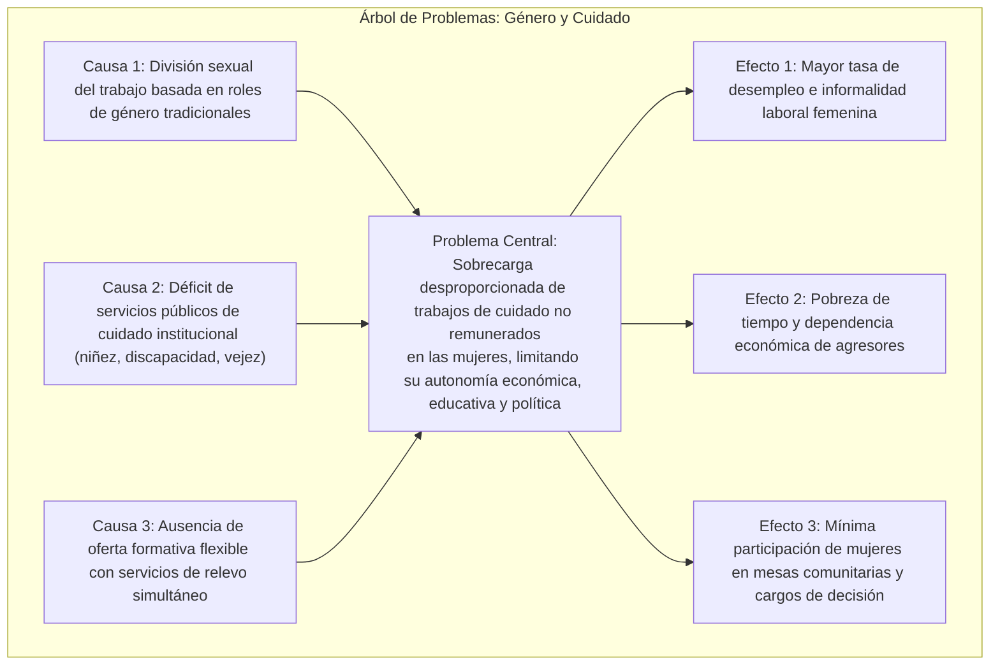

# Módulo 9: Casos de Estudio y Plantillas Sectoriales Canónicas en Colombia

Este módulo proporciona **5 casos de estudio completos y plantillas metodológicas** para los sectores más frecuentes en la formulación de políticas públicas en Colombia. Cada plantilla incluye su fundamento legal específico, Árbol de Problemas, Árbol de Soluciones y Matriz de Líneas Estratégicas con indicadores.

---

## 1. Caso 1: Movilidad Urbana Sostenible e Intermodal

* **Ámbito de Aplicación**: Ciudades intermedias y áreas metropolitanas.
* **Marco Normativo Específico**:
  - **Ley 1083 de 2006**: Planes de Movilidad Sostenible obligatorios para municipios con más de 100.000 habitantes.
  - **Ley 1811 de 2016**: Incentivo al uso de la bicicleta y medios no motorizados.
  - **Documento CONPES 3991 de 2020**: Política Nacional de Movilidad Urbana y Regional Sostenible.
  - **Ley 2294 de 2023 (PND)**: Cofinanciación nacional de Sistemas de Transporte Público Colectivo y Masivo descarbonizados.

### 1.1 Conversión a Líneas Estratégicas e Indicadores

| Código | Línea Estratégica (Medio) | Meta Cuatrienal | Indicador DNP / SINERGIA | Fuente de Financiación |
| :---: | :--- | :--- | :--- | :--- |
| **LE-01** | **Infraestructura Cicloinclusiva y Segura**: Construcción y adecuación de red troncal de ciclorrutas segregadas con iluminación LED y pacificación de entornos escolares. | Construir 35 km nuevos de ciclorrutas segregadas y señalizadas. | Kilómetros de ciclorruta construidos con estándares técnicos N-TCT (Producto). | Sobretasa a la Gasolina + SGR Regional. |
| **LE-02** | **Modernización y Descarbonización del Transporte Colectivo**: Reestructuración de rutas periféricas e incorporación de flota de cero o bajas emisiones (eléctrica/gas). | Sustituir el 40% de la flota obsoleta e integrar tarifa única electrónica. | Porcentaje de la flota de transporte colectivo con tecnología cero emisiones (Resultado). | Cofinanciación Nación (Convenio DNP-MinTransporte) + ICLD. |
| **LE-03** | **Seguridad Vial y Visión Cero**: Rediseño de puntos críticos de siniestralidad y zonas 30 km/h en barrios residenciales. | Reducir en un 30% la tasa de mortalidad por siniestros viales. | Tasa de mortalidad por siniestros viales por cada 100.000 habitantes (Impacto). | Fondo de Seguridad Vial (Recursos SOAT / ANSV). |

---

## 2. Caso 2: Equidad de Género y Sistema Local del Cuidado

* **Ámbito de Aplicación**: Distritos, Municipios y Departamentos.
* **Marco Normativo Específico**:
  - **Ley 1257 de 2008**: Normas de sensibilización, prevención y sanción de formas de violencia y discriminación contra las mujeres.
  - **Ley 1413 de 2010**: Regula la inclusión de la Economía del Cuidado en el Sistema de Cuentas Nacionales (DANE).
  - **Documento CONPES 4080 de 2022**: Política Pública Nacional de Equidad de Género para las Mujeres.
  - **Sentencia C-297 de 2016 y C-519 de 2019**: Reconocimiento del valor social y productivo del cuidado.

### 2.1 Conversión a Líneas Estratégicas e Indicadores (Las 3 "R" del Cuidado)

| Código | Línea Estratégica (Medio) | Meta Cuatrienal | Indicador DNP / SINERGIA | Fuente de Financiación |
| :---: | :--- | :--- | :--- | :--- |
| **LE-01** | **Reconocimiento Social y Cultural**: Campañas pedagógicas territoriales de transformación cultural para la corresponsabilidad masculina en el hogar. | 50.000 hogares certificados en talleres comunitarios de corresponsabilidad. | Número de personas formadas en masculinidad no violenta y corresponsabilidad (Producto). | ICLD + Cooperación Internacional (ONU Mujeres). |
| **LE-02** | **Reducción del Tiempo de Cuidado**: Creación de Manzanas o Nodos Locales del Cuidado que agrupan lavanderías públicas, jardines infantiles y centros día. | Poner en operación 8 Nodos Locales del Cuidado en comunas vulnerables. | Horas promedio semanales dedicadas por mujeres al trabajo no remunerado (Resultado - DANE). | SGP Propósito General + Crédito Público. |
| **LE-03** | **Redistribución y Autonomía Económica**: Oferta de formación técnica (SENA) y capital semilla para emprendimientos asociativos femeninos con guardería in-situ. | Graduar a 4.000 mujeres cuidadoras en programas técnicos y certificar competencias. | Tasa de ocupación laboral formal de mujeres cuidadoras beneficiarias (Resultado/Impacto). | SGR Fondo de Compensación Regional. |

---

## 3. Caso 3: Gestión del Cambio Climático y Cuencas Hídricas

* **Ámbito de Aplicación**: Provincias, Regiones Administrativas (RAP), Departamentos y CAR.
* **Marco Normativo Específico**:
  - **Ley 1931 de 2018**: Directrices para la gestión del cambio climático en Colombia.
  - **Ley 2169 de 2021**: Ley de Acción Climática (Metas de reducción del 51% de GEI a 2030 y carbono neutralidad a 2050).
  - **Decreto 1640 de 2012**: Instrumentos de planificación de cuencas (POMCA).
  - **Sentencia T-622 de 2016 (Río Atrato) y STC 4360-2018 (Amazonía)**: Sujetos de Derechos y protección biocultural.

### 3.1 Líneas Estratégicas y Fichas de Indicador

| Código | Línea Estratégica | Meta Cuatrienal | Indicador DNP | Financiación |
| :---: | :--- | :--- | :--- | :--- |
| **LE-01** | **Restauración Ecológica de Rondas Hídricas**: Reforestación comunitaria con especies nativas en zonas de nacimiento y recarga de acuíferos. | Restaurar y cercar 1.800 hectáreas de rondas de ríos y quebradas abastecedoras. | Hectáreas de cuenca abastecedora con cobertura vegetal nativa restaurada (Producto). | Sobretasa Ambiental (CAR) + SGR Asignación Ambiental. |
| **LE-02** | **Saneamiento Básico y Descontaminación**: Construcción y modernización de Plantas de Tratamiento de Aguas Residuales (PTAR) en cabeceras y centros poblados. | Incrementar el tratamiento de aguas servidas del 18% al 65%. | Porcentaje de aguas residuales urbanas domésticas tratadas antes del vertimiento (Resultado). | SGP Agua Potable + OCAD Paz / Regional. |
| **LE-03** | **Gestión Comunitaria del Riesgo Climático**: Sistemas de alerta temprana participativos y reubicación concertada de viviendas en zona de amenaza alta por inundación/avenida torrencial. | 12 cuencas micro-monitoreadas con alarmas comunitarias y 350 familias reubicadas. | Número de familias reasentadas de zonas de alto riesgo no mitigable (Resultado). | Fondo Nacional de Gestión del Riesgo (UNGRD) + ICLD. |

---

## 4. Caso 4: Juventud, Empleabilidad y Ciudadanía Deliberativa

* **Ámbito de Aplicación**: Municipios y Departamentos.
* **Marco Normativo Específico**:
  - **Ley Estatutaria 1622 de 2013 y Ley 1885 de 2018**: Estatuto de Ciudadanía Juvenil.
  - **Documento CONPES 4040 de 2021**: Pacto Colombia con las Juventudes.
  - **Articulación Institucional**: Consejos Municipales de Juventud (CMJ), Plataformas de Juventud y Asambleas Juveniles.

### 4.1 Líneas Estratégicas y Fichas de Indicador

| Código | Línea Estratégica | Meta Cuatrienal | Indicador DNP | Financiación |
| :---: | :--- | :--- | :--- | :--- |
| **LE-01** | **Inserción Laboral y Primer Empleo Joven**: Subsidios a la nómina para empresas locales que vinculen jóvenes sin experiencia y formación intensiva en programación/TIC. | Vincular a 3.000 jóvenes al primer empleo formal con contratos mínimos a 1 año. | Tasa de desempleo juvenil desagregada por sexo y comuna (Resultado - GEIH DANE). | ICLD + Fondo Emprender SENA. |
| **LE-02** | **Salud Mental y Entornos Protectores**: Centros de escucha comunitaria en colegios y barrios, prevención del consumo de sustancias psicoactivas y atención psicosocial. | Atender a 15.000 jóvenes en rutas de salud mental y reducir la tasa de intento de suicidio en un 25%. | Tasa de intentos de suicidio en jóvenes entre 14 y 28 años por 100k hab (Resultado - SIVIGILA). | SGP Salud Pública + Estampilla Pro-Juventud. |
| **LE-03** | **Presupuesto Participativo Juvenil**: Asignación del 15% de los presupuestos participativos locales para iniciativas diseñadas y votadas por el CMJ y colectivos juveniles. | Financiar 120 proyectos culturales, deportivos y de innovación social juvenil. | Monto de inversión pública ejecutado en iniciativas juveniles priorizadas (Insumo/Producto). | Presupuestos Participativos (Ley 1757 de 2015). |

---

## 5. Caso 5: Soberanía Alimentaria y Desarrollo Rural Campesino

* **Ámbito de Aplicación**: Municipios PDET, ZOMAC, provincias agropecuarias y departamentos.
* **Marco Normativo Específico**:
  - **Acto Legislativo 01 de 2023**: El campesinado como sujeto de especial protección constitucional.
  - **Ley 2046 de 2020**: Compras Públicas Locales de Alimentos (mínimo 30% a productores campesinos locales).
  - **Decreto 1985 de 2013**: Sistema Nacional de Desarrollo Rural.

### 5.1 Líneas Estratégicas y Fichas de Indicador

| Código | Línea Estratégica | Meta Cuatrienal | Indicador DNP | Financiación |
| :---: | :--- | :--- | :--- | :--- |
| **LE-01** | **Circuitos Cortos y Mercados Campesinos**: Eliminación de intermediarios mediante centros de acopio rural y logística municipal para distribución directa a plazas y tiendas. | Dotar 6 centros de acopio y realizar 96 ferias itinerantes de mercados campesinos. | Toneladas de alimentos comercializadas directamente sin intermediación comercial (Producto). | ADR (Agencia de Desarrollo Rural) + SGR. |
| **LE-02** | **Cumplimiento de Compras Públicas Locales (Ley 2046)**: Articulación del Programa de Alimentación Escolar (PAE), comedores comunitarios y cárceles con cooperativas campesinas. | Alcanzar el 55% de compras de insumos del PAE adquiridos a productores locales. | Porcentaje del valor de alimentos adquiridos en compras públicas provenientes de productores locales (Resultado). | Recursos PAE (Ministerio de Educación - UPaPa) + ICLD. |
| **LE-03** | **Distritos de Adecuación de Tierras y Agua para la Producción**: Construcción de micro-reservorios, canales de riego y dotación de maquinaria asociativa rural. | Beneficiar a 800 familias campesinas con acceso a riego continuo en épocas de sequía. | Hectáreas agrícolas cultivables con acceso a riego tecnificado (Resultado/Impacto). | Fondo de Fomento Agropecuario (MinAgricultura) + SGR. |
