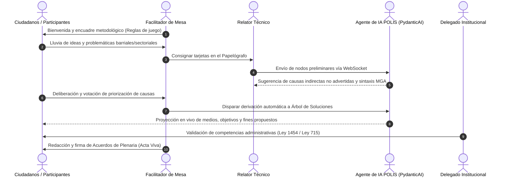
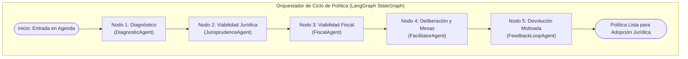

# Módulo 10: Manual de Facilitación Deliberativa y Especificación de Agentes de IA (PydanticAI / LangGraph)

---

## 1. La Facilitación Deliberativa: El Arte de Construir Acuerdos Públicos

Una mesa de trabajo no es una conferencia magistral ni un desahogo testimonial caótico; es un **proceso estructurado de inteligencia colectiva**. El facilitador (humano o asistido por IA) debe garantizar tres condiciones mínimas:
1. **Simetría Comunicativa**: Toda voz tiene el mismo valor argumentativo, independientemente del estrato socioeconómico o título académico del participante.
2. **Orientación Causal**: Evitar que el debate se quede en el síntoma superficial; profundizar hasta las causas raíces y los efectos estructurales.
3. **Compromiso con el Disenso**: El consenso no siempre es posible ni deseable si oculta desigualdades; los disensos legítimos deben quedar registrados formalmente en el acta de la plenaria.

---

## 2. Protocolo de Campo de la Mesa de Trabajo



### 2.1 El Decálogo del Facilitador en Territorio
1. **Regla de Oro contra la Solución Disfrazada de Problema**: Cuando un participante diga *"El problema es que no hay un CAI de policía"*, el facilitador debe preguntar: *"¿Qué situación de dolor o inseguridad ocurre en el barrio que los lleva a sentir la necesidad del CAI?"*. El problema real es el microtráfico o los robos a la salida del colegio, no la infraestructura física policial.
2. **Neutralidad Activa**: El facilitador no emite juicios de valor ni aprueba/desaprueba propuestas; devuelve preguntas reflexivas al grupo (*"¿Cómo afectaría esa medida a los comerciantes de la plaza de mercado?"*).
3. **Protección de la Participación Femenina y Juvenil**: Intervenir activamente si se detecta que los liderazgos tradicionales monopolizan el micrófono.
4. **Cierre Vinculante**: Ninguna mesa termina sin la lectura en voz alta de los **Acuerdos de Plenaria** y la firma digital o física del Acta Viva.

---

## 3. Especificación de la Red de Agentes de IA en POLIS (PydanticAI + LangGraph)

Con **PydanticAI** y **LangGraph** instalados en el entorno de Python 3.12, POLIS implementa una red de **4 agentes especializados** que operan de forma reactiva y en segundo plano:



---

### 3.1 Agente 1: `DiagnosticAgent` (Especialista en Marco Lógico y MGA)
* **Librería**: `pydantic-ai` con esquema canónico Pydantic v2 `ArbolProblemas` y `ArbolSoluciones`.
* **Función**:
  - Analiza las ideas crudas aportadas por los ciudadanos o relatores.
  - Detecta si una tarjeta describe un problema, una causa o una consecuencia.
  - Asegura la sintaxis correcta del DNP:
    - *Problemas*: sustantivos negativos (elevada deserción, precario acceso, deficiente cobertura).
    - *Objetivos*: verbos en infinitivo (reducir la deserción, ampliar el acceso, optimizar la cobertura).
* **Ejemplo de Salida PydanticAI**:
  ```python
  class NodoArbolSchema(BaseModel):
      id: str = Field(default_factory=lambda: str(uuid.uuid4()))
      texto: str = Field(description="Descripción sintáctica precisa según lineamientos DNP")
      hijos: list['NodoArbolSchema'] = Field(default_factory=list)

  class ArbolProblemasSchema(BaseModel):
      problema_central: str
      causas_directas: list[NodoArbolSchema]
      efectos_directos: list[NodoArbolSchema]
  ```

---

### 3.2 Agente 2: `JurisprudenceAgent` (Especialista Constitucional y Competencias)
* **Librería**: `pydantic-ai` con acceso al banco de conocimiento vectorial (RAG) de leyes y sentencias de la Corte Constitucional.
* **Función**:
  - Evalúa la propuesta frente a la **Ley 1454 de 2011 (LOOT)** y la **Ley 715 de 2001 (SGP)**: ¿Esta propuesta es competencia del Municipio, del Departamento o de la Nación?
  - Alerta temprana si una línea estratégica incide en territorios colectivos de pueblos indígenas o comunidades afrodescendientes, advirtiendo la obligatoriedad de **Consulta Previa (Convenio 169 OIT y Sentencia SU-123 de 2018)**.
  - Verifica que no existan medidas regresivas en Derechos Sociales (DESCA).

---

### 3.3 Agente 3: `FiscalAgent` (Especialista en Viabilidad Presupuestal)
* **Función**:
  - Cruza la línea estratégica con el catálogo oficial de fuentes de financiación colombianas (SGP, SGR, ICLD, Sobretasas, APP, Crédito).
  - Estima la razonabilidad del costeo frente a proyectos históricos del SUIFP / Terridata.
  - Emite la **Ficha de Alerta Fiscal**: clasifica si la propuesta requiere vigencias futuras ordinarias (CONFIS) o excepcionales (aprobación de Concejo/Asamblea bajo Ley 1483 de 2011).

---

### 3.4 Agente 4: `FeedbackLoopAgent` (Especialista en Devolución Ciudadana Motivada)
* **Fundamento Directo**: **Sentencia C-150 de 2015 de la Corte Constitucional**.
* **Función**:
  - Lee todas las propuestas ciudadanas registradas en la fase de deliberación que el equipo técnico catalogó como *"No incorporadas"* o *"Competencia de otro nivel de gobierno"*.
  - Redacta de forma automática, respetuosa, transparente y fundamentada en derecho, la **justificación técnica y jurídica motivada** que la administración entregará al ciudadano.
  - Genera la **Matriz de Devolución Ciudadana** en formato PDF y web para publicación obligatoria conforme a la Ley de Transparencia 1712 de 2014.

---

## 4. El Grafo de Estados en LangGraph (`PolicyLifecycleGraph`)

El ciclo de la política pública se modela en el backend como un `StateGraph` de LangGraph:

```python
from typing import TypedDict, Annotated
from langgraph.graph import StateGraph, START, END

class PolicyState(TypedDict):
    politica_id: str
    fase_actual: str
    diagnostico_aprobado: bool
    consulta_previa_requerida: bool
    concepto_fiscal_aprobado: bool
    total_aportes_ciudadanos: int
    devolucion_completada: bool

def diagnostico_step(state: PolicyState) -> PolicyState:
    # Ejecuta DiagnosticAgent para validar consistencia de causas/efectos
    ...
    return state

def viabilidad_juridica_step(state: PolicyState) -> PolicyState:
    # Ejecuta JurisprudenceAgent para verificar competencias y consulta previa
    ...
    return state

def deliberacion_mesas_step(state: PolicyState) -> PolicyState:
    # Monitorea sesiones de mesas participativas y aportes vía WebSockets
    ...
    return state

def devolucion_motivada_step(state: PolicyState) -> PolicyState:
    # Ejecuta FeedbackLoopAgent para generar las respuestas formales (C-150/15)
    ...
    return state

# Construcción del grafo de gobierno
builder = StateGraph(PolicyState)
builder.add_node("diagnostico", diagnostico_step)
builder.add_node("viabilidad_juridica", viabilidad_juridica_step)
builder.add_node("deliberacion", deliberacion_mesas_step)
builder.add_node("devolucion", devolucion_motivada_step)

builder.add_edge(START, "diagnostico")
builder.add_edge("diagnostico", "viabilidad_juridica")
builder.add_edge("viabilidad_juridica", "deliberacion")
builder.add_edge("deliberacion", "devolucion")
builder.add_edge("devolucion", END)

workflow = builder.compile()
```
