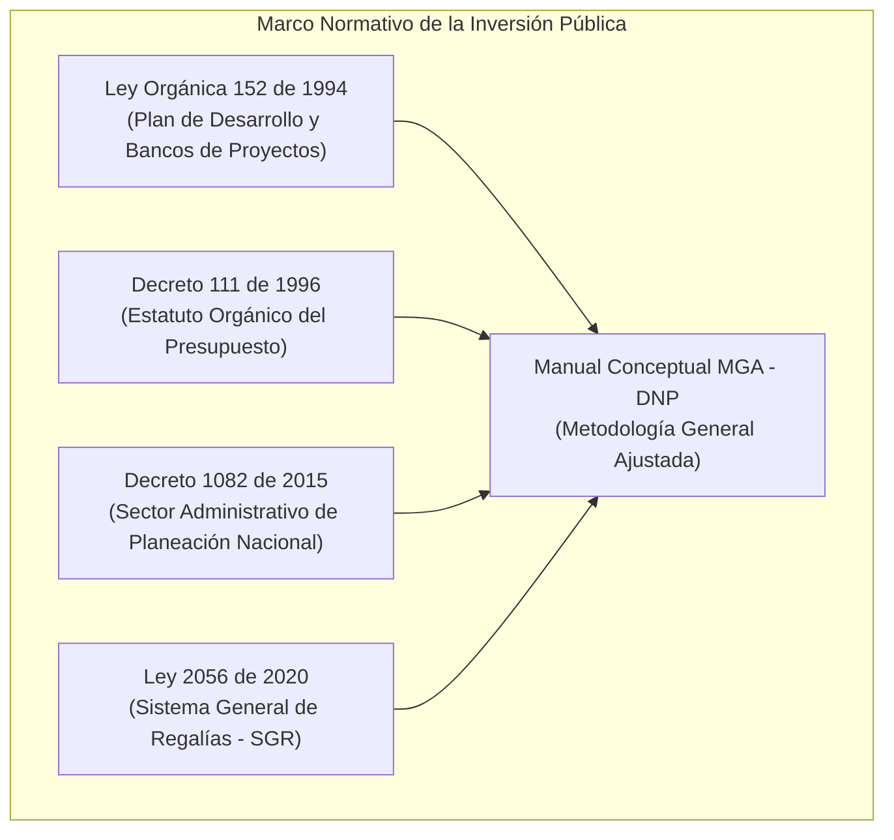
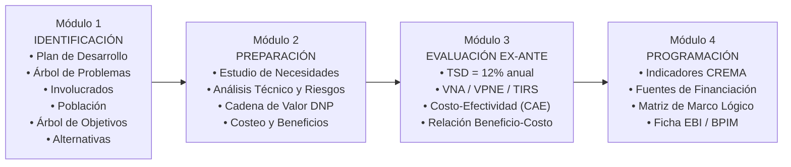
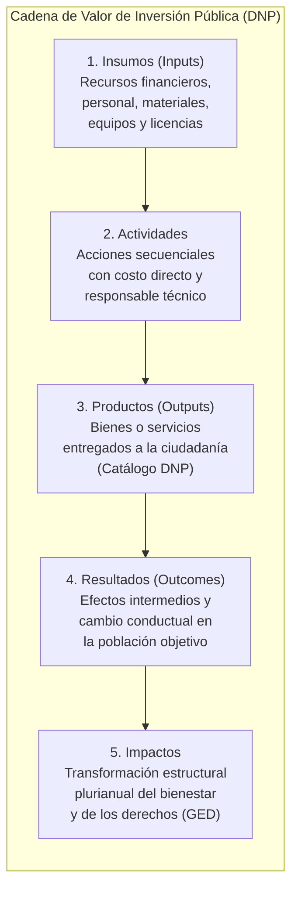
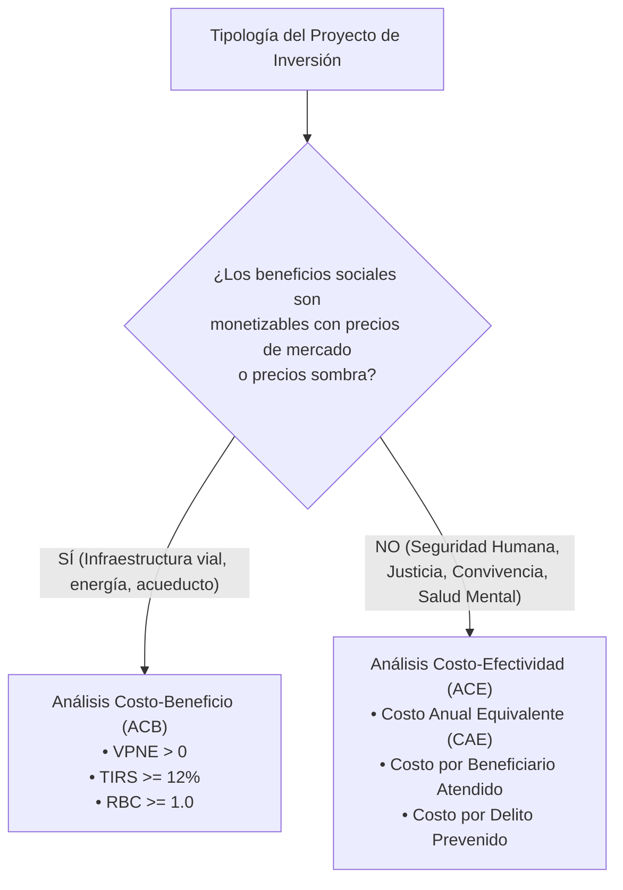
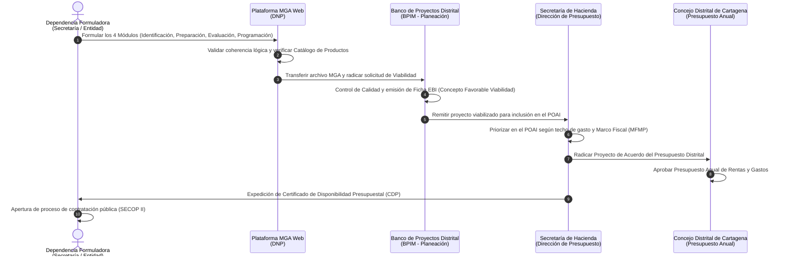

# Módulo 12: Estructuración y Formulación de Proyectos de Inversión Pública en Colombia (Metodología General Ajustada - MGA Web del DNP)

---

## 1. Fundamentos Normativos del Sistema de Inversión Pública en Colombia

En el ordenamiento jurídico colombiano, los proyectos de inversión pública son la unidad operativa básica a través de la cual el Estado materializa los planes de desarrollo y asigna el gasto social y de infraestructura. La estructuración y formulación de proyectos no es discrecional; obedece a un estricto marco legal, metodológico y presupuestal:

### 1.1 Ley Orgánica 152 de 1994 (Ley Orgánica del Plan de Desarrollo)
* **Artículo 27**: Establece el **Banco de Programas y Proyectos de Inversión Nacional (BPIN)**, administrado por el Departamento Nacional de Planeación (DNP), como el instrumento de planeación que registra los proyectos viables técnica, ambiental y socioeconómicamente.
* **Artículo 49**: Ordena a las entidades territoriales (departamentos, distritos y municipios) organizar sus propios **Bancos de Programas y Proyectos de Inversión Municipal/Distrital (BPIM)**, vinculados conceptual y metodológicamente al BPIN. Ningún recurso de inversión pública puede ser comprometido ni ejecutado si el proyecto no se encuentra previamente registrado y viabilizado en el BPIM/BPIN.

### 1.2 Decreto 111 de 1996 (Estatuto Orgánico del Presupuesto - EOP)
* **Artículo 68**: Define que el Presupuesto de Inversión de cada vigencia fiscal solo puede incluir proyectos que cuenten con concepto favorable de viabilidad emitido por el organismo de planeación respectivo (DNP en la Nación, Secretaría de Planeación en el Distrito de Cartagena).
* **Unidad de Caja y Destinación Específica**: Regula la armonización de las fuentes de financiación (Recursos Propios / ICLD, Sistema General de Participaciones - SGP, Sistema General de Regalías - SGR, Crédito y Cofinanciación).

### 1.3 Ley 2056 de 2020 y Decreto 1821 de 2020 (Nuevo Régimen del SGR)
* Establece el ciclo de proyectos financiado con regalías: **Formulación y Presentación $\rightarrow$ Viabilidad $\rightarrow$ Priorización y Aprobación $\rightarrow$ Ejecución $\rightarrow$ Seguimiento, Control y Evaluación (SCSGR)**.
* Exige que todos los proyectos presentados a los Órganos Colegiados de Administración y Decisión (OCAD) o aprobados directamente por las entidades territoriales sean formulados mediante la **MGA Web** y cumplan con los lineamientos de la Comisión Rectora del SGR.

---

## 2. Los Cuatro (4) Módulos Oficiales de la Metodología General Ajustada (MGA Web)

La **Metodología General Ajustada (MGA)** es la herramienta informática oficial estandarizada por el DNP para registrar, formular y evaluar proyectos de inversión pública en Colombia. Se estructura en cuatro módulos secuenciales e interdependientes:

---

### Módulo 1: Identificación del Proyecto

El Módulo de Identificación delimita el contexto estratégico, el problema público central y los fines que justifican la intervención del Estado.

#### 1.1 Contribución a la Política Pública y Alineación Estratégica
Todo proyecto de inversión debe articularse verticalmente con los tres niveles de planeación:
1. **Plan Nacional de Desarrollo (PND)**: Eje transformador y Catalizador de Política Nacional.
2. **Plan de Desarrollo Territorial (PDD/PDT)**: Línea Estratégica, Programa y Subprograma del Plan de Desarrollo (ej. Plan "Cartagena Ciudad de Derechos" 2024–2027, Línea 1 "Seguridad Humana").
3. **Sector MGA y Programa Presupuestal**: Catálogo de Clasificación Presupuestal (CCP) estandarizado por el Ministerio de Hacienda y el DNP (ej. Sector 37: *Inclusión Social y Reconciliación*, Sector 03: *Justicia y del Derecho*, Sector 40: *Gobierno Territorial*).

#### 1.2 Delimitación del Problema Central (Árbol de Problemas)
* **Regla de Oro DNP**: El problema central debe redactarse como una **situación negativa real y verificable** que afecta a una comunidad en un territorio determinado. **Nunca debe redactarse como la ausencia o falta de una solución** (ej. Error: *"Falta de un centro de monitoreo de cámaras"*; Corrección: *"Altos índices de inseguridad ciudadana, hurtos y respuesta tardía policial en la Localidad 2"*).
* **Causas Directas (Primer Nivel)**: Factores inmediatos que explican la existencia del problema.
* **Causas Indirectas (Segundo y Tercer Nivel)**: Factores estructurales o antecedentes que alimentan las causas directas.
* **Efectos Directos**: Manifestaciones inmediatas del problema sobre la población objetivo.
* **Efectos Indirectos**: Consecuencias estructurales de mediano y largo plazo en el desarrollo socioeconómico territorial.

#### 1.3 Análisis de Participantes / Actores Involucrados
Identifica los grupos sociales, gremios e instituciones que interactúan con el problema:
* **Beneficiarios**: Población que recibe el impacto positivo directo del proyecto.
* **Cooperantes**: Entidades públicas, privadas o de cooperación que aportan recursos o capacidades.
* **Oponentes**: Grupos que perciben el proyecto como una amenaza a sus intereses o actividades.
* **Perjudicados**: Actores que podrían sufrir externalidades negativas no deseadas durante la ejecución.
* **Mecanismos de Concertación**: Enfoque de gobernanza deliberativa ciudadana (Mesas de Trabajo, Consulta Previa Ley 70/1993 y Convenio 169 OIT).

#### 1.4 Población Afectada vs. Población Objetivo
* **Población Afectada**: Universo demográfico total que padece el problema en el área de influencia geográfica (fuente: DANE Censo 2018 / Proyecciones 2025–2026, Terridata).
* **Población Objetivo**: Fracción de la población afectada que el proyecto atenderá efectivamente durante su horizonte de ejecución, delimitada por criterios de **focalización etaria, socioeconómica (Sisbén IV grupos A, B o C) y territorial (Localidades, UCG y Corregimientos)**.

#### 1.5 Transformación al Árbol de Objetivos
* **Objetivo General**: Transformación positiva del problema central. Debe iniciar obligatoriamente con un **verbo en infinitivo fuerte** que denote impacto o resolución (ej. *Reducir, Disminuir, Incrementar, Mejorar*).
* **Objetivos Específicos (Medios)**: Transformación en positivo de las causas directas. Cada objetivo específico se convertirá en un **Componente de la Cadena de Valor**.
* **Fines Directos e Indirectos**: Transformación en positivo de los efectos directos e indirectos.

#### 1.6 Identificación y Preselección de Alternativas de Solución
Se plantean combinaciones viables de medios para alcanzar los objetivos específicos. Las alternativas preseleccionadas deben ser mutuamente excluyentes o complementarias y someterse a análisis de prefactibilidad legal, técnica y ambiental.

---

### Módulo 2: Preparación de la Alternativa

El Módulo de Preparación traduce las intenciones estratégicas en requerimientos de ingeniería, estudios de mercado, localización física y estructuración de la **Cadena de Valor**.

#### 2.1 Estudio de Necesidades (Balance Oferta vs. Demanda)
* **Demanda**: Cantidad del bien o servicio público que la población objetivo requiere por período durante el horizonte de vida útil del proyecto.
* **Oferta**: Capacidad actual de prestación del servicio con la infraestructura o recursos existentes.
* **Déficit de Atención**: 
  $$\text{Déficit}_t = \text{Demanda}_t - \text{Oferta Actual}_t$$
  El proyecto de inversión debe dimensionarse exactamente para cerrar o mitigar este déficit cuantitativo.

#### 2.2 Estudio Técnico y Localización Territorial
* **Macrolocalización**: Contexto departamental o distrital (Distrito Turístico y Cultural de Cartagena de Indias).
* **Microlocalización**: Coordenadas geográficas, barrios, Unidades Comuneras de Gobierno (UCG 1 a UCG 15) o los **15 Corregimientos Oficiales de Cartagena** (La Boquilla, Arroyo de Piedra, Punta Canoa, Bayunca, Pasacaballos, Arroyo Grande, Santa Ana, Tierra Bomba, Bocachica, Islas del Rosario, Isla Fuerte, Barú, Ararca, Caño del Oro y Pontezuela).
* **Especificaciones Técnicas**: Diseños arquitectónicos, planos hidrosanitarios, estudios de suelos, topografía, normas sismorresistentes (NSR-10) y normas RETIE/RETILAP si involucra tecnología o iluminación.

#### 2.3 Análisis de Riesgos y Cambio Climático
En cumplimiento de la **Ley 1523 de 2012** (Gestión del Riesgo de Desastres):
* Matriz de Probabilidad $\times$ Impacto en fases de preinversión, ejecución y operación.
* Clasificación de riesgos: Financieros, Operativos, Geológicos/Inundación por marejadas (erosión costera en zona insular), Sociales/Bloqueos comunitarios y Regulatorios.
* Plan de Contingencia y Mitigación con asignación de presupuesto específico.

#### 2.4 Estructuración de la Cadena de Valor Pública (Estándar DNP)

La Cadena de Valor es el núcleo metodológico de la MGA y del Sistema de Presupuesto por Resultados en Colombia:

| Eslabón | Definición Técnica DNP | Regla Metodológica Estricta | Ejemplo en Seguridad Humana |
| :--- | :--- | :--- | :--- |
| **1. Insumos (Inputs)** | Factores productivos cuantificables (dinero, horas de profesionales, servidores de red, vehículos, metros cuadrados). | Se costean a precios de mercado desagregados por ítems presupuestales. | \$2.400 millones COP, 12 ingenieros de telecomunicaciones, 40 cámaras tipo domo PTZ 4K. |
| **2. Actividades** | Conjunto de tareas y procesos requeridos para transformar los insumos en productos. | Se redactan obligatoriamente con **verbo fuerte en infinitivo**. Tienen cronograma y costo unitario asignado. | *Instalar* el cableado de fibra óptica submarino y los postes metálicos antivandálicos en la zona insular. |
| **3. Productos (Outputs)** | **Bien o servicio público final entregado directamente a la ciudadanía**. | **Debe seleccionarse obligatoriamente del Catálogo Único de Productos del DNP**. No puede ser una tarea interna ni un insumo. | Producto MGA: *3701004 — Servicio de vigilancia y monitoreo comunitario con tecnología analítica operando*. |
| **4. Resultados (Outcomes)** | Cambio observable en las condiciones socioeconómicas inmediatas de la población intervenida. | Se asocia al Objetivo Específico del proyecto y al Programa del Plan de Desarrollo. | Disminución del 34% en el tiempo de respuesta policial ante llamados del cuadrante barrial. |
| **5. Impactos** | Transformación de largo plazo en el goce efectivo de derechos y desarrollo del territorio. | Se evalúa ex-post mediante metodologías de impacto econométrico y encuestas DANE. | Reducción de la tasa distrital de homicidios y hurtos por cada 100.000 habitantes en Cartagena. |

#### 2.5 Costeo y Presupuesto por Fases
El presupuesto debe desglosarse en tres horizontes temporales:
1. **Fase de Preinversión**: Estudios de factibilidad, licenciamiento ambiental, levantamientos topográficos y Consulta Previa.
2. **Fase de Inversión / Ejecución**: Adquisición de bienes, obras civiles, suministros, interventoría y supervisión técnica.
3. **Fase de Operación y Sostenibilidad**: Gastos recurrentes de mantenimiento, personal operativo, conectividad y pólizas (garantizando que el proyecto no quede en abandono institucional).

---

### Módulo 3: Evaluación Ex-Ante del Proyecto

El Módulo de Evaluación Ex-Ante determina la viabilidad y conveniencia socioeconómica de asignar recursos públicos escasos a la alternativa seleccionada frente a la opción de no intervenir.

#### 3.1 Conversión de Precios de Mercado a Precios Cuenta (Precios Sombra)
En la evaluación social, los precios que paga el Estado en el mercado están distorsionados por impuestos, aranceles, subsidios o monopolios. El DNP publica anualmente las **Razones Precio-Cuenta (RPC)** para corregir estas distorsiones:
* **Mano de obra no calificada (RPC $\approx$ 0,60)**: Refleja el costo de oportunidad social del empleo en regiones con alta informalidad como Cartagena.
* **Bienes transables / Divisas**: Eliminación de aranceles e IVA para medir el verdadero costo de oportunidad para la economía nacional.

#### 3.2 Tasa Social de Descuento (TSD = 12% anual)
* La **Tasa Social de Descuento (TSD)** oficial fijada por el DNP para Colombia es del **12% anual en términos reales**.
* Representa el costo de oportunidad del capital público para la sociedad colombiana. Cualquier flujo futuro de beneficios o costos debe ser traído a valor presente utilizando esta tasa de descuento del 12%.

#### 3.3 Indicadores de Decisión y Viabilidad Financiera y Económica

1. **Valor Presente Neto Social / Económico ($\text{VPNE}$ o $\text{VNA}$)**:
   $$\text{VPNE} = \sum_{t=0}^{n} \frac{B_t - C_t}{(1 + \text{TSD})^t} \quad \text{con } \text{TSD} = 12\%$$
   * **Criterio de Decisión**: Si $\text{VPNE} > 0$, el proyecto genera riqueza neta para la sociedad y es **elegible**. Si $\text{VPNE} < 0$, debe rechazarse o reformularse.
2. **Tasa Interna de Retorno Social ($\text{TIRS}$)**:
   * Tasa de descuento que hace que el $\text{VPNE} = 0$.
   * **Criterio de Decisión**: El proyecto es socialmente rentable si $\text{TIRS} \ge 12\%$.
3. **Relación Beneficio-Costo Social ($\text{RBC}$)**:
   $$\text{RBC} = \frac{\text{VNP(Beneficios Sociales)}}{\text{VNP(Costos de Inversión y Operación)}}$$
   * **Criterio de Decisión**: Es viable si $\text{RBC} \ge 1,0$ (cada peso invertido genera al menos un peso de bienestar social).
4. **Costo Anual Equivalente ($\text{CAE}$) y Análisis Costo-Efectividad ($\text{ACE}$)**:
   * **Aplicación en Seguridad Humana y Convivencia**: En proyectos de desarme barrial, prevención de violencias o fortalecimiento de Casas de Justicia, monetizar el valor de una vida o la paz barrial es complejo o éticamente cuestionable.
   * Se utiliza el **Costo Anual Equivalente ($\text{CAE}$)**:
     $$\text{CAE} = \text{VPC} \times \left[ \frac{i(1+i)^n}{(1+i)^n - 1} \right] \quad \text{con } i = 12\%$$
   * Se evalúa el **Ratio Costo-Efectividad**:
     $$\text{Ratio ACE} = \frac{\text{CAE}}{\text{Número Anual de Jóvenes en Riesgo Resocializados / Delitos Evitados}}$$
   * La alternativa seleccionada es aquella que logra el objetivo al **menor costo unitario por beneficiario**.

---

### Módulo 4: Programación y Matriz de Marco Lógico

El Módulo de Programación estructura el cronograma, la asignación de fuentes presupuestales y la Matriz de Marco Lógico que guiará el seguimiento en el BPIM.

#### 4.1 Selección de Indicadores (Filtro de Calidad CREMA)
Cada indicador del proyecto debe superar los criterios de calidad técnicos del DNP:
* **C (Claro)**: Fácil de comprender, sin ambigüedades de interpretación.
* **R (Relevante)**: Mide una dimensión sustantiva y directa del producto o resultado.
* **E (Económico)**: El costo de recolectar la información es razonable frente a su utilidad.
* **M (Medible)**: Se basa en fórmulas cuantitativas verificables y fuentes oficiales auditables.
* **A (Adecuado)**: Aporta información suficiente para evaluar si se cumplió la meta sin inducir sesgos perversos.

#### 4.2 Programación de Fuentes de Financiación por Vigencia
* Clasificación de fuentes según el Clasificador Presupuestal (CCP):
  - **Ingresos Corrientes de Libre Destinación (ICLD)**: Recursos ordinarios del Distrito de Cartagena.
  - **Sistema General de Participaciones (SGP)**: Asignaciones de Propósito General, Educación o Salud.
  - **Sistema General de Regalías (SGR)**: Asignaciones directas o Fondos de Desarrollo Regional.
  - **Recursos de Crédito Público**: Empréstitos bancarios autorizados por el Concejo Distrital.
  - **Cofinanciación Nacional**: Recursos transferidos por Ministerios o Agencias de la Nación (ej. FONSECON).
* Programación plurianual (año a año) asegurando que el flujo de desembolsos coincida con el cronograma físico de actividades.

#### 4.3 Matriz de Marco Lógico (MML de 4 Filas $\times$ 4 Columnas)

| Nivel de Objetivo | Resumen Narrativo | Indicadores Objetivamente Verificables | Medios de Verificación | Supuestos Críticos |
| :--- | :--- | :--- | :--- | :--- |
| **Fin (Impacto)** | Contribución de largo plazo a la seguridad y desarrollo distrital. | Tasa de victimización y homicidios por 100.000 hab. en Cartagena (DANE/Medicina Legal). | Boletines del Instituto Nacional de Medicina Legal y DANE. | Estabilidad en la política macroeconómica y política carcelaria nacional. |
| **Propósito (Resultado)** | Efecto directo logrado por el proyecto sobre la población objetivo. | Variación porcentual en la percepción de seguridad ciudadana en los polígonos priorizados. | Encuestas de Percepción Ciudadana (Cartagena Cómo Vamos / Terridata). | Las dependencias distritales mantienen la articulación interinstitucional. |
| **Componentes (Productos)** | Bienes y servicios entregados según el Catálogo MGA-DNP. | Metas acumuladas y anuales de productos DNP entregados con su unidad de medida. | Actas de entrega y recepción técnica a satisfacción, inventarios físicos del BPIM. | Contratistas cumplen cronogramas sin prórrogas desiertas ni suspensiones. |
| **Actividades** | Tareas necesarias para producir cada componente. | Presupuesto ejecutado y avance físico porcentual por actividad (T1, T2, T3, T4). | Informes de interventoría, órdenes de pago, registros contables SIIF/Distrito. | La Secretaría de Hacienda realiza el giro oportuno de las cuentas del PAC. |

---

## 3. El Ciclo Institucional del Proyecto: De MGA Web a BPIM, BPIN, SUIFP y POAI

El registro en software no basta; un proyecto de inversión pública debe transitar por el ciclo institucional de control y viabilidad:

1. **Formulación en MGA Web**: El equipo técnico de la dependencia distrital registra la totalidad de la información y ejecuta el validador de consistencia matemática del sistema.
2. **Transferencia al Banco de Proyectos (BPIM)**: Se transfiere el proyecto al Banco Distrital de Programas y Proyectos de Inversión de Cartagena, asignándosele un **Código BPIM canónico de 13 dígitos** (ej. `2026130010015`).
3. **Emisión de Viabilidad y Ficha EBI (Estadística Básica de Inversión)**: La Secretaría de Planeación Distrital revisa el cumplimiento de los requisitos metodológicos, ambientales, jurídicos y financieros, expidiendo el dictamen de viabilidad.
4. **Inclusión en el POAI (Plan Operativo Anual de Inversiones)**: Es la relación anualizada de proyectos viables que se financiarán en la siguiente vigencia fiscal.
5. **Incorporación en el Presupuesto Distrital**: El Alcalde Mayor y el Secretario de Hacienda someten el proyecto al Concejo Distrital dentro del Proyecto de Acuerdo de Presupuesto.
6. **Desagregación en el Plan de Acción Institucional**: Las metas del proyecto se traducen en las actividades operativas de la **Hoja 1 del Plan de Acción**, supervisadas trimestralmente (T1, T2, T3, T4).

---

## 4. Fichas Modelo de Proyectos MGA para Seguridad Humana en Cartagena

A continuación se presentan tres plantillas estructuradas completas aplicables al contexto de Cartagena:

### Plantilla 1: Infraestructura Tecnológica y Entornos Seguros de Convivencia

* **Código BPIM Proyectado**: `2026130010021`
* **Sector MGA**: `40 - Gobierno Territorial y Convivencia`
* **Programa PDD**: `Programa 01 - Inteligencia y Tecnología para la Seguridad Humana`
* **Entidad Responsable**: `Distriseguridad / Secretaría del Interior`
* **Problema Central**: *Altas tasas de comisión de delitos de alto impacto y débil capacidad probatoria y de respuesta policial en los cuadrantes de las Localidades 2 y 3 de Cartagena.*
* **Objetivo General**: *Optimizar la capacidad de vigilancia, detección temprana y judicialización de delitos en los corredores críticos del Distrito de Cartagena.*
* **Cadena de Valor MGA**:
  - **Insumos**: \$4.850.000.000 COP, 45 cámaras analíticas LPR (reconocimiento automático de placas), 30 domos PTZ 4K, 12 km de fibra óptica monomodo, servidores de almacenamiento en Centro de Mando CAD-MECAR.
  - **Actividades**:
    1. *Adquirir* dispositivos de videovigilancia y licencias analíticas de software de reconocimiento facial y vehicular.
    2. *Tender* la red de transmisión de datos en fibra óptica aérea y subterránea en puntos calientes priorizados.
    3. *Integrar* los flujos de video con el Sistema Integrado de Emergencias y Seguridad (SIES 123).
  - **Producto MGA**: `Catálogo DNP 4001015 — Servicio de videovigilancia y analítica para la seguridad ciudadana implementado`.
  - **Indicador de Producto**: *Número de cámaras analíticas en operación continua conectadas al CAD* (Meta: 75 cámaras).
  - **Indicador de Resultado**: *Reducción del 25% en el tiempo medio de reacción de las patrullas policiales en los cuadrantes intervenidos*.
* **Evaluación Ex-Ante**:
  - Metodología: **Análisis Costo-Efectividad (ACE)**.
  - CAE: \$745 millones COP/año.
  - Costo por Evento Delictivo Prevenido / Identificado: \$1.820.000 COP (Alternativa 1 seleccionada por menor CAE frente a cámaras autónomas con enlace microondas).
* **Fuentes de Financiación**:
  - Fondo Territorial de Seguridad y Convivencia Ciudadana (FONSET): \$3.500.000.000 COP.
  - ICLD Inversión: \$1.350.000.000 COP.

---

### Plantilla 2: Prevención Social de Violencias y Oportunidades para Jóvenes en Riesgo

* **Código BPIM Proyectado**: `2026130010042`
* **Sector MGA**: `37 - Inclusión Social y Reconciliación`
* **Programa PDD**: `Programa 02 - Jóvenes Tejedores de Paz y Oportunidades Barriales`
* **Entidad Responsable**: `Secretaría de Participación y Desarrollo Social / PES Pedro Romero`
* **Problema Central**: *Alta vinculación de adolescentes y jóvenes a pandillas y economías ilícitas barriales en las UCG 4, 5 y 6 de la Localidad de la Virgen y Turística.*
* **Objetivo General**: *Promover alternativas formativas, psicosociales y de inclusión productiva para jóvenes en riesgo de vulnerabilidad social y violencia.*
* **Cadena de Valor MGA**:
  - **Insumos**: \$2.600.000.000 COP, equipo interdisciplinario (psicólogos, trabajadores sociales, talleristas deportivos y facilitadores comunitarios), kits de capital semilla para emprendimiento.
  - **Actividades**:
    1. *Caracterizar* a 600 jóvenes en situación de vulnerabilidad y riesgo delictivo en sectores priorizados.
    2. *Impartir* talleres pedagógicos en habilidades socioemocionales, resolución pacífica de conflictos y derechos humanos.
    3. *Entregar* incentivos de capital semilla y acompañamiento técnico a 120 iniciativas productivas juveniles.
  - **Producto MGA**: `Catálogo DNP 3702008 — Personas en situación de vulnerabilidad formadas y acompañadas psicosocialmente`.
  - **Indicador de Producto**: *Número de jóvenes en riesgo vinculados y certificados en la ruta integral de prevención social* (Meta: 600 jóvenes).
  - **Indicador de Resultado**: *Tasa de desvinculación activa de dinámicas de confrontación violenta barrial superior al 78%*.
* **Evaluación Ex-Ante**:
  - Metodología: **Análisis Costo-Efectividad (ACE)** con TSD 12%.
  - Costo Unitario por Joven Resocializado: \$4.333.333 COP.
* **Fuentes de Financiación**:
  - SGP Propósito General: \$1.600.000.000 COP.
  - Recursos Propios (ICLD): \$1.000.000.000 COP.

---

### Plantilla 3: Justicia Cercana al Ciudadano y Mediación Comunitaria Rural e Insular

* **Código BPIM Proyectado**: `2026130010058`
* **Sector MGA**: `03 - Justicia y del Derecho`
* **Programa PDD**: `Programa 03 - Convivencia, Paz y Justicia Comunitaria Descentralizada`
* **Entidad Responsable**: `Secretaría del Interior y Convivencia Ciudadana`
* **Problema Central**: *Barreras geográficas y económicas de acceso a mecanismos formales y alternativos de resolución de conflictos en los corregimientos rurales e insulares de Cartagena.*
* **Objetivo General**: *Garantizar el acceso efectivo a la justicia local, la mediación comunitaria y la conciliación en equidad en los 15 corregimientos del Distrito.*
* **Cadena de Valor MGA**:
  - **Insumos**: \$1.750.000.000 COP, 2 unidades móviles fluviales y terrestres de justicia, equipo móvil de defensores, comisarías de familia e inspectores de policía itinerantes, materiales de mediación.
  - **Actividades**:
    1. *Desplegar* jornadas itinerantes quincenales de Casas de Justicia Móviles en los 15 corregimientos oficiales (Barú, Tierra Bomba, La Boquilla, Pasacaballos, etc.).
    2. *Formar* y habilitar a 90 líderes comunitarios como Conciliadores en Equidad reconocidos por el Ministerio de Justicia.
    3. *Tramitar* y resolver controversias de linderos, convivencia vecinal y violencia intrafamiliar mediante acuerdos concertados.
  - **Producto MGA**: `Catálogo DNP 0301012 — Servicio de acceso a la justicia y conciliación en equidad prestado en territorio`.
  - **Indicador de Producto**: *Número de casos atendidos y resueltos mediante mecanismos alternativos de solución de conflictos en zona rural e insular* (Meta: 1.500 casos).
  - **Indicador de Resultado**: *Porcentaje de acuerdos de convivencia cumplidos voluntariamente por las partes conciliadas superior al 85%*.
* **Evaluación Ex-Ante**:
  - Metodología: **Análisis Costo-Efectividad (ACE)** con TSD 12%.
  - Costo por Conflicto Vecinal Resuelto Pacíficamente: \$1.166.666 COP (frente a un costo judicial ordinario superior a \$6.500.000 COP por proceso formal).
* **Fuentes de Financiación**:
  - ICLD Inversión: \$1.200.000.000 COP.
  - Cooperación Internacional / FCTI: \$550.000.000 COP.

---

## 5. Articulación con la Plataforma POLIS

La doctrina de estructuración de proyectos de inversión pública en MGA Web se integra orgánicamente en POLIS:

| Componente Metodológico DNP / MGA | Módulo Operativo en Plataforma POLIS |
| :--- | :--- |
| **Diagnóstico y Árbol de Problemas** | Módulo de **Diagnóstico Territorial** y **Papelógrafo Reactivo**: captura en campo de causas/efectos con deliberación ciudadana en las 37 mesas de trabajo. |
| **Árbol de Objetivos y Alternativas** | Módulo de **Alternativas de Solución**: generación de propuestas y votación ciudadana priorizada. |
| **Cadena de Valor MGA (Productos DNP)** | **Motor Plan de Acción DNP**: auditoría de actividades con verbo fuerte en infinitivo y homologación al Catálogo de Productos DNP. |
| **Evaluación Ex-Ante (TSD 12% / VNA / CAE)** | **Simulador DEA y Eficiencia de Inversión**: evaluación de eficiencia operativa ($E_1$) y estratégica ($E_2$) de las 29 entidades distritales. |
| **Plan Operativo Anual de Inversiones (POAI)** | **Tríada de Motores**: conciliación y cruce tripartito de metas PDD $\leftrightarrow$ Actividades PA $\leftrightarrow$ Proyectos BPIM. |
| **SUIFP / BPIM de Cartagena** | **Banco de Conocimiento DNP**: repositorio pedagógico interactivo de normatividad, taxonomías, reglas de formulación y fichas modelo. |
