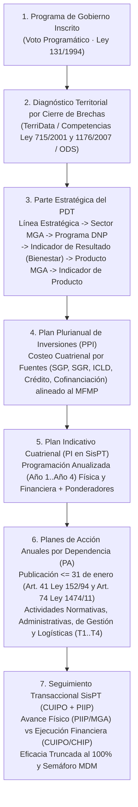
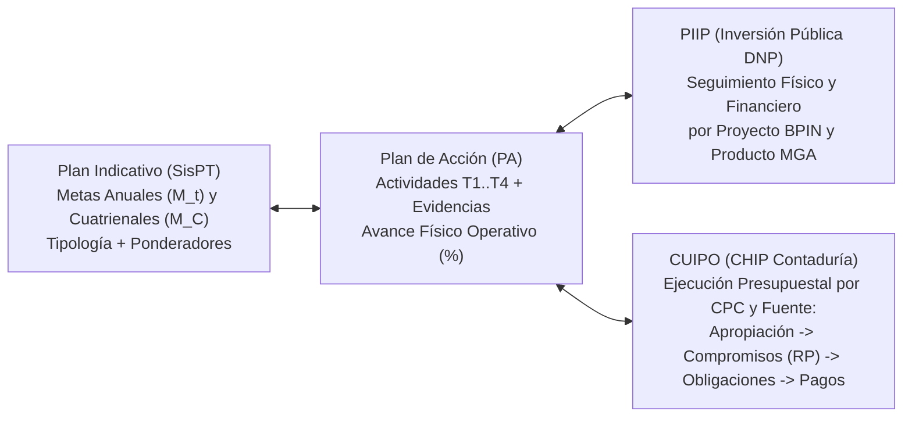

# Módulo 16: Arquitectura Metodológica y Transaccional del Sistema de Planeación Territorial (`SisPT` — DNP: `https://sispt.dnp.gov.co/`) para Formulación de PDT, Indicadores, Plan Indicativo, Planes de Acción y Seguimiento (`CUIPO` + `PIIP`)

---

## 1. Propósito y Alcance en la Plataforma POLIS

El **Sistema de Planeación Territorial (`SisPT`)** del Departamento Nacional de Planeación (`DNP`, `https://sispt.dnp.gov.co/`), evolución tecnológica del **Kit de Planeación Territorial (`KPT`)**, constituye el estándar oficial de Colombia para la **formulación, programación cuatrienal (Plan Indicativo), operacionalización anual (Planes de Acción) y seguimiento físico-financiero interoperable (`CUIPO` + `PIIP`)** de los Planes de Desarrollo Territorial (`PDT`).

Este módulo incorpora al Banco de Conocimiento de **POLIS** y al motor agéntico **`PDT-AI-EVALUATOR`**:
1. La **secuencia de 6 pasos de formulación de un PDT en `SisPT`** (desde el Voto Programático hasta el Plan Indicativo y el Plan Plurianual de Inversiones `PPI`).
2. La **estructura, parametrización y fórmulas matemáticas exactas de los indicadores en `SisPT`** (*Incremento Acumulativo*, *Incremento No Acumulativo*, *Reducción* y *Mantenimiento*), incluyendo la **regla de truncamiento anti-compensación al `100%`** y los ponderadores ($\sum w_i = 100\%$).
3. La **metodología oficial del Plan de Acción (`PA`) del DNP / MHCP** (7 pasos de elaboración, 6 componentes, 3 clases de metas, 4 tipos de actividades y 3 bolsas de financiación).
4. El **Modelo Integral de Seguimiento en `SisPT`** mediante la interoperabilidad transaccional **`Plan Indicativo ↔ Plan de Acción ↔ CUIPO ↔ PIIP`** y su conexión con la **Medición de Desempeño Municipal (`MDM`)**.

---

## 2. Estructuración y Formulación del Plan de Desarrollo Territorial (`PDT`) en `SisPT`

De acuerdo con la **Ley Orgánica 152 de 1994**, la **Ley 131 de 1994** (Voto Programático) y los lineamientos de **`SisPT` (`https://sispt.dnp.gov.co/`)**, todo Plan de Desarrollo Territorial se estructura en dos grandes bloques articulados: **(A) Diagnóstico y Parte General (Componente Estratégico)** y **(B) Plan Plurianual de Inversiones (`PPI`)**, desplegados en **6 pasos secuenciales**:

### 2.1 Los 6 Pasos Oficiales del Módulo de Formulación `SisPT`

| Paso `SisPT` | Nombre del Eslabón | Contenido Obligatorio y Regla de Validación en `POLIS` |
| :--- | :--- | :--- |
| **Paso 1** | **Alistamiento y Empalme con el Programa de Gobierno** | Mapeo uno-a-uno entre los compromisos del **Programa de Gobierno** inscrito ante la Registraduría (Ley 131/1994) y las líneas del PDT. Ningún compromiso programático puede quedar huérfano sin justificación técnica o fiscal. |
| **Paso 2** | **Diagnóstico Territorial Basado en Brechas (`TerriData` / `KPT`)** | Identificación de problemas públicos mediante **brechas socioeconómicas** (comparación del distrito/localidad frente al promedio departamental y nacional), competencias legales (`Ley 715/2001`, `Ley 1176/2007`, `Ley 136/1994`, `Ley 1551/2012`), determinantes ambientales (`POT`/`POMCA`), enfoque de derechos (`GED`) y **Objetivos de Desarrollo Sostenible (`ODS`)**. |
| **Paso 3** | **Estructura Programática de la Parte Estratégica** |Adopción estricta de la jerarquía canónica del DNP: `Línea Estratégica (Eje) → Sector MGA (Código Sectorial) → Programa Presupuestal (Catálogo DNP) → Objetivo e Indicador de Resultado (Bienestar) → Producto del Catálogo MGA → Indicador de Producto`. |
| **Paso 4** | **Formulación del Plan Plurianual de Inversiones (`PPI`)** | Proyección financiera cuatrienal (`Año 1, Año 2, Año 3, Año 4`) desagregada por **Línea Estratégica**, **Programa** y **Fuente de Financiación** (`ICLD`, `SGP Educación/Salud/Agua/Propósito General`, `SGR Regalías`, `Crédito Público`, `Cofinanciación Nacional/Departamental`, `Otros`), sujeta al techo del **Marco Fiscal de Mediano Plazo (`MFMP`, Ley 819/2003)**. |
| **Paso 5** | **Concertación Participativa e Instancias Legales** | Concepto previo del **Consejo Territorial de Planeación (`CTP`)**, concertación con la **Autoridad Ambiental** (`CARDIQUE` / `EPA`), consulta previa con comunidades étnicas cuando aplique, mesas ciudadanas y aprobación por Acuerdo del **Concejo Distrital** (o Acuerdo Local de las **JAL** para los `PDL`). |
| **Paso 6** | **Estructuración del Plan Indicativo (`PI`) en `SisPT`** | Matriz plurianual que desagrega cada meta cuatrienal en metas anuales (`Vigencias 1 a 4`), le asigna su **tipología de acumulación**, su **sentido**, su **ponderador ($\sum w_i = 100\%$)** y la **dependencia líder responsable**. |

---

## 3. Estructuración, Tipologías y Fórmulas Matemáticas de los Indicadores en `SisPT`

En **`SisPT`**, los indicadores del PDT se dividen jerárquicamente en dos niveles de la Cadena de Valor Pública:

1. **Indicadores de Resultado (Bienestar / *Outcome*)**:
   - Asociados a las **Líneas Estratégicas y Programas**.
   - Miden cambios estructurales en las condiciones de vida de la población o cierres de brechas territoriales (ej. *Tasa de mortalidad infantil*, *Índice de Pobreza Multidimensional*, *Cobertura neta en educación media*).
2. **Indicadores de Producto (*Output* — Catálogo MGA-DNP)**:
   - Asociados a los **Productos de los Programas** (y ejecutados mediante proyectos `BPIN` y Planes de Acción).
   - Miden los bienes y servicios cuantificables entregados directamente a la ciudadanía (ej. *Kilómetros de vías urbanas pavimentadas*, *Instituciones educativas oficiales dotadas*, *Personas atendidas*).

### 3.1 Las 4 Tipologías Oficiales de Comportamiento y Acumulación en `SisPT`

Todo indicador cargado en `SisPT` debe parametrizarse con su **sentido** y su **regla de acumulación cuatrienal**. El sistema aplica **4 fórmulas matemáticas diferenciadas** para calcular el porcentaje de avance físico ($E_t$ en la vigencia $t$ y $E_{\text{cuatrienio}}$ en el acumulado del periodo):

| Código Tipología `SisPT` | Naturaleza y Sentido | Regla de Relación entre Metas Anuales ($M_1..M_4$) y Meta Cuatrienio ($M_C$) | Fórmula de Eficacia Anual ($E_t$) y Cuatrienal ($E_C$) en `SisPT` | Ejemplo Típico en Cartagena |
| :--- | :--- | :--- | :--- | :--- |
| **`INCREMENTO_ACUMULATIVO_FLUJO`** | **Acumulativo (Flujo)** · Sentido Ascendente | La meta del cuatrienio es la **suma** de las metas programadas en las 4 vigencias: $$M_C = \sum_{t=1}^{4} M_t$$ | $$E_t = \left(\frac{L_t}{M_t}\right) \times 100$$ $$E_C = \left(\frac{\sum_{t=1}^{4} L_t}{\sum_{t=1}^{4} M_t}\right) \times 100$$ | *Nuevos parques construidos*, *vías rehabilitadas (km)*, *personas capacitadas*. |
| **`INCREMENTO_NO_ACUMULATIVO_CAPACIDAD`** | **No Acumulativo (Capacidad / Estado)** · Sentido Ascendente | El indicador mide un nivel o cobertura creciente que no se suma año a año; la meta cuatrienal es el valor esperado al cierre ($M_C = M_4 > LB$): | $$E_t = \left(\frac{L_t - LB}{M_t - LB}\right) \times 100$$ *(Si $M_t = LB$ o no se mide brecha incremental: $E_t = (L_t / M_t) \times 100$)* | *Tasa de cobertura neta escolar (%)*, *puntaje promedio Saber 11*, *capacidad instalada*. |
| **`REDUCCION_BRECHA`** | **Reducción (Decreciente)** · Sentido Descendente | El éxito consiste en **disminuir** el valor respecto a la Línea Base ($M_C < LB$, con trayectoria $LB \ge M_1 \ge M_2 \ge M_3 \ge M_4 = M_C$): | $$E_t = \left(\frac{LB - L_t}{LB - M_t}\right) \times 100$$ *(Cuando $L_t \le M_t$, alcanza $\ge 100\%$; cuando $L_t \ge LB$, hay retroceso $\le 0\%$)* | *Tasa de homicidios por 100k hab*, *deserción escolar (%)*, *mortalidad materna*. |
| **`MANTENIMIENTO_STOCK`** | **Mantenimiento (Stock / Sostenibilidad)** · Sentido Estable | El objetivo es **sostener** en cada vigencia un estándar o cobertura ya alcanzado ($M_1 = M_2 = M_3 = M_4 = M_C$): | $$E_t = \left(\frac{L_t}{M_t}\right) \times 100$$ $$E_C = \frac{1}{K}\sum_{t=1}^{K} \min\left(\frac{L_t}{M_t}\times 100,\, 100\right)$$ | *Mantener en 100% la cobertura de aseguramiento en salud*, *sostener operación de 43 centros ESE*. |

### 3.2 Regla de Truncamiento Anti-Compensación al `100%` y Ponderadores ($\sum w_i = 100\%$)

Uno de los pilares metodológicos de **`SisPT`** y de la **Medición de Desempeño Municipal (`MDM`)** del DNP es impedir la **falsa compensación aritmética**:
- Si un programa tiene dos metas con peso igual ($50\%$ cada una), y la Meta A tuvo un sobrecumplimiento de **$200\%$** mientras la Meta B quedó en **$0\%$**, un promedio simple daría **$100\%$ de cumplimiento**, ocultando el fracaso total de la Meta B.
- Por ello, en **`SisPT`**:
  1. **Eficacia Bruta ($E_{\text{bruta}, i}$)**: conserva el valor real observado (ej. $200\%$) para efectos de trazabilidad y análisis de planeación subestimada.
  2. **Eficacia Truncada Oficial `SisPT` ($E_{\text{SisPT}, i}$)**: se acota estrictamente al intervalo $[0\%, 100\%]$ antes de agregar por programa, línea estratégica o entidad:
     $$E_{\text{SisPT}, i} = \min\Big(\max\big(E_{\text{bruta}, i},\, 0.0\big),\, 100.0\Big)$$
  3. **Eficacia Ponderada del Programa / Línea / Plan ($I_{\text{eficacia}}^{\text{SisPT}}$)**:
     $$I_{\text{eficacia}}^{\text{SisPT}} = \sum_{i=1}^{N} w_i \cdot E_{\text{SisPT}, i}, \qquad \text{con } \sum_{i=1}^{N} w_i = 1.0$$
  4. **Alerta por Sobrecumplimiento Crónico (`> 120%`)**: cuando $E_{\text{bruta}, i} > 120\%$, `SisPT` y `POLIS` emiten hallazgo de **subestimación en la programación de la meta** (*meta laxa o mal calibrada frente a la capacidad instalada*).

### 3.3 Rangos Oficiales del Semáforo de Eficacia `SisPT` / `MDM` (DNP)

| Rango de Eficacia Truncada ($E_{\text{SisPT}}$) | Categoría Oficial `SisPT` / `MDM` | Semáforo | Interpretación Institucional |
| :--- | :--- | :---: | :--- |
| **$85,0\% \le E_{\text{SisPT}} \le 100,0\%$** | **`SOBRESALIENTE`** | 🟢 Verde Oscuro | Cumplimiento alto y oportuno de las metas programadas. |
| **$70,0\% \le E_{\text{SisPT}} < 85,0\%$** | **`SATISFACTORIO`** | 🟢 Verde Claro | Avance adecuado dentro de la senda esperada del Plan Indicativo. |
| **$60,0\% \le E_{\text{SisPT}} < 70,0\%$** | **`MEDIO`** | 🟡 Amarillo | Rezago moderado; requiere plan de choque trimestral en el Plan de Acción. |
| **$40,0\% \le E_{\text{SisPT}} < 60,0\%$** | **`BAJO`** | 🟠 Naranja | Incumplimiento significativo; riesgo alto de no alcanzar la meta del cuatrienio. |
| **$0,0\% \le E_{\text{SisPT}} < 40,0\%$** | **`CRITICO`** | 🔴 Rojo | Parálisis operativa o rezago crítico; exige intervención en Consejo de Gobierno. |

---

## 4. Estructura y Seguimiento del Plan de Acción (`PA`) según el Kit Financiero DNP y `SisPT`

Con fundamento en el **Artículo 41 de la Ley 152 de 1994**, el **Artículo 74 de la Ley 1474 de 2011** (Estatuto Anticorrupción), el **Decreto 2482 de 2012** y el **Instructivo Oficial del Plan de Acción del DNP / MHCP** ([`instructivo_plan_accion_dnp_anydoc.md`](file:///root/polis/data/planes_accion/instructivo_plan_accion_dnp_anydoc.md)), el **Plan de Acción (`PA`)** es el instrumento gerencial anual mediante el cual cada Secretaría y entidad descentralizada operacionaliza el **Plan Indicativo (`PI`)** en cada vigencia fiscal.

### 4.1 Los 7 Pasos Oficiales para la Elaboración y Aprobación del Plan de Acción

1. **Paso 1 — Orientaciones metodológicas de la Secretaría de Planeación**: convocatoria a los enlaces de cada dependencia y revisión de competencias misionales.
2. **Paso 2 — Consolidación y verificación de insumos**: cruce entre el **Plan Indicativo (`PI`)**, el **Marco Fiscal de Mediano Plazo (`MFMP`)**, el **Plan Operativo Anual de Inversiones (`POAI`)**, el **Presupuesto Anual** y el **Programa Anual Mensualizado de Caja (`PAC`)**.
3. **Paso 3 — Clasificación e incorporación de las 3 clases de metas**:
   - **`META_DE_PRODUCTO`**: entrega directa de bienes o servicios a la ciudadanía, asociada a proyectos de inversión `BPIN`/`BPIM` del Plan Indicativo.
   - **`META_DE_GESTION`**: gestiones interinstitucionales para apalancar recursos o viabilizar intervenciones (ej. *radicar proyecto ante ministerios, gestionar cofinanciación*).
   - **`META_ADMINISTRATIVA`**: acciones recurrentes de funcionamiento interno de la entidad territorial (*diseñar políticas internas, actualizar manuales, atención al ciudadano*).
4. **Paso 4 — Programación de actividades por dependencia y concurrencia**: definición de tareas trimestrales (`T1, T2, T3, T4`) e identificación de metas que requieren concurrencia entre dos o más dependencias.
5. **Paso 5 — Diligenciamiento de la Matriz Oficial del Plan de Acción**: registro de actividades, fechas (`DD/MM/AAAA`), ponderaciones, proyectos `BPIN` y fuentes de financiación.
6. **Paso 6 — Aprobación en Consejo de Gobierno**: conforme al **Art. 41 de la Ley 152 de 1994**, la Secretaría de Planeación somete los Planes de Acción a aprobación formal del Consejo de Gobierno Distrital.
7. **Paso 7 — Publicación web obligatoria ($\le$ 31 de enero)**: conforme al **Art. 74 de la Ley 1474 de 2011**, todas las entidades deben publicar su Plan de Acción anual a más tardar el **31 de enero de cada vigencia**, articulado con el Plan Anual de Adquisiciones (`PAA`).

### 4.2 Las 4 Tipologías Oficiales de Actividades del Plan de Acción (Estándar DNP)

El DNP clasifica todas las actividades de un Plan de Acción en **4 categorías operativas**, cada una encabezada por un **verbo en infinitivo**:

| Tipología de Actividad DNP | Definición Operativa | Verbos Canónicos DNP Asociados | Ejemplos en la Gestión Distrital |
| :--- | :--- | :--- | :--- |
| **1. `ACTIVIDAD_NORMATIVA`** | Expedición, modificación o adopción de actos administrativos, acuerdos, decretos, estatutos o reglamentos técnicos. | *Adecuar, adoptar, expedir, modificar, reglamentar, fijar, derogar*. | *Adecuar el estatuto tributario; expedir decreto reglamentario; adoptar protocolo técnico*. |
| **2. `ACTIVIDAD_ADMINISTRATIVA`** | Procesos contractuales, convenios interadministrativos, desarrollo/ajuste de sistemas de información y trámites internos de soporte. | *Firmar, contratar, suscribir, diseñar, ajustar, adquirir, licitar*. | *Suscribir convenio interadministrativo; contratar interventoría; implementar software*. |
| **3. `ACTIVIDAD_DE_GESTION`** | Focalización, caracterización de beneficiarios, registros administrativos, cobro persuasivo/coactivo, articulación interinstitucional e inspección. | *Crear, identificar, gestionar, ejecutar, construir, intervenir, rehabilitar, capacitar, atender, brindar, mantener, mejorar*. | *Identificar beneficiarios; construir obras; rehabilitar vías; capacitar docentes; ejecutar programas*. |
| **4. `ACTIVIDAD_LOGISTICA`** | Operación de campo, notificaciones, puntos de atención al ciudadano, suministro de insumos y verificación de equipos/terminales. | *Notificar, publicar, suministrar, verificar, instalar, organizar, disponer*. | *Suministrar dotación; instalar equipos; verificar terminales; habilitar puntos de atención*. |

### 4.3 Las 3 Bolsas de Financiación del Plan de Acción

Toda actividad del Plan de Acción debe especificar explícitamente su bolsa presupuestal:
1. **`INVERSION`**: financiada con proyectos `BPIN`/`BPIM` del `POAI` desagregados por fuente (`SGP`, `SGR`, `ICLD`, `Crédito Público`, `Cofinanciación`, `Otros`).
2. **`FUNCIONAMIENTO`**: apropiaciones para actividades normativas, administrativas y de funcionamiento recurrente (*Gastos de personal / servicios personales*, *Gastos generales* y *Transferencias*).
3. **`RECURSOS_DE_GESTION`**: gestiones directas ante la Nación, cooperación internacional o sector privado que apalancan el cumplimiento de actividades pero no ingresan al presupuesto del Distrito.

---

## 5. Modelo Integral de Seguimiento en `SisPT`: Interoperabilidad `Plan Indicativo ↔ Plan de Acción ↔ CUIPO ↔ PIIP`

En **`SisPT` (`https://sispt.dnp.gov.co/`)**, el seguimiento a los indicadores del Plan de Desarrollo y a los Planes de Acción no depende de hojas de cálculo aisladas, sino de la **conciliación transaccional trimestral y anual** entre cuatro registros:

### 5.1 Reglas de Auditoría de Coherencia Físico-Financiera (`SisPT` — `CUIPO` — `PIIP`)

El motor **`PDT-AI-EVALUATOR`** verifica automáticamente en cada meta de los 8 planes (`2012–2027` + `PDL 1..3`) las siguientes **5 reglas de consistencia `SisPT`**:

1. **Regla `SISPT-R1` — Coherencia entre Tipología del Indicador y Serie Anual/Trimestral**:
   - En `INCREMENTO_ACUMULATIVO_FLUJO`, la suma de las metas anuales debe igualar la meta del cuatrienio ($M_C = \sum_{t=1}^{4} M_t$) y la suma trimestral debe igualar la meta anual ($M_t = \sum_{q=1}^{4} T_{t,q}$).
   - En `MANTENIMIENTO_STOCK` y `INCREMENTO_NO_ACUMULATIVO_CAPACIDAD` (tasas/porcentajes), está prohibido sumar porcentajes entre trimestres o vigencias.
2. **Regla `SISPT-R2` — Truncamiento Anti-Compensación al `100%`**:
   - Ningún sobrecumplimiento individual ($E_{\text{bruta}} > 100\%$) puede compensar el rezago de otra meta al calcular el cumplimiento del Programa, Línea Estratégica o Dependencia ($E_{\text{SisPT}} = \min(E_{\text{bruta}}, 100\%)$).
3. **Regla `SISPT-R3` — Trazabilidad `PIIP` (`Meta Producto ↔ Proyecto BPIN ↔ Actividad PA`)**:
   - Toda `META_DE_PRODUCTO` debe contar con código de proyecto `BPIN`/`BPIM` y actividades programadas en el Plan de Acción con verbo fuerte y fechas de inicio/fin.
4. **Regla `SISPT-R4` — Armonización Presupuestal `CUIPO` (`Apropiación Definitiva ≥ Compromisos RP ≥ Obligaciones ≥ Pagos`)**:
   - Verifica que la cadena presupuestal reportada en `CUIPO` respete el principio de legalidad del gasto (`Apropiación Definitiva ≥ Compromisos RP`) y clasifica la fuente (`SGP`, `SGR`, `ICLD`, `Crédito`, `Cofinanciación`).
5. **Regla `SISPT-R5` — Alerta de Desfase Físico-Financiero (`CUIPO` vs `PIIP`/`PA`)**:
   - **`DESFASE_CUIPO_SIN_AVANCE_PIIP`**: Ejecución financiera en `CUIPO` $\ge 75\%$ con eficacia física `SisPT` $< 40\%$ (*riesgo de pago o compromiso sin entrega material del bien/servicio*).
   - **`AVANCE_FISICO_SIN_SOPORTE_CUIPO`**: Eficacia física `SisPT` $\ge 80\%$ en una `META_DE_PRODUCTO` de inversión con ejecución financiera `CUIPO` $= 0\%$ (*meta reportada sin respaldo presupuestal o reclasificable como `META_DE_GESTION` / `FUNCIONAMIENTO`*).
